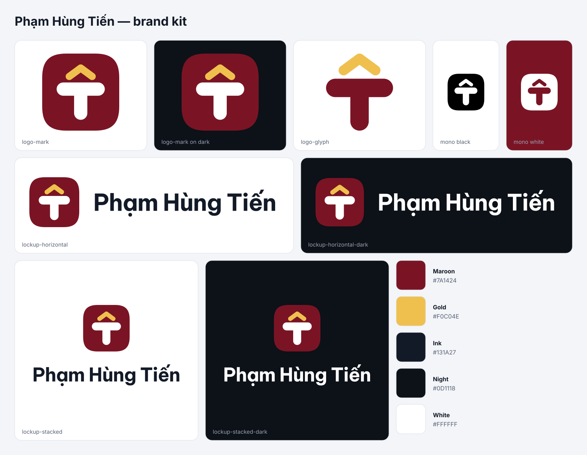

# Brand kit: Phạm Hùng Tiến

The mark is a **T** for _Tiến_, crowned by the circumflex of **ế**. The accent makes it
unmistakably Vietnamese and doubles as an upward chevron. It sits on an app-icon
squircle, a nod to the apps it signs.

Everything in this folder except this README is generated from the geometry in
`src/assets/brand/logo.svg` by `npm run brand`. Change the source and re-run the
command; don't edit the generated files by hand.

## Files

| Folder     | What                                                                       | Use it for                          |
| ---------- | -------------------------------------------------------------------------- | ----------------------------------- |
| `svg/`     | `logo-mark` (squircle), `logo-mark-square` (full bleed), `logo-glyph`      | Web, print, any size                |
|            | `logo-mono-black` / `logo-mono-white`: single colour, glyph cut out        | Stamps, engraving, one-colour print |
|            | `lockup-horizontal(-dark)`, `lockup-stacked(-dark)`: mark plus name        | Headers, slides, documents          |
|            | `avatar`, `banner-1500x500`                                                | Profile pictures and cover images   |
| `png/`     | `logo-mark-{16…1024}`, mono marks at 512, lockups at 12×                   | Where SVG is not accepted           |
| `favicon/` | The exact icons the website ships, plus `site.webmanifest`                 | Websites                            |
| `social/`  | `avatar-1024`, `banner-1500x500` (LinkedIn, X, GitHub), `og-home-1200x630` | Social profiles and link previews   |

The wordmark in the lockups is **Be Vietnam Pro Bold**, converted to outlines, so the
SVGs open correctly without the font installed.

## Colours

| Name   | Hex       | Role                                      |
| ------ | --------- | ----------------------------------------- |
| Maroon | `#7A1424` | Tile, primary brand colour                |
| Gold   | `#F0C04E` | Circumflex, accent (brand colour on dark) |
| White  | `#FFFFFF` | The T, text on dark                       |
| Ink    | `#131A27` | Text on light                             |
| Night  | `#0D1118` | Dark backgrounds                          |

## Rules

- **Clear space:** keep at least a quarter of the mark's width empty on every side.
- **Minimum size:** 16 px for the mark, 120 px wide for the horizontal lockup.
- Use the `-dark` lockups on dark backgrounds and the plain ones on light backgrounds.
- Don't recolour, stretch, rotate, outline or add shadows to the mark.
- Don't separate the circumflex from the T, and don't set the name in another typeface.
- The mark identifies the developer, not an app. Don't use it as an app icon.

## Licence

The logo and name identify Phạm Hùng Tiến. The website's source code is open source,
but the brand assets are not covered by its licence. Ask before using them for anything
other than referring to the author or his apps.
