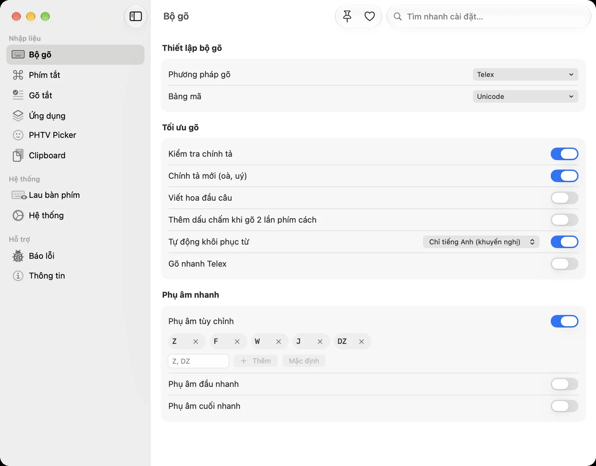

Bạn mở một tài liệu cũ và thấy toàn ký tự như "TiÕng ViÖt" hay "Tieáng Vieät"? Đó không phải lỗi máy hay lỗi file, mà là **văn bản được gõ bằng một bảng mã khác** với bảng mã máy bạn đang đọc. Bài này giải thích các bảng mã tiếng Việt phổ biến, vì sao chúng gây lỗi và cách chuyển văn bản về chuẩn Unicode.

## Bảng mã là gì?

Máy tính lưu chữ dưới dạng các con số. **Bảng mã** là quy ước con số nào ứng với chữ nào. Với chữ cái tiếng Anh, mọi bảng mã đều thống nhất (A là 65, B là 66…). Nhưng với chữ có dấu như "ệ", "ữ", trước khi Unicode phổ biến, mỗi nhóm đã tự đặt quy ước riêng. Vì vậy cùng một con số, máy dùng bảng mã này hiểu là "ệ", máy dùng bảng mã khác lại hiện ra "Ö".

## Các bảng mã tiếng Việt thường gặp

| Bảng mã                | Đặc điểm                                                                       | Thường gặp ở đâu                                               |
| ---------------------- | ------------------------------------------------------------------------------ | -------------------------------------------------------------- |
| **Unicode** (dựng sẵn) | Mỗi chữ có dấu là một ký tự duy nhất. Chuẩn quốc tế.                           | Mọi ứng dụng, website và điện thoại hiện nay                   |
| **Unicode tổ hợp**     | Chữ có dấu = chữ gốc + ký tự dấu ghép riêng (ví dụ "e" + "̂" + "̣")              | Một số tên tệp, phần mềm cũ, văn bản sao chép từ hệ thống khác |
| **TCVN3 (ABC)**        | Tiêu chuẩn Việt Nam cũ, cần font riêng bắt đầu bằng `.Vn` (.VnTime, .VnArial…) | Văn bản hành chính, giáo trình soạn trước khoảng năm 2005      |
| **VNI Windows**        | Cần font bắt đầu bằng `VNI-` (VNI-Times…), một chữ có dấu có thể gồm hai ký tự | Tài liệu cũ soạn bằng bộ gõ VNI, file thiết kế, bản vẽ         |
| **CP1258**             | Bảng mã của Windows cho tiếng Việt, ghép một phần dấu                          | Phần mềm Windows đời cũ, cơ sở dữ liệu cũ                      |

**Kết luận ngắn: hãy luôn dùng Unicode.** Các bảng mã còn lại chỉ để đọc hoặc chỉnh sửa tài liệu cũ.

## Vì sao chữ bị lỗi font?

Ba tình huống hay gặp nhất:

1. **Mở file cũ trên máy mới.** File soạn bằng TCVN3 cần font `.VnTime`. Máy không có font đó, hoặc ứng dụng tự đổi sang font Unicode, nên chữ hiện ra ký tự lạ.
2. **Gõ sai bảng mã.** Bộ gõ đang đặt bảng mã TCVN3 hay VNI Windows trong khi ứng dụng đọc Unicode. Bạn gõ đúng nhưng chữ hiện ra sai.
3. **Unicode tổ hợp gặp phần mềm không hỗ trợ.** Chữ trông đúng ở một nơi nhưng sang nơi khác thì dấu bị tách rời ("Vie^.t"), tìm kiếm không ra, hoặc sắp xếp sai thứ tự.

## Chọn bảng mã đúng trong PHTV

Trong **Cài đặt › Bộ gõ**, mục **Bảng mã**, PHTV hỗ trợ: Unicode, TCVN3 (ABC), VNI Windows, Unicode tổ hợp và CP 1258.

- Để **Unicode** cho mọi việc hằng ngày.
- Chỉ đổi sang TCVN3 hay VNI Windows khi cần **sửa tiếp một file cũ** vẫn dùng font `.Vn` hay `VNI-`, để chữ mới gõ khớp với chữ cũ.
- Nếu thường xuyên phải làm việc với một ứng dụng cũ, bật **Nhớ bảng mã theo ứng dụng** trong **Cài đặt › Ứng dụng**. PHTV sẽ tự chuyển bảng mã khi bạn chuyển sang ứng dụng đó, và trở lại Unicode ở các ứng dụng khác.

## Chuyển văn bản cũ sang Unicode

Gặp một đoạn văn bản TCVN3 hay VNI cần dùng lại? Không cần gõ lại từ đầu:

1. Sao chép đoạn văn bản bị lỗi (<kbd>⌘</kbd> + <kbd>C</kbd>).
2. Mở **Cài đặt › Hệ thống › Tiện ích › Chuyển đổi bảng mã** của PHTV (hoặc menu trên thanh menu › **Công cụ**).
3. Chọn bảng mã nguồn (ví dụ TCVN3) và bảng mã đích là Unicode, rồi chuyển nội dung clipboard.
4. Dán (<kbd>⌘</kbd> + <kbd>V</kbd>) vào tài liệu mới. Văn bản đã ở dạng Unicode.

Sau khi chuyển, hãy đổi font của đoạn văn sang một font Unicode như Times New Roman, Arial, Helvetica hay SF Pro để chữ hiển thị đúng ở mọi nơi.

> Mẹo nhận diện nhanh bảng mã nguồn: thấy chữ dạng "TiÕng ViÖt" thường là TCVN3; thấy dạng "Tieáng Vieät" thường là VNI Windows. Nếu chuyển xong chữ vẫn lạ, hãy thử bảng mã nguồn còn lại.

## Unicode dựng sẵn và Unicode tổ hợp: khác nhau thế nào?

Đây là điểm ít người biết nhưng hay gây lỗi khó hiểu. Chữ "ệ" có thể được lưu theo hai cách:

- **Dựng sẵn:** một ký tự duy nhất (mã U+1EC7).
- **Tổ hợp:** chữ "e" (U+0065), cộng dấu mũ ghép (U+0302), cộng dấu nặng ghép (U+0323).

Trên màn hình, hai cách trông y hệt nhau. Nhưng với máy tính chúng là hai chuỗi khác nhau, nên có thể:

- tìm kiếm "Việt" không ra kết quả trong một văn bản trông rõ ràng có chữ "Việt";
- tên tệp có dấu trông giống nhau nhưng hệ thống coi là hai tệp khác nhau khi chép sang máy Windows hoặc lên một số dịch vụ lưu trữ;
- đếm độ dài chuỗi trong lập trình ra số lớn hơn số chữ bạn thấy.

Khi gõ, hãy dùng **Unicode (dựng sẵn)**. Đây là dạng được dùng rộng rãi nhất và cũng là mặc định của PHTV. Nếu bạn là lập trình viên, hãy chuẩn hóa chuỗi về dạng NFC trước khi so sánh hay lưu vào cơ sở dữ liệu.

## Tóm tắt

- Unicode dựng sẵn là chuẩn cho mọi thứ ngày nay.
- TCVN3 và VNI Windows chỉ dùng khi phải sửa tài liệu cũ, và cần đúng font đi kèm.
- Chữ bị lỗi font gần như luôn là do lệch bảng mã giữa người gõ và nơi hiển thị.
- PHTV vừa gõ được mọi bảng mã, vừa có công cụ chuyển văn bản cũ sang Unicode.

Xem thêm: [Sửa lỗi gõ tiếng Việt trên Mac](/huong-dan/sua-loi-go-tieng-viet-tren-mac/).
