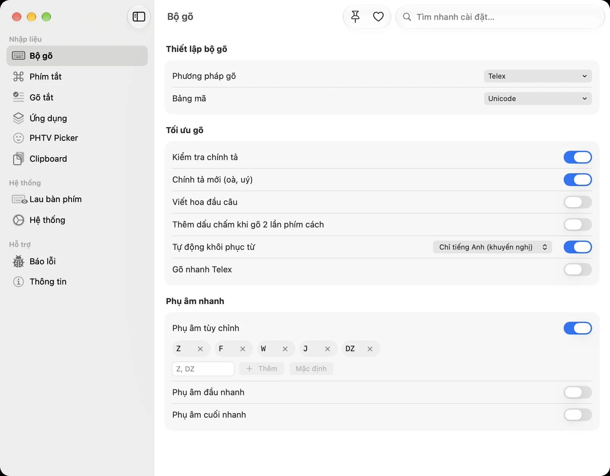

如果旧文档出现「TiÕng ViÖt」或「Tieáng Vieät」，里面的越南语可能是按另一种字符编码或字体存储的。先确定原来的编码，再将文档副本转换成 Unicode。下面使用 [Mac 版 PHTV](/zh/PHTV/) 的编码转换器。

## 越南语编码有何不同

编码规定数字如何映射到字符。早期越南语标准将变音符号或带音标的字母分配给了一些数字，而其他编码中，这些数字对应着别的字符。如果文档丢失原有的编码或字体信息，新编辑器就可能把原来的文字显示成不相干的字符。

| 编码                       | 识别特征                                         | 常见用途                     |
| -------------------------- | ------------------------------------------------ | ---------------------------- |
| **预组合 Unicode**         | ệ 等带音标字母可用一个码位存储                   | 现代网站、应用和文档         |
| **分解 Unicode**           | 基本字母和组合符号分别占用码位                   | 跨系统复制的文字和某些文件名 |
| **TCVN3（ABC）**           | 依赖 `.Vn` 开头的字体，如 `.VnTime`              | 早期越南政府和教育文档       |
| **VNI Windows**            | 字体如 `VNI-Times`，文字可显示为「Tieáng Vieät」 | 早期文档和设计文件           |
| **Windows-1258（CP1258）** | 使用部分组合符号的越南语 Windows 代码页          | 早期 Windows 应用和数据导出  |

新文档建议采用 Unicode。**VNI Windows 编码**与 **VNI 输入法**是独立选项。用 VNI 输入法仍可生成现代 Unicode 文字。

## 为什么音标消失或变成其他字符

1. 文档可能依赖 `.VnTime` 等旧字体。缺少该字体时，同一数字编码会由采用其他映射的字体绘制。
2. 可能把输入法设为 TCVN3 或 VNI Windows，而编辑器要求 Unicode。
3. 两个 Unicode 字符串可能显示相同，但码位序列不同。如果应用不做规范化，搜索可能匹配不到，外观完全相同的文件名也可能被当作不同名称。

## 在 PHTV 中选择编码

打开**设置 › 输入 › 编码**，日常输入选择 **Unicode**。继续编辑采用 TCVN3 或 VNI Windows 的旧文档时，可以改用相应编码。如果经常使用某个旧应用，可在 PHTV 的**设置 › 应用**为它启用编码记忆。

## 将旧文字转换成 Unicode

1. 先备份文档，再从副本中选一小段受影响的文字，按 <kbd>⌘</kbd> + <kbd>C</kbd> 复制。
2. 从工具菜单或设置面板打开 PHTV 的**编码转换器**。
3. 选择源编码，目标设为 **Unicode**，然后转换剪贴板内容。
4. 按 <kbd>⌘</kbd> + <kbd>V</kbd> 粘贴，并使用 Times New Roman、Arial 或 Helvetica 等 Unicode 字体。
5. 抽查几个有音标的单词和大小写，再逐步转换剩余部分。「TiÕng ViÖt」通常表明原文是 TCVN3，「Tieáng Vieät」通常表明是 VNI Windows。

如果转换后仍无法恢复原字，请试着以原有编码或字体重新打开原文档，再复制并转换。

## 预组合形式与分解形式

**ệ** 可用单个 `U+1EC7` 表示，也可由 `e`、下点和抑扬符组合，两种方式可能显示成同一个字形。由于长度和二进制表示不同，直接比较原始字符串的软件可能判断两者不等。代码若需稳定地比较越南语文字，可先将双方规范化为 NFC 等相同形式。[Unicode 规范化规范](https://www.unicode.org/reports/tr15/)

如果文本已是 Unicode，但输入时仍丢失音标，请参阅 [Mac 越南语输入排障指南](/zh/guides/sua-loi-go-tieng-viet-tren-mac/)。
