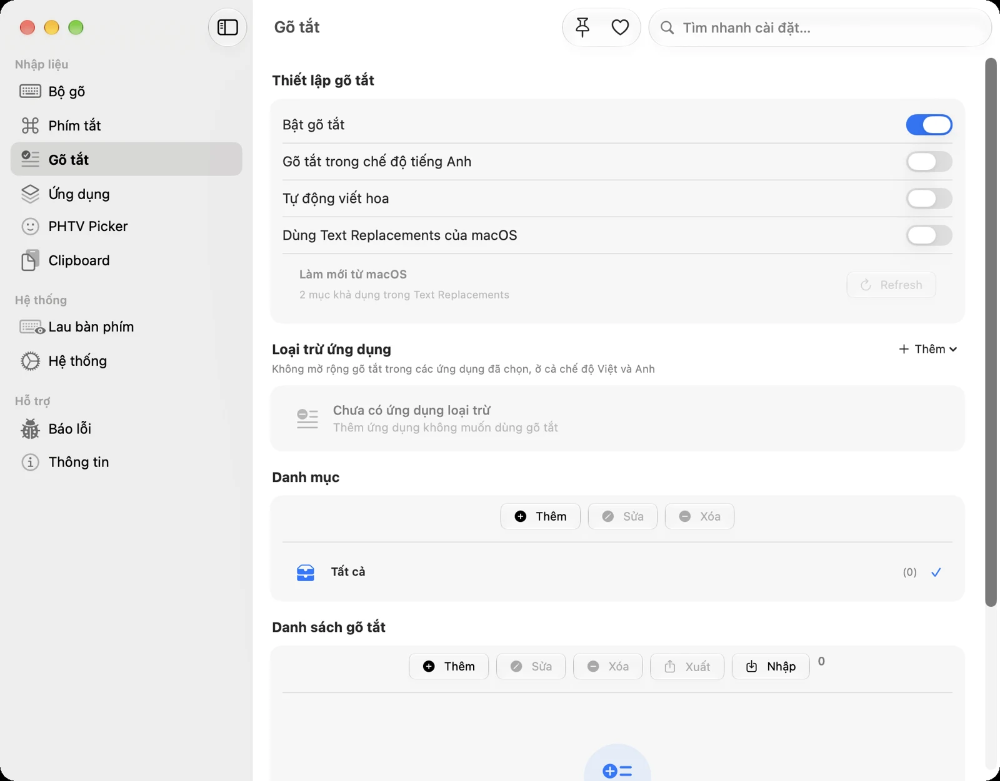

Use a PHTV macro to replace a short trigger with text you type often. A macro can insert a fixed phrase in Vietnamese or English, or generate a date, an incrementing number or clipboard text at the moment you use it.

## Turn on macros

Open the PHTV menu bar item and choose **Open Settings**, then open **Macros**. Enable macros. Enable the English-mode option if you also want expansion in English mode. The automatic capitalization option can adjust an expansion to match a trigger typed with an initial capital or in all caps.

## Add your first shortcut

1. In the macro list, choose **Add**.
2. Enter a trigger such as `tyc` and choose plain text.
3. Enter a phrase such as “Thank you for contacting us. I'll reply today.” and save it.
4. In TextEdit, type `tyc` and press Space to see it expand.

Start with a short sequence that rarely occurs in ordinary typing. Give related shortcuts a shared pattern such as `replyhi` and `replybye`. A trigger that is already a word can interrupt normal typing.

## Insert dates, clipboard text or numbers

Choose the appropriate snippet type when adding a macro.

| Type          | What it inserts                        | Example setting                                 |
| ------------- | -------------------------------------- | ----------------------------------------------- |
| Plain text    | The same phrase each time              | An email address                                |
| Date          | The current date                       | `dd/MM/yyyy` produces `15/10/2026`              |
| Time          | The current time                       | `HH:mm` produces `14:30`                        |
| Date and time | Both in one expansion                  | `dd/MM/yyyy HH:mm`                              |
| Clipboard     | The current clipboard text             | Nothing to configure                            |
| Random        | One phrase from a list                 | Enter alternatives separated by commas          |
| Counter       | A number that increments with each use | Prefix `INV-` gives `INV-1`, `INV-2`, and so on |

Uppercase `M` stands for month and lowercase `m` stands for minute. Use `HH` for a 24-hour clock. Try a date snippet for meeting notes, a counter for a local ticket list or a random snippet for a short acknowledgment. Check the current clipboard before using its snippet in a message.

## Organize macros and set exclusions

Use categories to group work, personal or support snippets. Filter the macro list by category as it grows. Under app exclusions, add a terminal or code editor if a shortcut would conflict with text you need to type there.

## Back up your shortcuts

Use **Export** in the macro list to retain snippet types and categories. On the new Mac, **Import** merges the shortcuts into the existing list. PHTV's system settings also offer a broader settings backup that can include app rules and clipboard data. Choose a backup scope that matches what you intend to transfer.

## Reuse macOS Text Replacements

If you already use **System Settings › Keyboard › Text Replacements**, PHTV can use those shortcuts too. When two text tools try to expand the same shortcut, you may see duplicate letters. Check which expansion is active and test it in the app where you want to type. PHTV adds options for dynamic snippets, capitalization and per-app exclusions.

Follow the [PHTV installation and typing guide](/en/guides/go-tieng-viet-tren-mac-voi-phtv/) to set up the input method before creating macros.
