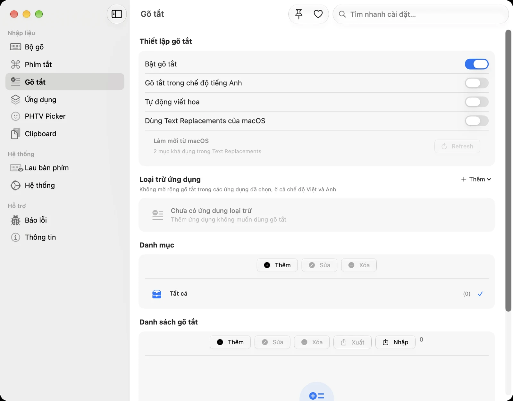

Una macro de PHTV sustituye una abreviatura por un texto que escribes a menudo. Puedes insertar una frase fija en vietnamita o inglés, o añadir la fecha del momento, un número que vaya aumentando o el texto del portapapeles.

## Activa las macros

Abre PHTV desde la barra de menús, elige **Abrir ajustes** y entra en **Macros**. Activa la función y, si quieres usarla al escribir en inglés, habilita también ese modo. Las mayúsculas automáticas adaptan el resultado si escribes la abreviatura con inicial mayúscula o en mayúsculas.

## Crea tu primera abreviatura

1. En la lista de macros, elige **Añadir**.
2. Escribe una abreviatura como `tyc` y elige texto sin formato.
3. Añade una frase como «Gracias por escribir. Te respondo hoy» y guarda.
4. En TextEdit, escribe `tyc` y pulsa espacio para comprobar cómo se expande.

Empieza con una secuencia que apenas uses al escribir. Puedes agrupar abreviaturas con un patrón, como `msginicio` y `msgfin`. Una abreviatura que sea una palabra habitual puede expandirse cuando no lo necesitas.

## Inserta fechas, números o texto del portapapeles

| Tipo de fragmento | Qué inserta                        | Ejemplo                                     |
| ----------------- | ---------------------------------- | ------------------------------------------- |
| Texto fijo        | La misma frase cada vez            | Una dirección de correo                     |
| Fecha             | La fecha actual                    | `dd/MM/yyyy` da `15/10/2026`                |
| Hora              | La hora actual                     | `HH:mm` da `14:30`                          |
| Fecha y hora      | Ambas a la vez                     | `dd/MM/yyyy HH:mm`                          |
| Portapapeles      | El texto copiado en ese momento    | No requiere ajustes adicionales             |
| Aleatorio         | Una frase de una lista             | Separa las opciones con comas               |
| Contador          | Un número que aumenta con cada uso | El prefijo `INV-` da `INV-1`, `INV-2`, etc. |

`M` en mayúscula indica el mes y `m` en minúscula indica los minutos. Usa `HH` para el formato de 24 horas. Puedes usar la fecha en las notas de una reunión, el contador para numerar tareas o un fragmento aleatorio para variar las respuestas cortas. Antes de insertar texto del portapapeles en un mensaje, revisa qué tienes copiado.

## Organiza, excluye aplicaciones y guarda copias

Crea categorías para el trabajo, asuntos personales o solicitudes de soporte. Así puedes filtrar la lista cuando crezca. En las exclusiones, añade una terminal o editor cuando una abreviatura pueda interferir con lo que escribes allí.

Desde la lista, **Exportar** conserva los tipos y categorías de macros. En el equipo de destino, **Importar** combina esas macros con las existentes. En los ajustes del sistema de PHTV puedes hacer una copia más amplia que incluya reglas por aplicación y datos del portapapeles. Elige qué necesitas llevar al otro Mac.

## Usa los reemplazos de texto de macOS

PHTV también puede usar las abreviaturas de **Ajustes del Sistema › Teclado › Sustituciones de texto**. Si dos funciones intentan expandir la misma abreviatura, pueden aparecer letras duplicadas. Comprueba cuál está actuando en la aplicación donde escribes. PHTV añade opciones de fragmentos dinámicos, mayúsculas y exclusiones por aplicación.

Si aún tienes que configurar el método de entrada, consulta la [guía de instalación de PHTV](/es/guides/go-tieng-viet-tren-mac-voi-phtv/).
