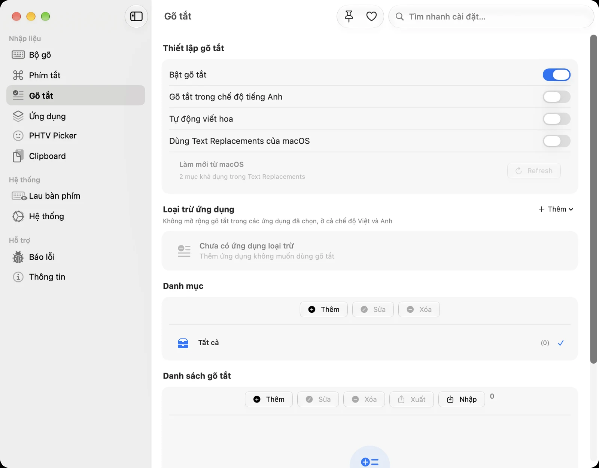

PHTVのマクロは、短い入力をよく使う文章へ置き換えます。ベトナム語や英語の定型文に加え、入力する時点の日付、連番、クリップボードのテキストを挿入できます。

## マクロを有効にする

PHTVのメニューバーから設定を開き、マクロをオンにします。英語モードでも展開したい場合は英語モードのオプションを有効にします。大文字の調整を有効にすると、先頭を大文字にした入力やすべて大文字の入力に展開結果を合わせられます。

## 最初の定型文を登録する

1. マクロの一覧で追加を選びます。
2. `tyc`などの短いトリガーを入力し、形式をプレーンテキストにします。
3. 「お問い合わせありがとうございます。本日中に返信します。」などの文を入力して保存します。
4. テキストエディットで`tyc`に続けてSpaceを押し、文章に展開されることを確かめます。

普段の入力に出てこない文字列を選びます。関連する定型文には`replyhi`と`replybye`のように共通する文字列を付けると探しやすくなります。普段使う単語を指定すると、意図せず展開する場合があります。

## 日付、クリップボード、連番を挿入する

| 種類           | 挿入内容                       | 設定例                                     |
| -------------- | ------------------------------ | ------------------------------------------ |
| テキスト       | 毎回同じ文章                   | メールアドレス                             |
| 日付           | 今日の日付                     | `dd/MM/yyyy`で`15/10/2026`                 |
| 時刻           | 現在の時刻                     | `HH:mm`で`14:30`                           |
| 日付と時刻     | 日付と時刻を同時に挿入         | `dd/MM/yyyy HH:mm`                         |
| クリップボード | 現在のクリップボードのテキスト | 追加の設定は不要                           |
| ランダム       | リストから選んだ1つの文        | 候補をカンマで区切る                       |
| カウンター     | 使うたびに増える数字           | 接頭辞`INV-`で`INV-1`、`INV-2`のように進む |

大文字の`M`は月、小文字の`m`は分、`HH`は24時間表記です。会議メモに日付、自分用のチケットの一覧に連番、短い返事にランダム文を試してみてください。メッセージに貼り付ける際は、先にクリップボードの内容を確認します。

## 分類とアプリ別の除外

仕事用、個人用、サポート用などに分類し、増えてきたらカテゴリで絞り込みます。ターミナルやエディターで同じキーを入力する必要がある場合は、対象のアプリを除外できます。

## 設定をバックアップする

マクロ一覧から書き出すと、スニペットの形式とカテゴリも保持されます。新しいMacで読み込むと既存の一覧に統合されます。PHTVのシステム設定からは、アプリ別のルールやクリップボードのデータを含む、より広い範囲のバックアップも選べます。移行したいデータに合わせて選択してください。

## macOSのユーザ辞書を併用する

「システム設定」の「キーボード」から管理するユーザ辞書（Text Replacements）の短縮入力を、PHTVでも利用できます。同じトリガーを2つのツールが処理すると文字が重複する場合があります。使うアプリで試し、どの機能が動作しているか確認します。PHTVでは動的スニペット、大文字の調整、アプリ別の除外も指定できます。

PHTVを初めて使う場合は[インストールと入力の手順](/ja/guides/go-tieng-viet-tren-mac-voi-phtv/)から準備してください。
