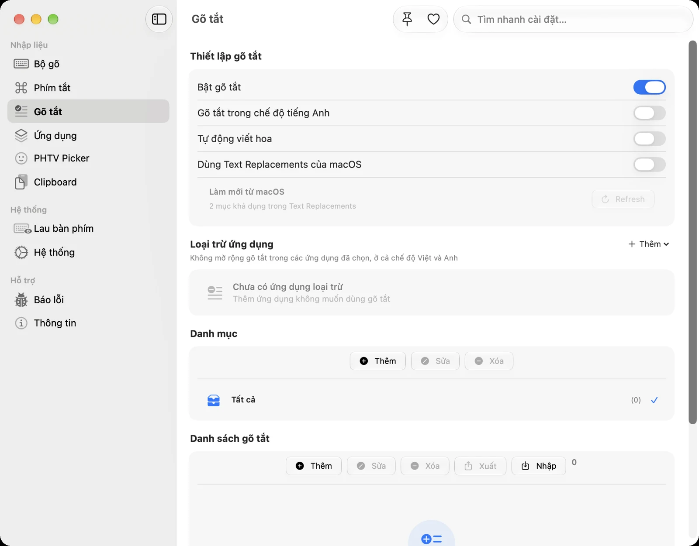

Mỗi ngày bạn gõ đi gõ lại bao nhiêu lần "Cảm ơn anh/chị đã liên hệ", địa chỉ email hay số tài khoản? **Gõ tắt** (macro) cho phép bạn gõ vài ký tự ngắn và nhận ngay cả câu dài. PHTV có gõ tắt tích hợp, chạy được ở cả chế độ tiếng Việt lẫn tiếng Anh, và còn có **snippet động**: tự chèn ngày giờ hiện tại, nội dung clipboard hay một số tự tăng.

## Bật gõ tắt

Mở **Cài đặt › Gõ tắt** của PHTV (bấm biểu tượng ngôi sao trên thanh menu › **Mở Cài đặt…**, hoặc nhấn <kbd>⌘</kbd> + <kbd>,</kbd> khi PHTV đang mở):

- **Bật gõ tắt:** công tắc chính.
- **Gõ tắt trong chế độ tiếng Anh:** bật nếu bạn muốn macro hoạt động cả khi đang gõ tiếng Anh.
- **Tự động viết hoa:** gõ `Btw` ra "By the way", gõ `BTW` ra "BY THE WAY".
- **Dùng Text Replacements của macOS:** nhập các mục Thay thế văn bản bạn đã tạo trong Cài đặt hệ thống, để chỉ PHTV xử lý thay chữ.

## Tạo gõ tắt đầu tiên

1. Ở mục **Danh sách gõ tắt**, bấm **Thêm**.
2. Nhập **từ tắt**, ví dụ `ctn`.
3. Nhập **nội dung**, ví dụ "Cảm ơn bạn đã liên hệ. Mình sẽ phản hồi trong hôm nay nhé!".
4. Lưu lại.

Giờ ở bất kỳ ứng dụng nào, gõ `ctn` rồi nhấn phím cách: cụm từ tắt được thay bằng cả câu.

### Đặt từ tắt sao cho dễ dùng?

- **Không trùng với từ thật.** `cam` hay `ban` là từ tiếng Việt có nghĩa, đặt làm từ tắt sẽ bị thay nhầm. Hãy dùng tổ hợp ít gặp như `ctn`, `dcl`, `@@`.
- **Ngắn mà dễ nhớ:** viết tắt chữ cái đầu (`tks` → "Thanks", `kbd` → "Không biết đâu").
- **Dùng tiền tố cho một nhóm:** ví dụ mọi macro email bắt đầu bằng `;` như `;hi`, `;bye`, `;ky` (chữ ký).

## Snippet động: nội dung tự thay đổi

Khi thêm gõ tắt, bạn chọn **loại** nội dung:

| Loại          | Kết quả                 | Cách điền                                  |
| ------------- | ----------------------- | ------------------------------------------ |
| Văn bản tĩnh  | Đoạn văn cố định        | Nội dung bất kỳ                            |
| Ngày hiện tại | Ngày hôm nay            | Định dạng, ví dụ `dd/MM/yyyy` → 15/10/2026 |
| Giờ hiện tại  | Giờ lúc gõ              | Định dạng, ví dụ `HH:mm` → 14:30           |
| Ngày và giờ   | Cả hai                  | Ví dụ `dd/MM/yyyy HH:mm`                   |
| Clipboard     | Nội dung vừa sao chép   | Không cần điền                             |
| Ngẫu nhiên    | Một mục trong danh sách | Các mục cách nhau bằng dấu phẩy            |
| Bộ đếm        | Số tự tăng mỗi lần dùng | Tiền tố, ví dụ `HD` → HD1, HD2, HD3…       |

Trong định dạng ngày giờ: `d` là ngày, `M` là tháng, `y` là năm, `H` là giờ (24 giờ), `m` là phút, `s` là giây. Lưu ý `M` viết hoa là tháng, `m` viết thường là phút.

### Vài ý tưởng thực tế

| Từ tắt  | Loại                       | Dùng để                                                                    |
| ------- | -------------------------- | -------------------------------------------------------------------------- |
| `;nay`  | Ngày hiện tại `dd/MM/yyyy` | Ghi ngày trong biên bản, nhật ký                                           |
| `;gio`  | Giờ hiện tại `HH:mm`       | Đánh dấu thời gian khi ghi chú cuộc họp                                    |
| `;mail` | Văn bản tĩnh               | Địa chỉ email của bạn                                                      |
| `;stk`  | Văn bản tĩnh               | Số tài khoản ngân hàng, tên chủ tài khoản                                  |
| `;cam`  | Ngẫu nhiên                 | "Cảm ơn bạn!, Thanks nha!, Cảm ơn nhiều!", đỡ lặp lại khi trả lời tin nhắn |
| `;hd`   | Bộ đếm, tiền tố `HD-`      | Đánh số hóa đơn, phiếu, ticket: HD-1, HD-2…                                |
| `;ln`   | Clipboard                  | Dán nhanh liên kết vừa sao chép kèm câu dẫn                                |

## Sắp xếp bằng danh mục

Khi có nhiều gõ tắt, hãy tạo **danh mục** (ví dụ "Công việc", "Cá nhân", "Chăm sóc khách hàng") ở mục **Danh mục**, mỗi danh mục có biểu tượng và màu riêng. Danh sách gõ tắt có thể lọc theo danh mục để tìm nhanh.

## Không gõ tắt trong một số ứng dụng

Ở mục **Loại trừ ứng dụng**, thêm những ứng dụng mà bạn không muốn gõ tắt hoạt động, ví dụ Terminal hay trình soạn code, nơi `;hd` có thể là một đoạn mã thật. Gõ tắt sẽ không mở rộng ở các ứng dụng này, dù đang ở chế độ Việt hay Anh.

## Sao lưu và chuyển sang máy mới

- Nút **Xuất** và **Nhập** trong Danh sách gõ tắt giúp sao lưu riêng các macro. File xuất giữ nguyên loại snippet, danh mục và thông tin đi kèm.
- Trong **Cài đặt › Hệ thống**, mục Dữ liệu & sao lưu xuất toàn bộ cấu hình PHTV, gồm cả gõ tắt, quy tắc theo ứng dụng và lịch sử Clipboard. Khi nhập trên máy mới, chỉ phần có trong file được thay thế.

## Gõ tắt hay Thay thế văn bản của macOS?

macOS cũng có tính năng Thay thế văn bản (Cài đặt hệ thống › Bàn phím › Thay thế văn bản…). Tuy nhiên, khi dùng cùng bộ gõ tiếng Việt, hai cơ chế thay chữ có thể giẫm chân nhau và gây lặp chữ. Gõ tắt của PHTV có lợi thế:

- hoạt động ổn định với chữ có dấu tiếng Việt;
- có snippet động (ngày giờ, clipboard, bộ đếm…) mà macOS không có;
- tự viết hoa theo cách bạn gõ từ tắt;
- loại trừ được theo từng ứng dụng.

Nếu đã có sẵn danh sách trong macOS, hãy bật **Dùng Text Replacements của macOS** để PHTV nhập chúng vào, rồi để PHTV lo phần thay chữ.

Chưa cài PHTV? Xem [Cách gõ tiếng Việt trên Mac với PHTV](/huong-dan/go-tieng-viet-tren-mac-voi-phtv/).
