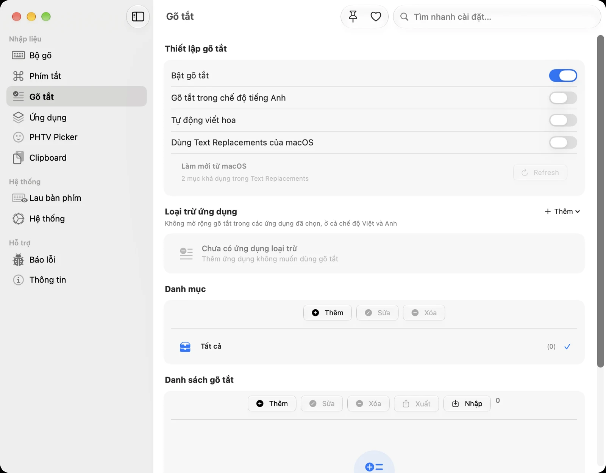

PHTV 的宏可把简短的触发词替换为常用文字。宏既能插入固定的越南语或英语短句，也能在使用时生成日期、递增的编号或剪贴板中的文字。

## 启用宏

从 PHTV 菜单栏图标选择**打开设置**（Open Settings），打开**宏**（Macros），并启用该功能。如果想在英语模式中展开短语，也可开启对应选项。自动调整大小写可根据触发词的首字母大写或全部大写决定展开结果。

## 添加第一个快捷短语

1. 在宏列表中选择**添加**（Add）。
2. 输入 `tyc` 等触发词，并选择纯文本。
3. 输入「谢谢你联系我们，我会在今天回复。」等短语，然后保存。
4. 在「文本编辑」中输入 `tyc`，按空格，确认短语成功展开。

建议使用在平时输入中很少遇到的短字符序列。相关快捷短语可使用统一前缀，例如 `replyhi` 和 `replybye`。如果用实际单词作触发词，可能打断正常输入。

## 插入日期、剪贴板文字或数字

创建宏时可选择以下动态内容类型。

| 类型       | 插入的内容         | 示例设置                             |
| ---------- | ------------------ | ------------------------------------ |
| 纯文本     | 每次使用相同短语   | 电子邮箱地址                         |
| 日期       | 当前日期           | `dd/MM/yyyy` 生成 `15/10/2026`       |
| 时间       | 当前时间           | `HH:mm` 生成 `14:30`                 |
| 日期和时间 | 两者同时插入       | `dd/MM/yyyy HH:mm`                   |
| 剪贴板     | 当前剪贴板里的文字 | 无需设置格式                         |
| 随机短语   | 从列表中选出一项   | 用逗号分隔不同文本                   |
| 计数器     | 每次使用递增的编号 | 前缀 `INV-` 生成 `INV-1`、`INV-2` 等 |

大写 `M` 代表月份，小写 `m` 代表分钟。`HH` 表示 24 小时制。可用日期宏记录会议，用计数器为本地事项编号，或用随机宏回复简短的确认语。将剪贴板文本插入消息前，先确认其中的内容。

## 分类和排除个别应用

可按工作、个人或支持等类别整理宏。列表变长时，用类别筛选。如果某个触发词会干扰终端或代码编辑器中需要输入的字符，可在应用排除选项中加入该应用。

## 备份快捷短语

在宏列表中选择**导出**，保留快捷短语的类型和类别。在新 Mac 上选择**导入**，将其合并到现有列表。PHTV 的系统设置也能进行更全面的备份，可包括应用规则与剪贴板数据。请选择适合所需迁移内容的范围。

## 使用已有的 macOS 文本替换

PHTV 也可以使用**系统设置 › 键盘 › 文本替换**中的快捷短语。如果两个工具同时展开同一个触发词，可能出现重复文字。请确认当前启用的是哪种展开方式，并在目标应用中测试。PHTV 另提供动态文本、大小写及按应用排除的选项。

如尚未配置输入法，可先参阅 [PHTV 安装与输入指南](/zh/guides/go-tieng-viet-tren-mac-voi-phtv/)。
