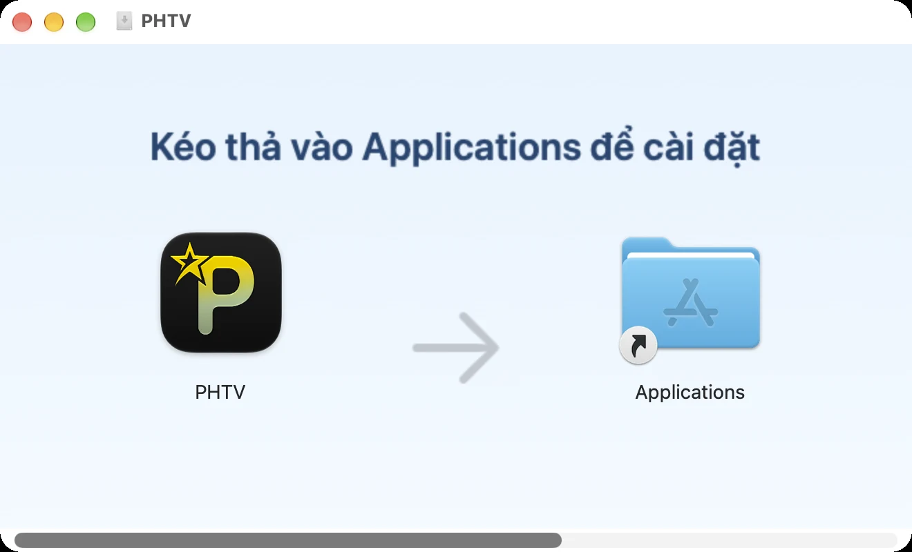
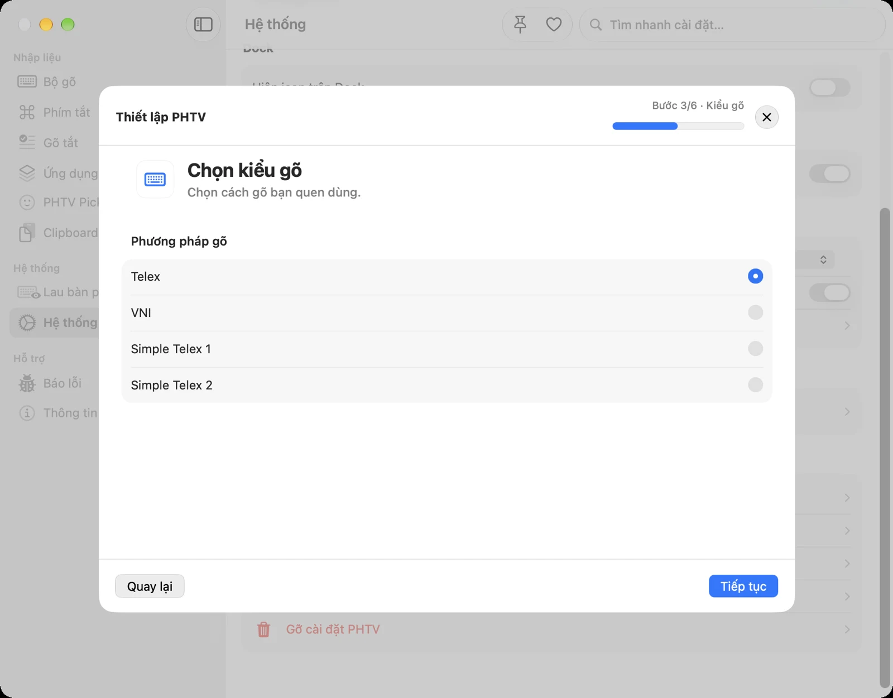
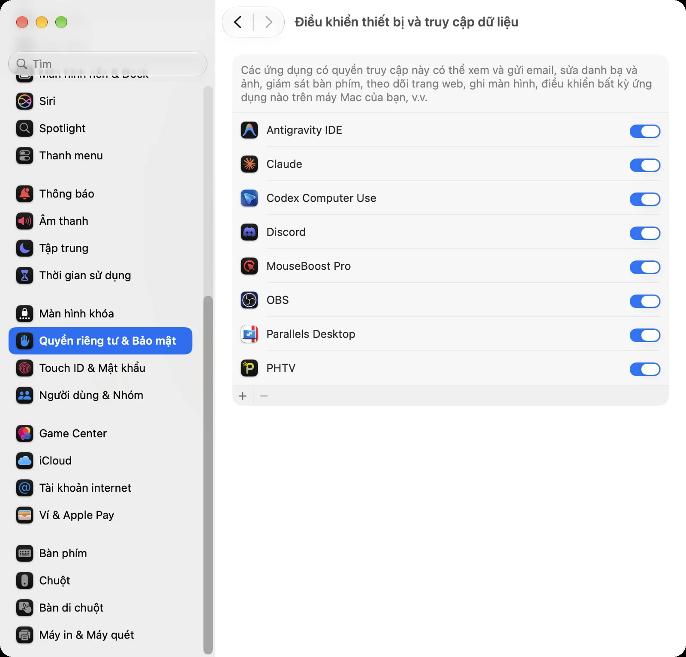
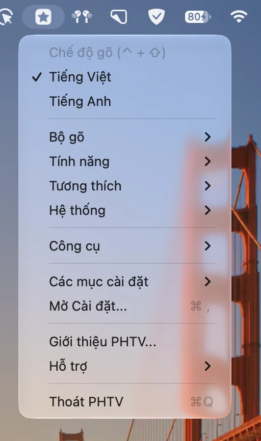

[PHTV](/en/PHTV/) is a free, open-source Vietnamese input method for macOS. It processes ordinary typing on your Mac. This guide takes you from installation to your first sentence in Telex. The screenshots show PHTV in Vietnamese.

## Check your Mac and keyboard source

PHTV requires **macOS 14 Sonoma or later**, with installers for Apple silicon and Intel. Keep the macOS input source on **ABC** or **U.S.** when using PHTV. The PHTV menu controls whether you type Vietnamese or English.

## Install with Homebrew or a DMG

If you already use Homebrew, open Terminal and run:

```bash
brew install --cask phtv
```

The app appears in Applications. PHTV checks for updates from within the app. If you manage its updates through Homebrew, you can also run `brew upgrade --cask --greedy phtv`.

To install without Homebrew, choose the latest installer for your Mac on the [PHTV page](/en/PHTV/) or under [GitHub Releases](https://github.com/PhamHungTien/PHTV/releases/latest). Open the DMG and drag **PHTV** into **Applications**. Open the installed copy from Spotlight or Applications.



## Set up PHTV on first launch

1. Start setup from the welcome screen.
2. In **System Settings › Keyboard › Text Input**, click **Edit** next to Input Sources. Turn off automatic spelling correction and inline predictive text to prevent them from rewriting the same word as PHTV. If automatic capitalization, double-space periods or smart punctuation also interfere with typing, turn off the corresponding options in the same panel. Use **Done** and return to setup. [Apple’s guide to Input Sources](https://support.apple.com/guide/mac-help/mchl84525d76/mac)
3. Choose **Telex**, **VNI**, **Simple Telex 1** or **Simple Telex 2**. Telex uses letters for accents. VNI uses numbers. Practice with the [Telex chart](/en/guides/bang-go-telex-day-du/) or compare [Telex and VNI](/en/guides/cach-go-vni-telex-hay-vni/).
4. Choose whether to remember a separate typing mode per app, use modern accent placement, restore recognized English words, or enable [text expansion macros](/en/guides/go-tat-tren-mac-voi-phtv/). You can change any of these in PHTV's settings later.
5. Grant the macOS permission PHTV requests. Wait for the app to show that it is ready, then finish setup.



## Grant the permission shown by PHTV

PHTV opens the appropriate system settings pane for the Mac it is running on. Enable the permission it asks for so it can read keystrokes and insert accented text in the current app.

| macOS version        | Permission shown in setup        |
| -------------------- | -------------------------------- |
| macOS 27.3 and later | System & App Protection Override |
| macOS 27.0–27.2      | Device Control and Data Access   |
| macOS 26 and earlier | Accessibility                    |



On newer systems, the settings screen may have a different name from the screenshot. See [PHTV's installation documentation](https://github.com/PhamHungTien/PHTV/blob/main/docs/INSTALL.md) and the [privacy policy](/en/PHTV/privacy.html).

## Switch to Vietnamese and try Telex

Open PHTV's star icon in the menu bar and choose **Vietnamese**. The default switching shortcut is <kbd>Control</kbd> + <kbd>Shift</kbd>. Open Notes or TextEdit. With **Telex** selected, type:

```text
Tooi yeeu Vieejt Nam
```

The result is **Tôi yêu Việt Nam**. Try `Vieetj` as well. It also produces **Việt**, with the tone key pressed at the end of the syllable.



Use <kbd>Esc</kbd> to restore the original keystrokes if you use the default shortcut. You can set a separate English typing mode for the terminal or code editor under **Settings › Apps**. To open the emoji picker, use <kbd>Command</kbd> + <kbd>E</kbd> with the default binding. The clipboard history controls are under **Settings › Clipboard**.

## If typing still does not work

Confirm that PHTV is in Vietnamese mode and reports its permission as enabled. Quit PHTV and reopen it after changing permissions. Test again in TextEdit before testing in the app where you first noticed the issue. For repeated characters and app-specific behavior, follow the [PHTV troubleshooting guide](/en/guides/sua-loi-go-tieng-viet-tren-mac/).

## Remove PHTV

For a Homebrew installation, use `brew uninstall --cask phtv`. For a DMG installation, open **Settings › System** in PHTV to find its uninstall tool. If you want to keep macros and app rules before removing settings, export them first.
