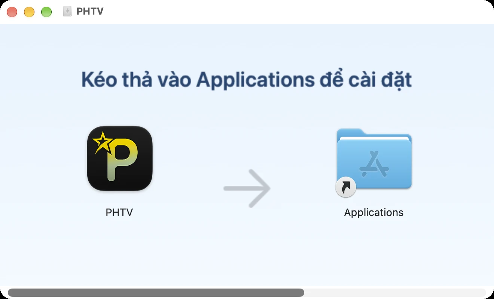
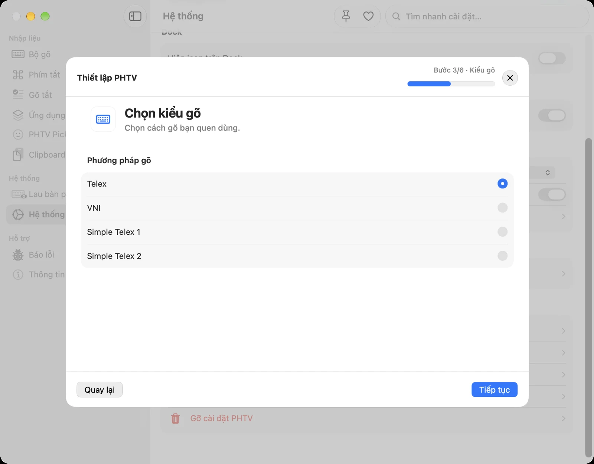
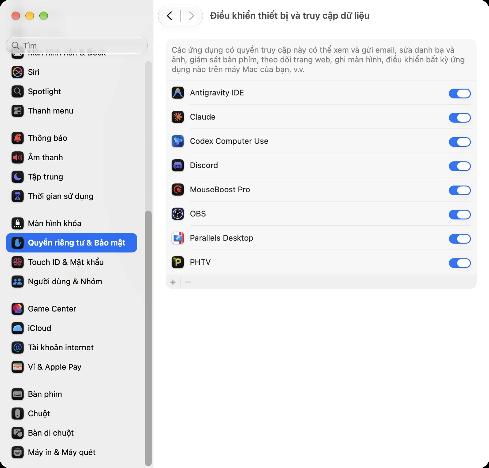
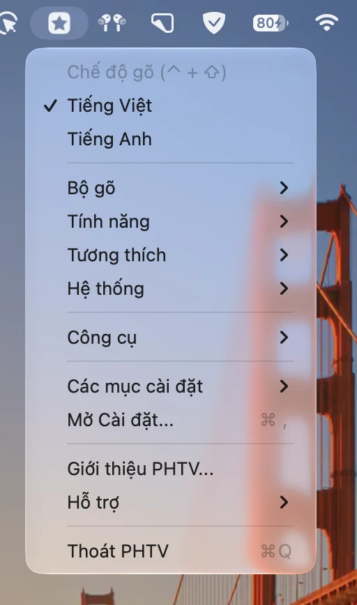

[PHTV](/es/PHTV/) es un método de entrada de código abierto y gratuito para escribir en vietnamita en macOS. Procesa la escritura en tu Mac. La guía te lleva desde la instalación hasta una primera frase en Telex. Las capturas muestran la interfaz en vietnamita.

## Comprueba el Mac y el teclado

PHTV requiere **macOS 14 Sonoma o posterior** y tiene instaladores para Apple Silicon e Intel. Selecciona **ABC** o **U.S.** como fuente de entrada de macOS. El menú de PHTV controla si escribes en vietnamita o en inglés.

## Instala con Homebrew o un DMG

Si ya usas Homebrew, abre Terminal y ejecuta:

```bash
brew install --cask phtv
```

La aplicación se instala en Aplicaciones y comprueba sus actualizaciones. Si las gestionas con Homebrew, puedes usar `brew upgrade --cask --greedy phtv`.

Para instalar sin Homebrew, elige el instalador para tu equipo en la [página de PHTV](/es/PHTV/) o en [GitHub Releases](https://github.com/PhamHungTien/PHTV/releases/latest). Abre el DMG, arrastra **PHTV** a **Aplicaciones** y abre la copia instalada desde esa carpeta o desde Spotlight.



## Configura la aplicación al abrirla por primera vez

1. Inicia la configuración desde la pantalla de bienvenida.
2. En **Ajustes del Sistema › Teclado › Entrada de texto**, pulsa **Editar** en las fuentes de entrada. Desactiva la corrección ortográfica y el texto predictivo en línea para que no reescriban las mismas palabras que PHTV. Si también interfieren las mayúsculas, la puntuación inteligente o el punto con doble espacio, desactiva la opción correspondiente. Pulsa **Aceptar** y vuelve a PHTV. [Guía de las fuentes de entrada de Apple](https://support.apple.com/guide/mac-help/mchl84525d76/mac)
3. Elige **Telex**, **VNI**, **Simple Telex 1** o **Simple Telex 2**. Telex usa letras y VNI usa números para las marcas. Consulta la [tabla de Telex](/es/guides/bang-go-telex-day-du/) o la [comparación entre Telex y VNI](/es/guides/cach-go-vni-telex-hay-vni/).
4. Decide si quieres recordar el modo de escritura por app, usar la ortografía moderna, recuperar palabras inglesas reconocidas o activar las [macros de texto](/es/guides/go-tat-tren-mac-voi-phtv/). Puedes cambiar estos ajustes más adelante.
5. Concede el permiso de macOS que PHTV pide. Cuando la app indique que está lista, termina la configuración.



## Concede el permiso que indica PHTV

PHTV abre el panel que corresponde a tu sistema. Activa el permiso que te indique para que pueda recibir pulsaciones e insertar texto con los signos correctos.

| Versión de macOS       | Permiso en la configuración      |
| ---------------------- | -------------------------------- |
| macOS 27.3 o posterior | System & App Protection Override |
| macOS 27.0–27.2        | Device Control and Data Access   |
| macOS 26 o anterior    | Accesibilidad                    |



El nombre en tu sistema puede variar según la versión y el idioma. Consulta la [documentación de instalación de PHTV](https://github.com/PhamHungTien/PHTV/blob/main/docs/INSTALL.md) y la [política de privacidad](/es/PHTV/privacy.html).

## Escribe una frase con Telex

Abre el icono con forma de estrella de PHTV y elige **Vietnamita**. El atajo predeterminado para alternar es <kbd>Control</kbd> + <kbd>Mayús</kbd>. En Notas o TextEdit, elige **Telex** y escribe:

```text
Tooi yeeu Vieejt Nam
```

El resultado es **Tôi yêu Việt Nam**. Prueba también `Vieetj` para producir **Việt** con la tecla de tono al final.



De forma predeterminada, <kbd>Esc</kbd> recupera las pulsaciones originales. Puedes asignar el modo inglés a la terminal o a un editor en **Ajustes › Apps**. <kbd>⌘</kbd> + <kbd>E</kbd> abre el selector de emojis con el atajo predeterminado. El historial se configura en **Ajustes › Portapapeles**.

## Si todavía no puedes escribir

Comprueba que PHTV esté en vietnamita y que muestre el permiso concedido. Sal de la app y vuelve a abrirla después de cambiar permisos. Prueba primero en TextEdit. Si las letras se repiten o fallan solo en un programa, usa la [guía de solución de problemas](/es/guides/sua-loi-go-tieng-viet-tren-mac/).

## Desinstala PHTV

Para una instalación de Homebrew, usa `brew uninstall --cask phtv`. Para una instalación con DMG, abre **Ajustes › Sistema** en PHTV y usa su herramienta de desinstalación. Si quieres conservar tus macros y reglas por aplicación, expórtalas primero.
