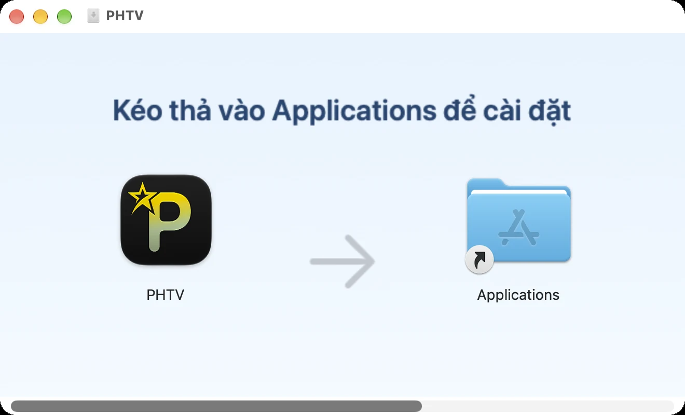
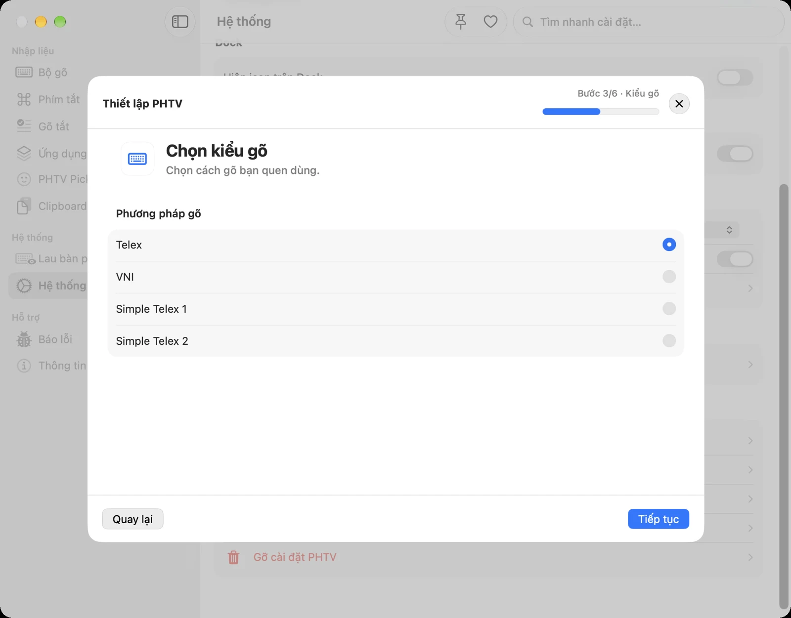
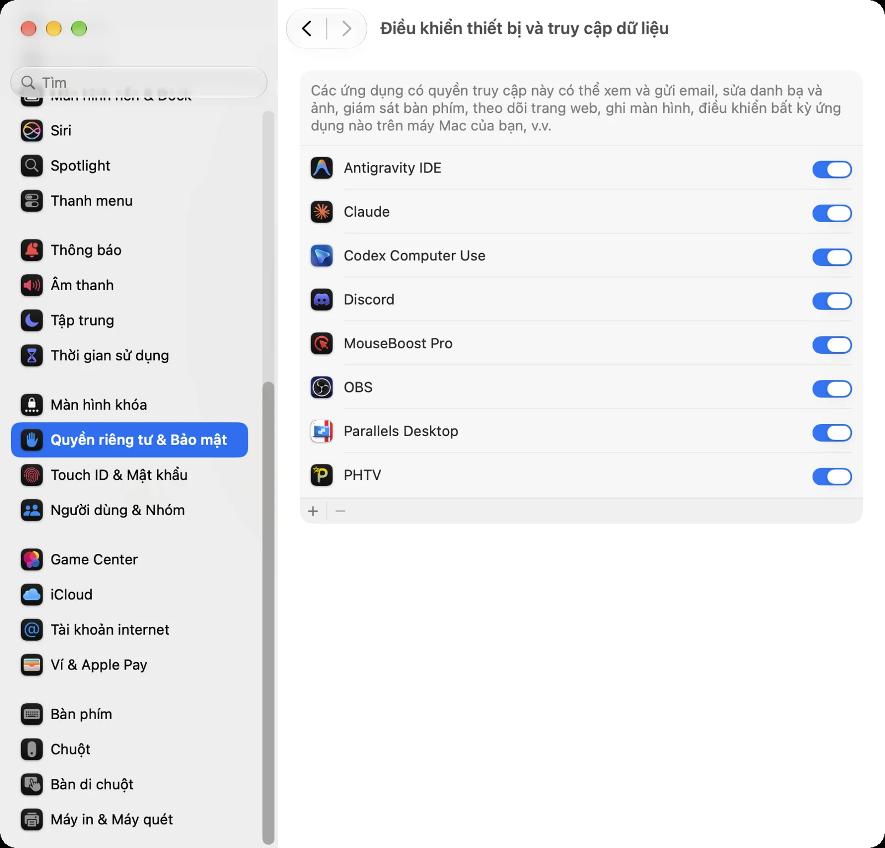
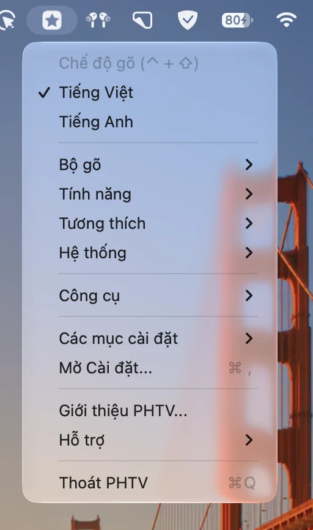

[PHTV](/ja/PHTV/)はmacOS向けの無料オープンソースのベトナム語入力アプリです。普段の入力内容はMacで処理します。インストールからTelexで最初の文を入力するまでを説明します。画面例のPHTVはベトナム語表示です。

## 対応するMacと入力ソース

**macOS 14 Sonoma以降**が必要です。Appleシリコン版とIntel版のインストーラーを用意しています。macOSの入力ソースを**ABC**または**U.S.**にし、ベトナム語と英語はPHTVのメニューで切り替えます。

## HomebrewまたはDMGからインストール

Homebrewを使っている場合はターミナルで次を実行します。

```bash
brew install --cask phtv
```

アプリケーションにPHTVが追加されます。更新はPHTV内から確認できます。Homebrewで更新を管理する場合は`brew upgrade --cask --greedy phtv`も使えます。

Homebrewを使わない場合は、[PHTVのページ](/ja/PHTV/)または[GitHub Releases](https://github.com/PhamHungTien/PHTV/releases/latest)から、お使いのMacに合う最新版を選びます。DMGを開き、**PHTV**を**アプリケーション**へドラッグします。SpotlightまたはアプリケーションからインストールしたPHTVを開きます。



## 初回起動時のセットアップ

1. ようこそ画面からセットアップを始めます。
2. 「システム設定 → キーボード → テキスト入力」で入力ソースの「編集」を選びます。PHTVの入力を上書きしないよう、スペルの自動修正とインラインの予測入力をオフにします。文頭の自動大文字化、2回のスペースによるピリオド、スマート句読点が入力に影響する場合も、同じ欄でオフにできます。「完了」を押してセットアップに戻ります。[Appleの入力ソースガイド](https://support.apple.com/ja-jp/guide/mac-help/mchl84525d76/mac)
3. **Telex**、**VNI**、**Simple Telex 1**、**Simple Telex 2**から選びます。Telexは文字、VNIは数字で記号を付けます。[Telex入力表](/ja/guides/bang-go-telex-day-du/)と[VNIとの比較](/ja/guides/cach-go-vni-telex-hay-vni/)を参照できます。
4. アプリ別の入力モードの記憶、現代正書法での記号の配置、英単語の自動復元、[定型文マクロ](/ja/guides/go-tat-tren-mac-voi-phtv/)を必要に応じて選びます。後から設定を変更できます。
5. 要求されたmacOSの権限を付与し、PHTVが準備完了を表示してから終了します。



## PHTVが案内する権限を付与する

PHTVがmacOSのバージョンに合うシステム設定画面を開きます。キー入力を受け取り、記号を付けた文字を入力先に挿入するために、案内に沿って権限を有効にします。

| macOSのバージョン | セットアップで表示される権限     |
| ----------------- | -------------------------------- |
| macOS 27.3以降    | System & App Protection Override |
| macOS 27.0〜27.2  | Device Control and Data Access   |
| macOS 26以前      | アクセシビリティ                 |



macOSのバージョンによって画面名が変わります。[PHTVのインストール資料](https://github.com/PhamHungTien/PHTV/blob/main/docs/INSTALL.md)と[プライバシーポリシー](/ja/PHTV/privacy.html)も参照できます。

## ベトナム語に切り替えてTelexを試す

メニューバーのPHTVの星アイコンを開き、ベトナム語を選びます。初期設定では<kbd>Control</kbd> + <kbd>Shift</kbd>でも切り替えられます。メモまたはテキストエディットを開き、**Telex**で入力します。

```text
Tooi yeeu Vieejt Nam
```

結果は**Tôi yêu Việt Nam**です。`Vieetj`でも、音節の最後に声調キーを置いて**Việt**と入力できます。



初期設定の<kbd>Esc</kbd>で元のキー入力に戻せます。アプリ別設定ではターミナルやエディターに英語モードを設定できます。絵文字ピッカーの初期設定は<kbd>Command</kbd> + <kbd>E</kbd>です。履歴の設定はPHTVのクリップボード欄にあります。

## 入力できないとき

PHTVがベトナム語モードで必要な権限を取得済みか確認します。権限を変更した後はPHTVを終了して開き直し、まずテキストエディットで試します。文字の重複やアプリごとの問題は[トラブルシューティング](/ja/guides/sua-loi-go-tieng-viet-tren-mac/)を参照してください。

## PHTVを削除する

Homebrewでのインストールを削除するには`brew uninstall --cask phtv`を使います。DMGから入れた場合はPHTVの「設定」からシステム欄にあるアンインストールを選びます。マクロやアプリ別のルールを残す場合、設定の削除前に書き出します。
