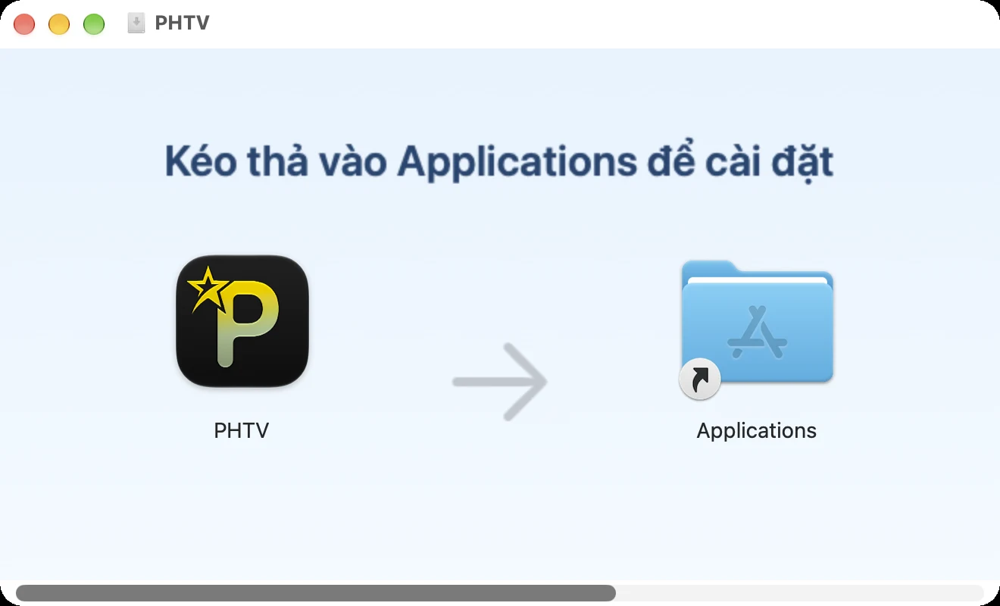
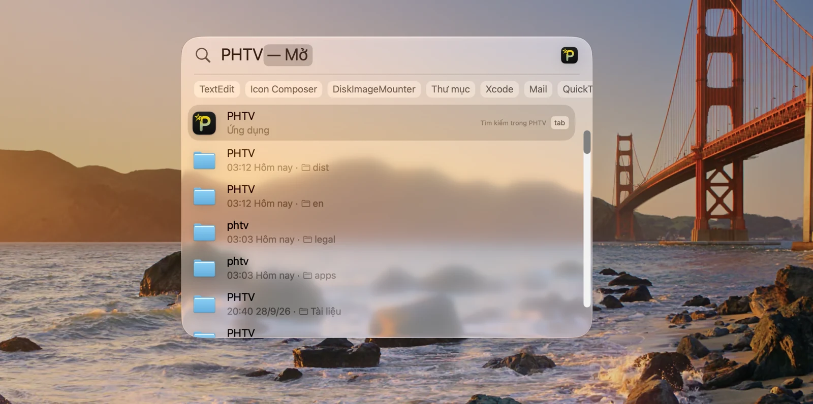
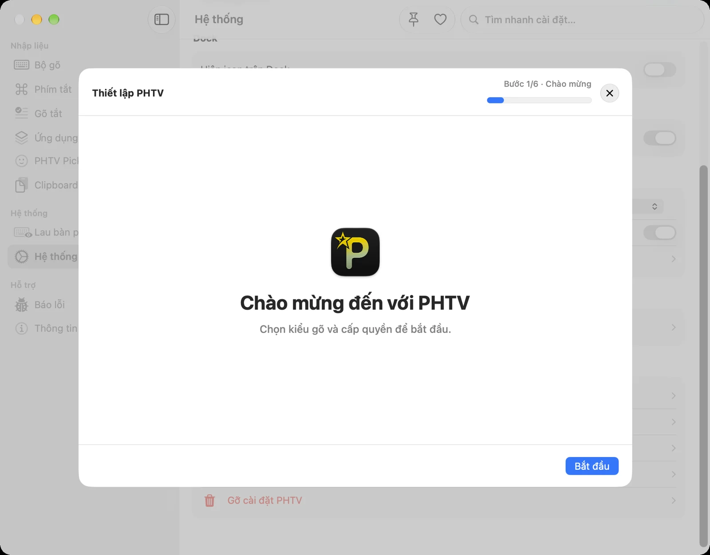
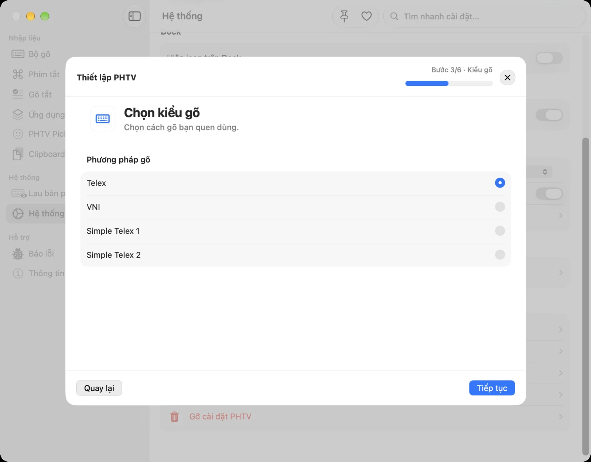
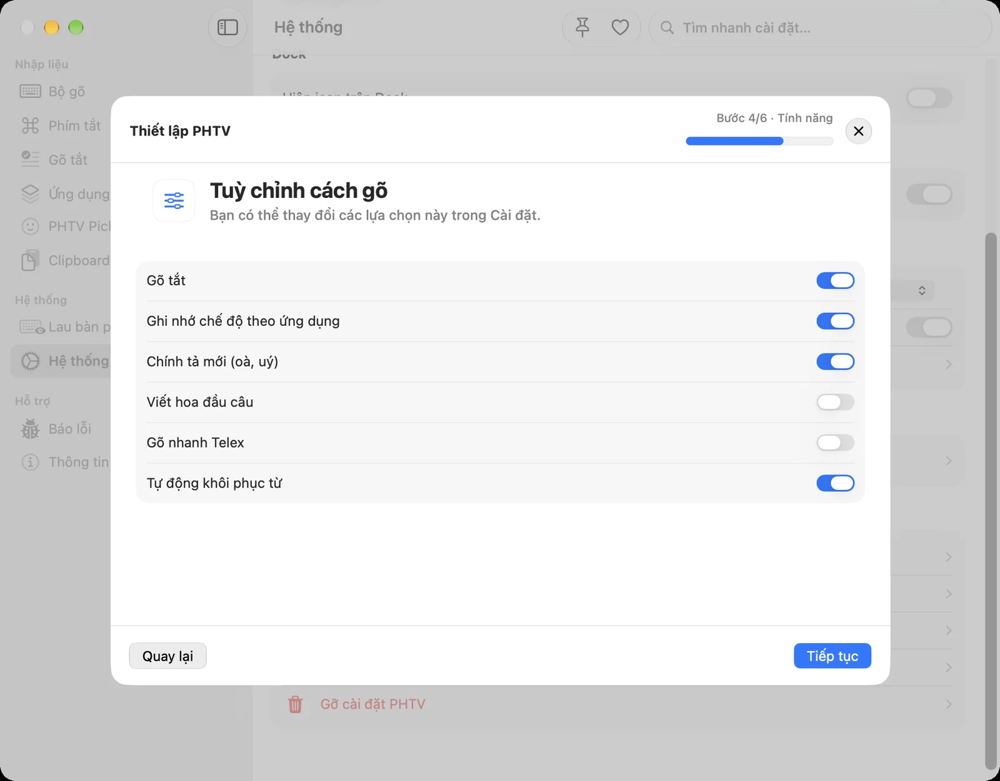
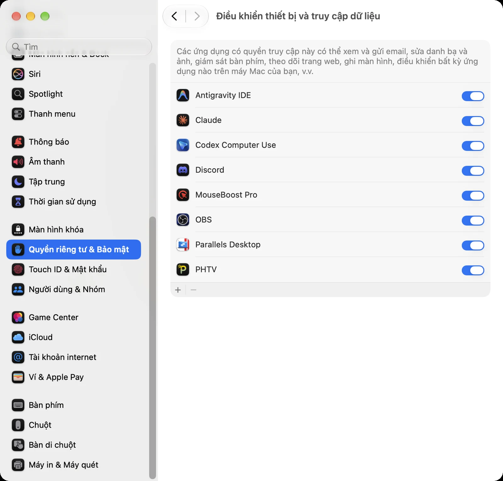
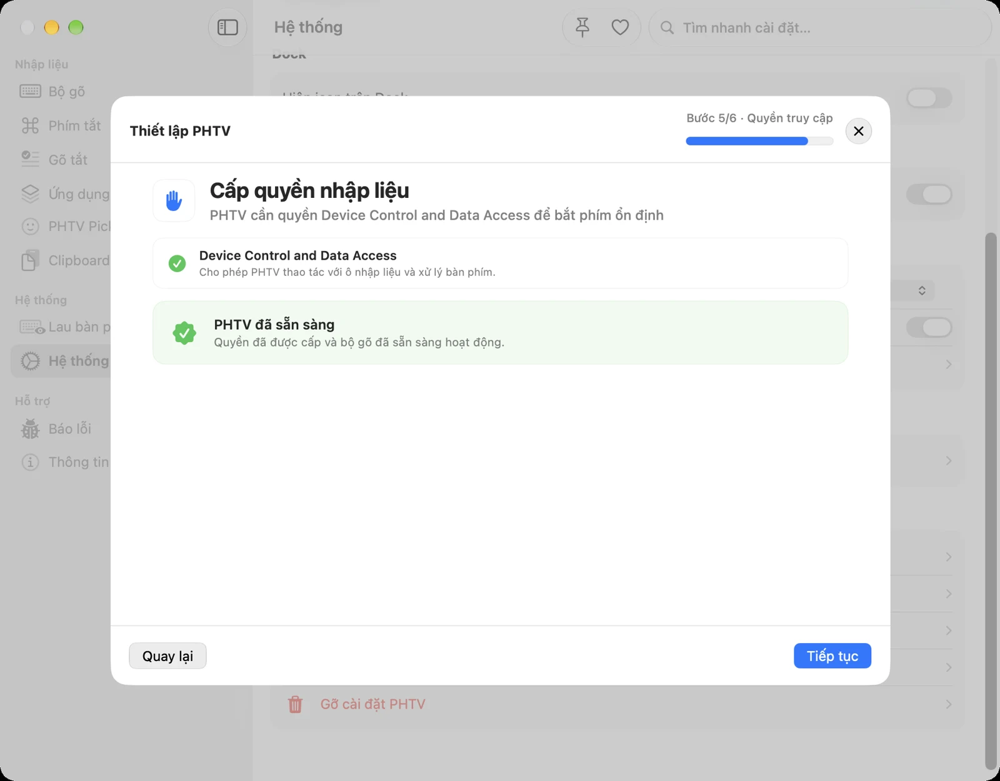
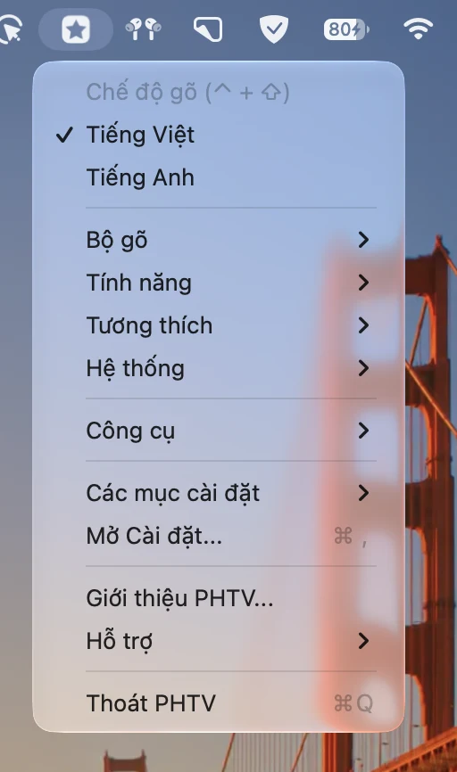

macOS có sẵn bộ gõ tiếng Việt, nhưng nhiều người vẫn gặp cảnh gõ "Việt" ra "Viêt", chữ bị gạch chân rồi tự đổi, hoặc dấu nhảy lung tung trong trình duyệt. **PHTV** là bộ gõ tiếng Việt miễn phí, mã nguồn mở, xử lý mọi phím gõ ngay trên máy và không gửi nội dung bạn gõ đi đâu. Bài này hướng dẫn từ lúc cài đặt đến khi gõ thành thạo, áp dụng cho PHTV 3.6.8.

Nếu bạn thích xem hơn đọc, video ở đầu bài đi qua đúng các bước bên dưới.

## Trước khi cài: máy bạn cần gì?

- **macOS 14 Sonoma trở lên.** PHTV có bản riêng cho chip Apple Silicon (M1, M2, M3, M4…) và chip Intel.
- Khoảng **50 MB** dung lượng trống.
- Quyền quản trị để cấp quyền nhập liệu cho ứng dụng.

Bạn không cần gỡ bộ gõ tiếng Việt có sẵn của macOS. Chỉ cần dùng PHTV ở chế độ tiếng Việt và giữ nguồn nhập của macOS ở ABC hoặc U.S.

## Cách 1: Cài bằng Homebrew (nhanh nhất)

[Homebrew](https://brew.sh) là trình quản lý phần mềm phổ biến trên Mac. PHTV đã có trong kho Homebrew Cask chính thức.

1. Mở **Terminal**: nhấn <kbd>⌘ Command</kbd> + <kbd>Space</kbd>, gõ "Terminal" rồi nhấn <kbd>Enter</kbd>.
2. Nếu máy chưa có Homebrew, dán lệnh cài đặt lấy từ trang [brew.sh](https://brew.sh), nhấn Enter và nhập mật khẩu máy khi được hỏi. Mật khẩu không hiện ký tự khi gõ, đó là chuyện bình thường.
3. Chạy lệnh cài PHTV:

```bash
brew install --cask phtv
```

Khi thấy dòng `phtv was successfully installed!`, PHTV đã nằm trong thư mục Applications. Về sau PHTV tự kiểm tra và cài bản mới, bạn không cần chạy lại lệnh. Nếu vẫn muốn cập nhật bằng Homebrew, dùng `brew upgrade --cask --greedy phtv`.

## Cách 2: Tải file DMG

1. Vào [phamhungtien.com/PHTV](/PHTV/) và bấm nút tải bản mới nhất, hoặc tải từ trang [GitHub Releases](https://github.com/PhamHungTien/PHTV/releases/latest).
2. Mở file `.dmg` vừa tải.
3. Kéo biểu tượng PHTV vào thư mục **Applications**.



Sau đó mở PHTV bằng Spotlight (<kbd>⌘</kbd> + <kbd>Space</kbd>, gõ "PHTV") hoặc từ Launchpad.



## Trình thiết lập 6 bước

Lần đầu mở, PHTV hiện trình thiết lập. Mỗi bước đều có nút Quay lại, nên bạn yên tâm bấm thử.

### Bước 1: Chào mừng

Bấm **Bắt đầu**.



### Bước 2: Tắt tính năng tự sửa chữ của macOS

Đây là bước nhiều người bỏ qua, và cũng là nguyên nhân phổ biến nhất của lỗi lặp chữ hay mất dấu. macOS có vài tính năng tự sửa văn bản chạy song song với bộ gõ. Khi cả hai cùng sửa một chữ, kết quả dễ bị sai.

Bấm **Mở Cài đặt Bàn phím**. macOS mở mục **Bàn phím › Nguồn đầu vào**. Tắt hết các công tắc sau:

- Sửa chính tả tự động
- Tự động viết hoa chữ cái đầu từ
- Hiển thị văn bản dự đoán trong dòng
- Thêm dấu chấm với hai dấu cách
- Sử dụng trích dẫn và gạch ngang thông minh


Bấm **Xong**, quay lại PHTV và bấm **Tiếp tục**.

### Bước 3: Chọn kiểu gõ

PHTV có bốn kiểu gõ: **Telex**, **VNI**, **Simple Telex 1** và **Simple Telex 2**. Nếu chưa biết chọn gì, hãy chọn Telex, kiểu gõ phổ biến nhất ở Việt Nam. Bài [Bảng gõ Telex đầy đủ](/huong-dan/bang-go-telex-day-du/) giải thích chi tiết, còn bài [Cách gõ VNI](/huong-dan/cach-go-vni-telex-hay-vni/) giúp bạn so sánh hai kiểu.



### Bước 4: Tùy chỉnh cách gõ

Các lựa chọn mặc định đã hợp với hầu hết mọi người:

- **Gõ tắt:** gõ chuỗi ngắn để ra cụm từ dài. Xem bài [Gõ tắt trên Mac với PHTV](/huong-dan/go-tat-tren-mac-voi-phtv/).
- **Ghi nhớ chế độ theo ứng dụng:** PHTV nhớ bạn đang gõ tiếng Việt hay tiếng Anh trong từng ứng dụng. Ví dụ Zalo luôn tiếng Việt, Terminal luôn tiếng Anh.
- **Chính tả mới (oà, uý):** đặt dấu kiểu mới ("hoà", "thuý") thay vì kiểu cũ ("hòa", "thúy").
- **Tự động khôi phục từ:** khi bạn gõ một từ tiếng Anh như "file" hay "focus", PHTV trả lại đúng chữ gốc thay vì biến thành chữ có dấu.

Bạn có thể đổi lại bất cứ lúc nào trong Cài đặt của PHTV.



### Bước 5: Cấp quyền nhập liệu

Để nhận phím bạn gõ và đưa chữ đã xử lý vào ứng dụng, PHTV cần **đúng một quyền** của macOS:

| Phiên bản macOS       | Tên quyền                                                                |
| --------------------- | ------------------------------------------------------------------------ |
| macOS 27 trở lên      | Điều khiển thiết bị và truy cập dữ liệu (Device Control and Data Access) |
| macOS 26 trở về trước | Trợ năng (Accessibility)                                                 |

PHTV tự mở đúng mục trong Cài đặt hệ thống. Bạn chỉ cần bật công tắc cạnh PHTV.



Khi thấy dòng **PHTV đã sẵn sàng**, bạn đã xong bước khó nhất.



> Quyền này nghe có vẻ lớn, nhưng mọi bộ gõ trên macOS đều cần nó. PHTV xử lý phím ngay trên máy và không gửi nội dung bạn gõ trong ứng dụng khác lên máy chủ. Mã nguồn công khai trên [GitHub](https://github.com/PhamHungTien/PHTV) để ai cũng kiểm tra được.

### Bước 6: Hoàn tất

Bấm **Bắt đầu sử dụng**.

## Chuyển giữa tiếng Việt và tiếng Anh

Biểu tượng ngôi sao của PHTV nằm trên thanh menu, góc trên bên phải màn hình. Bấm vào đó và chọn **Tiếng Việt** hoặc **Tiếng Anh**.



Nhanh hơn, nhấn <kbd>Control</kbd> + <kbd>Shift</kbd> để đổi qua lại. Bạn đổi được phím tắt này trong **Cài đặt › Phím tắt**, và có thể thêm một phím tắt phụ.

## Thử gõ câu đầu tiên

Mở Ghi chú (Notes) hoặc TextEdit, chuyển PHTV sang tiếng Việt rồi gõ:

```text
Tooi yeeu Vieejt Nam
```

Kết quả: **Tôi yêu Việt Nam**. Bạn cũng có thể gõ dấu ở cuối từ, ví dụ `Vieetj` vẫn ra "Việt". PHTV tự đặt dấu vào đúng nguyên âm.

## Một vài mẹo nên biết ngay

- **Gõ nhầm dấu?** Nhấn <kbd>Esc</kbd> ngay sau đó để trả lại chữ gốc bạn đã gõ.
- **Bảng Emoji và GIF:** nhấn <kbd>⌘</kbd> + <kbd>E</kbd> để mở PHTV Picker.
- **Lịch sử Clipboard:** bật trong **Cài đặt › Clipboard**, rồi nhấn <kbd>Control</kbd> + <kbd>V</kbd> để dán lại những gì đã sao chép.
- **Gõ code:** thêm Terminal hoặc trình soạn code vào danh sách **Tiếng Anh theo ứng dụng** trong **Cài đặt › Ứng dụng**, để PHTV không đặt dấu khi bạn viết lệnh.

## Nếu chưa gõ được tiếng Việt

Kiểm tra theo thứ tự:

1. Biểu tượng trên thanh menu đang ở chế độ **Tiếng Việt**.
2. Quyền nhập liệu đã bật cho PHTV, ở mục Trợ năng hoặc Điều khiển thiết bị và truy cập dữ liệu.
3. Thoát hẳn PHTV (menu › **Thoát PHTV**) rồi mở lại, nhất là ngay sau khi vừa cấp quyền.

Gặp lỗi khác như lặp chữ, mất dấu trong Chrome, hay không gõ được trong một ứng dụng cụ thể? Bài [Sửa lỗi gõ tiếng Việt trên Mac](/huong-dan/sua-loi-go-tieng-viet-tren-mac/) đi qua từng trường hợp.

## Gỡ cài đặt

- Cài bằng Homebrew: `brew uninstall --cask phtv`. Để xóa luôn cài đặt và dữ liệu, dùng `brew uninstall --zap --cask phtv`.
- Cài bằng DMG: dùng công cụ gỡ sạch trong **Cài đặt › Hệ thống** của PHTV. Nếu chỉ xóa PHTV khỏi Applications, cài đặt và dữ liệu của ứng dụng vẫn còn trên máy.
