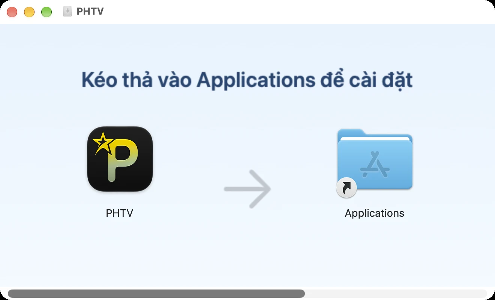
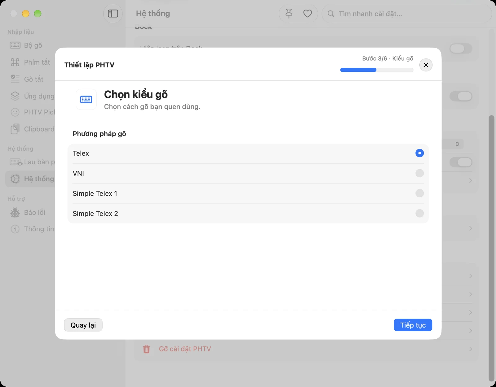
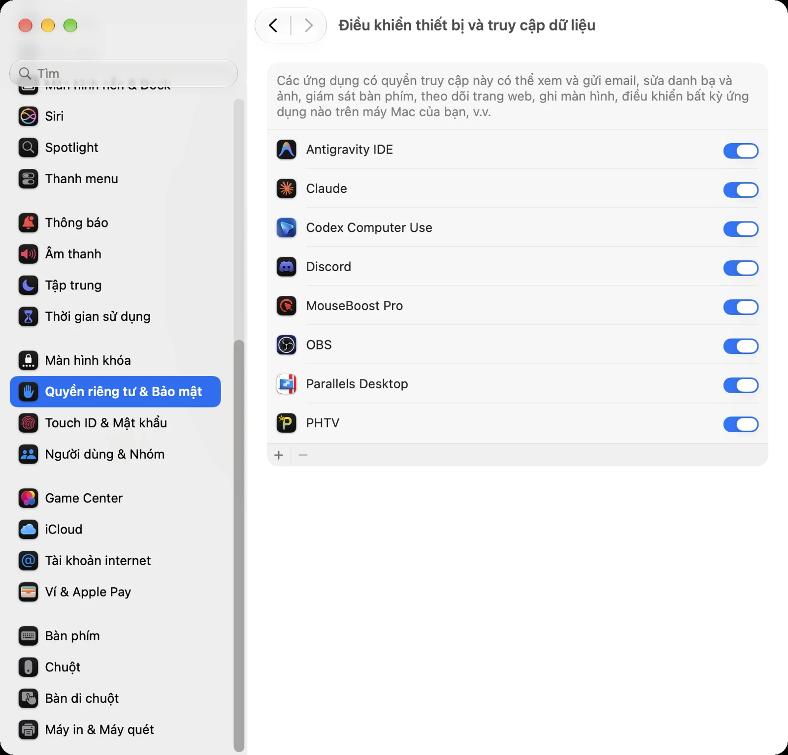
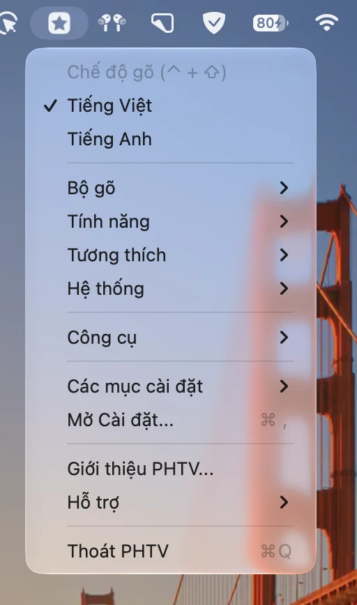

[PHTV](/zh/PHTV/) 是 macOS 上免费开源的越南语输入法。日常的按键处理在 Mac 本机完成。下面从安装开始，演示如何用 Telex 输入第一句越南语。截图中的应用界面为越南语。

## 检查 Mac 和系统输入法

PHTV 需要 **macOS 14 Sonoma 或更高版本**，分别提供 Apple 芯片和 Intel 芯片的安装包。使用 PHTV 时，保留 macOS 的 **ABC** 或 **U.S.** 输入源。越南语和英语的切换由 PHTV 菜单控制。

## 用 Homebrew 或 DMG 安装

如果已使用 Homebrew，请打开「终端」并运行：

```bash
brew install --cask phtv
```

安装后可在「应用程序」中找到 PHTV。应用支持在内部检查更新。如果要通过 Homebrew 更新，可运行 `brew upgrade --cask --greedy phtv`。

也可以从 [PHTV 产品页面](/zh/PHTV/)或 [GitHub Releases](https://github.com/PhamHungTien/PHTV/releases/latest) 下载适合你电脑的最新安装包。打开 DMG，并将 **PHTV** 拖到**应用程序**。然后在「应用程序」或「聚焦」中打开已安装的应用。



## 首次启动时完成设置

1. 从欢迎界面启动设置向导。
2. 前往**系统设置 › 键盘 › 文本输入**，点按输入源旁的**编辑**。关闭自动纠正拼写和行内预测文本，避免它们与 PHTV 同时修改一个词。如果自动大写、连按两次空格添加句号或智能标点也干扰输入，可在同一面板关闭相应项。点按**完成**并返回向导。[Apple 输入源指南](https://support.apple.com/guide/mac-help/mchl84525d76/mac)
3. 选择 **Telex**、**VNI**、**简易 Telex 1** 或 **简易 Telex 2**。Telex 用字母添加音标，VNI 使用数字。可按 [Telex 键位表](/zh/guides/bang-go-telex-day-du/)练习，或[比较两种输入方式](/zh/guides/cach-go-vni-telex-hay-vni/)。
4. 选择是否记住每个应用的输入语言、使用现代声调位置、恢复识别出的英语单词，或开启[快捷短语](/zh/guides/go-tat-tren-mac-voi-phtv/)。之后可在 PHTV 设置中调整这些选项。
5. 授予 PHTV 请求的 macOS 权限。等应用显示已就绪后完成向导。



## 授予 PHTV 显示的权限

PHTV 会根据 macOS 版本打开相应的系统设置面板。授予应用请求的权限后，它才能接收按键，并在当前应用中插入带音标的文字。

| macOS 版本        | 向导显示的权限                   |
| ----------------- | -------------------------------- |
| macOS 27.3 及以上 | System & App Protection Override |
| macOS 27.0–27.2   | Device Control and Data Access   |
| macOS 26 及以下   | 辅助功能（Accessibility）        |



新版本的设置名称可能与截图不同。详见 [PHTV 安装文档](https://github.com/PhamHungTien/PHTV/blob/main/docs/INSTALL.md)和[隐私政策](/zh/PHTV/privacy.html)。

## 切换到越南语并尝试 Telex

点按菜单栏里的 PHTV 星形图标，选择**越南语**。默认切换快捷键为 <kbd>Control</kbd> + <kbd>Shift</kbd>。打开「备忘录」或「文本编辑」，选中 **Telex** 后输入：

```text
Tooi yeeu Vieejt Nam
```

应看到 **Tôi yêu Việt Nam**。也可以试 `Vieetj`。把声调键放在音节末尾，同样得到 **Việt**。



若使用默认设置，按 <kbd>Esc</kbd> 可恢复最初的按键。在**设置 › 应用**中可为终端或代码编辑器指定英语输入。默认情况下，按 <kbd>Command</kbd> + <kbd>E</kbd> 打开表情选择器。剪贴板历史记录可在**设置 › 剪贴板**控制。

## 输入仍然无效时

确认 PHTV 已切到越南语模式，并显示所需权限已启用。更改权限后，退出并重新打开 PHTV。先在「文本编辑」验证，再回到遇到问题的应用。若出现重复字符或只在某个应用中出错，请参阅 [PHTV 排障指南](/zh/guides/sua-loi-go-tieng-viet-tren-mac/)。

## 卸载 PHTV

如果通过 Homebrew 安装，请运行 `brew uninstall --cask phtv`。通过 DMG 安装时，可在 PHTV 的**设置 › 系统**中找到卸载工具。需要保留宏和应用规则时，请先导出设置。
