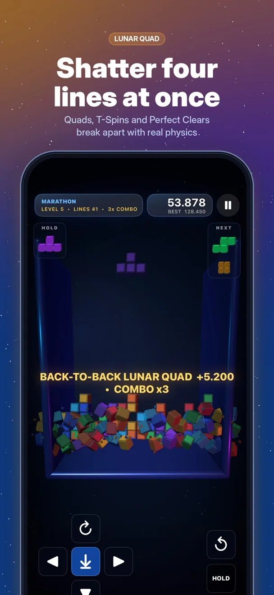

[Lunar Block](/LunarBlock/) is a falling-block puzzle. Move and rotate the active piece, line it up with the stack and complete horizontal rows to clear space. The first thing to practice is checking where the piece will land before making a hard drop.

## Choose a mode

| Mode         | Goal                                                              | What to practice                                             |
| ------------ | ----------------------------------------------------------------- | ------------------------------------------------------------ |
| **Marathon** | Keep the stack under control as speed increases through 20 levels | Leave several places for the next piece to fit               |
| **Sprint**   | Clear 40 rows as quickly as you can                               | Decide where the next piece goes while the current one falls |
| **Ultra**    | Maximize your score in two minutes                                | Build consecutive clears and avoid recovery moves            |

Start with Marathon so you can learn the controls at a lower speed. Once hard drops feel predictable, play Sprint to practice looking ahead.

## Move, rotate, drop and hold

| Action                    | Touch                                                  | Keyboard            | Controller               |
| ------------------------- | ------------------------------------------------------ | ------------------- | ------------------------ |
| Move left or right        | Swipe sideways or use the on-screen D-pad              | Left or Right arrow | D-pad or left stick      |
| Rotate clockwise          | Tap the board or use the rotate button                 | Up arrow or `X`     | `A`                      |
| Rotate counterclockwise   | Tap with two fingers or use the opposite rotate button | `Z`                 | `X`                      |
| Drop gradually            | Drag down or use D-pad Down                            | Down arrow          | Down                     |
| Drop and lock immediately | Flick down or use the center drop button               | Space               | `B`                      |
| Hold                      | Tap **HOLD**                                           | `C` or Shift        | `Y` or a shoulder button |
| Pause                     | Tap Pause                                              | `P` or Esc          | Menu                     |

Button lettering can vary with the controller. On a touchscreen, try the D-pad and left-handed layout if gestures feel harder to control.

## Use the ghost piece and hold slot

The **ghost piece** shows where the current piece would land if dropped immediately. Move or rotate until the outline sits where you intend. Then hard drop. While placing one piece, check the **next** queue and leave a path for the upcoming shapes.

Use **HOLD** to make room for the next piece or swap in the saved one. You can hold once per active piece. Lock that piece before trying to hold again. Save a long piece for a vertical gap only if the stack still has room for other shapes in the meantime.

## Try a repeatable practice run

1. In Marathon, clear a few rows using slow drops so you can watch the ghost piece change.
2. Make the next several placements with hard drops. Check the outline before committing.
3. Use hold to recover once when neither side of the current stack fits.
4. In Sprint, track whether you clear 40 lines more consistently as you rely on the next queue.

Lunar Block keeps personal records for each mode. You can also sign in to Game Center to use its leaderboards and achievements. See [Lunar Block's app page](/LunarBlock/) for device support and settings.
