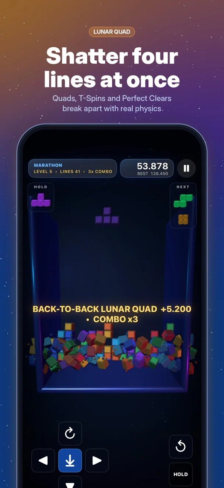

En [Lunar Block](/es/LunarBlock/) colocas piezas que caen para completar líneas horizontales y abrir espacio. Empieza por comprobar dónde va a aterrizar la pieza antes de soltarla de golpe.

## Elige un modo

| Modo         | Objetivo                                                                   | Qué practicar                                             |
| ------------ | -------------------------------------------------------------------------- | --------------------------------------------------------- |
| **Marathon** | Controla el tablero mientras aumenta la velocidad a lo largo de 20 niveles | Deja varios huecos donde pueda encajar la siguiente pieza |
| **Sprint**   | Elimina 40 líneas en el menor tiempo                                       | Elige el lugar de la próxima pieza mientras cae la actual |
| **Ultra**    | Consigue la mayor puntuación en dos minutos                                | Encadena líneas y evita movimientos de recuperación       |

Prueba Marathon primero para habituarte a los controles a menor velocidad. Cuando puedas predecir dónde termina una caída rápida, usa Sprint para practicar cómo anticiparte a las siguientes piezas.

## Mueve, gira, suelta y reserva piezas

| Acción                       | Pantalla táctil                                   | Teclado                    | Mando                       |
| ---------------------------- | ------------------------------------------------- | -------------------------- | --------------------------- |
| Mover a izquierda o derecha  | Desliza o usa la cruceta                          | Flecha izquierda o derecha | Cruceta o palanca izquierda |
| Girar en sentido horario     | Toca el tablero o el botón de giro                | Flecha arriba o `X`        | `A`                         |
| Girar en sentido antihorario | Toca con dos dedos o usa el giro inverso          | `Z`                        | `X`                         |
| Bajar poco a poco            | Arrastra hacia abajo o usa la cruceta             | Flecha abajo               | Abajo                       |
| Bajar y fijar de inmediato   | Desliza rápido hacia abajo o usa el botón central | Espacio                    | `B`                         |
| Reservar                     | Toca **HOLD**                                     | `C` o Mayús                | `Y` o botón superior        |
| Pausar                       | Toca el botón de pausa                            | `P` o Esc                  | Menú                        |

Las letras de los botones pueden variar entre mandos. Si los gestos te resultan difíciles, prueba la cruceta en pantalla y el diseño para zurdos.

## Usa la pieza fantasma y el espacio de reserva

La **pieza fantasma** muestra dónde aterrizarías al soltar la pieza en ese momento. Antes de la caída rápida, gira o desplaza la pieza hasta que el contorno ocupe el hueco correcto. Mira también las piezas siguientes mientras colocas la actual.

Pulsa **HOLD** para guardar una pieza o intercambiarla con la que ya reservaste. Solo puedes hacerlo una vez por pieza activa. Fíjala en el tablero antes de volver a usar la reserva. Si guardas una pieza larga para un hueco vertical, deja espacio para acomodar otras piezas mientras tanto.

## Practica con una partida que puedas repetir

1. En Marathon, elimina unas líneas dejando bajar las piezas poco a poco. Observa cómo se mueve la pieza fantasma.
2. Coloca las siguientes con caídas rápidas, comprobando el contorno antes de cada una.
3. Reserva una pieza que no encaje fácilmente en el tablero.
4. Pasa a Sprint y comprueba si mirar las piezas siguientes te ayuda a completar las 40 líneas con más regularidad.

Lunar Block conserva tus récords en cada modo. También puedes consultar las clasificaciones y los logros al iniciar sesión en Game Center. Revisa los dispositivos y ajustes en la [página de Lunar Block](/es/LunarBlock/).
