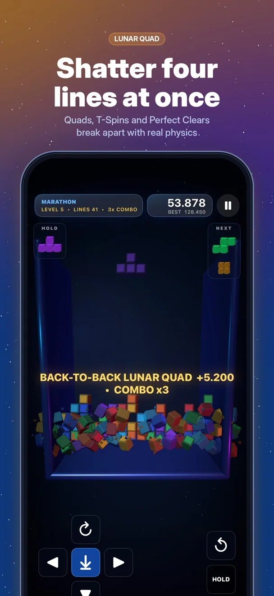

[Lunar Block](/ja/LunarBlock/)は落ちものパズルです。落下中のブロックを動かして回転させ、横一列を埋めるとラインが消えます。まず、ハードドロップを押す前にブロックの落下先を確認する練習から始めましょう。

## モードを選ぶ

| モード       | 目標                                   | 練習すること                                 |
| ------------ | -------------------------------------- | -------------------------------------------- |
| **Marathon** | 20段階で速くなる中で積み上がりを抑える | 次のブロックが置ける場所を複数残す           |
| **Sprint**   | 40ラインをなるべく早く消す             | 今のブロックが落ちる間に次の置き場所を決める |
| **Ultra**    | 2分間で得点を伸ばす                    | 連続でラインを消し、積み直しを減らす         |

最初はMarathonの低速で操作を覚えます。ハードドロップの行き先が読めるようになったら、Sprintで先を読む練習をします。

## 移動、回転、落下、ホールド

| 操作               | タッチ                                   | キーボード      | コントローラ              |
| ------------------ | ---------------------------------------- | --------------- | ------------------------- |
| 左右に移動         | 横にスワイプ、または画面の方向ボタン     | 左・右矢印      | 方向ボタン、左スティック  |
| 時計回りに回転     | 盤面をタップ、または回転ボタン           | 上矢印または`X` | `A`                       |
| 反時計回りに回転   | 2本指でタップ、または逆向きの回転ボタン  | `Z`             | `X`                       |
| 少しずつ落とす     | 下へドラッグ、または方向ボタンの下       | 下矢印          | 下                        |
| 一気に落として固定 | 下へフリック、または中央のドロップボタン | Space           | `B`                       |
| ホールド           | **HOLD**をタップ                         | `C`またはShift  | `Y`またはショルダーボタン |
| 一時停止           | 一時停止ボタン                           | `P`またはEsc    | Menu                      |

コントローラの機種によってボタン表記が異なります。タッチのジェスチャーで操作しづらい場合は、画面の方向ボタンや左利き向けレイアウトを試してください。

## ゴーストとホールドを使う

**ゴースト**はそのまま落としたときにブロックが到達する位置です。置きたい場所に輪郭が合うように移動または回転し、ハードドロップします。ブロックを置く間にネクスト欄も確認し、次の形が入りそうな場所を残します。

**HOLD**で今のブロックを保留して次に進むか、保留中のブロックと入れ替えられます。ホールドは落下中のブロック1つにつき一度です。使い直す前に置いて固定します。縦長の隙間に長いブロックを保留する場合は、その間にほかの形が置ける余裕も確認します。

## 同じ練習を繰り返して比べる

1. Marathonでゆっくり落とし、ゴーストが変わるのを見ながら数ライン消します。
2. 次の何手かはハードドロップを使い、押す前に輪郭を確かめます。
3. 今のブロックが左右どちらにも合わないときに、一度ホールドを使って立て直します。
4. Sprintでは、ネクスト欄を見ながら40ラインを安定して消せるか確認します。

モードごとの自己ベストが保存されます。ランキングと達成項目はGame Centerにサインインして利用できます。対応端末と設定は[Lunar Blockのページ](/ja/LunarBlock/)をご覧ください。
