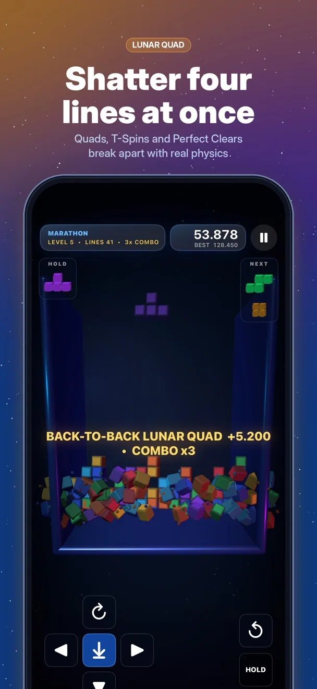

Trong [Lunar Block](/vi/LunarBlock/), bạn di chuyển và xoay từng khối đang rơi để lấp kín hàng ngang. Hàng đầy sẽ biến mất, tạo khoảng trống cho các khối tiếp theo. Khi mới chơi, hãy tập nhìn bóng chiếu để biết khối sẽ đáp ở đâu trước khi thả nhanh.

## Chọn chế độ chơi

| Chế độ       | Mục tiêu                                          | Kỹ năng nên tập                                          |
| ------------ | ------------------------------------------------- | -------------------------------------------------------- |
| **Marathon** | Giữ chồng khối ổn định khi tốc độ tăng qua 20 cấp | Chừa nhiều chỗ cho khối kế tiếp                          |
| **Sprint**   | Xóa 40 hàng trong thời gian ngắn nhất             | Nhìn trước khối tiếp theo khi khối hiện tại vẫn đang rơi |
| **Ultra**    | Ghi nhiều điểm nhất trong hai phút                | Xóa hàng liên tiếp và hạn chế các lượt sửa thế xếp       |

Bạn có thể bắt đầu ở Marathon để làm quen khi khối còn rơi chậm, sau đó chuyển sang Sprint để luyện nhìn trước.

## Di chuyển, xoay, thả và giữ khối

| Thao tác                     | Cảm ứng                                     | Bàn phím               | Tay cầm             |
| ---------------------------- | ------------------------------------------- | ---------------------- | ------------------- |
| Sang trái hoặc phải          | Vuốt ngang hoặc dùng D-pad trên màn hình    | Mũi tên trái hoặc phải | D-pad hoặc cần trái |
| Xoay theo chiều kim đồng hồ  | Chạm sân chơi hoặc nút xoay                 | Mũi tên lên hoặc `X`   | `A`                 |
| Xoay ngược chiều kim đồng hồ | Chạm bằng hai ngón hoặc dùng nút xoay ngược | `Z`                    | `X`                 |
| Thả từ từ                    | Kéo xuống hoặc dùng nút xuống               | Mũi tên xuống          | Hướng xuống         |
| Thả nhanh và khóa ngay       | Vuốt nhanh xuống hoặc bấm nút thả ở giữa    | Phím cách              | `B`                 |
| Giữ khối                     | Chạm **HOLD**                               | `C` hoặc Shift         | `Y` hoặc nút vai    |
| Tạm dừng                     | Chạm nút tạm dừng                           | `P` hoặc Esc           | Nút Menu            |

Ký hiệu nút có thể khác tùy tay cầm. Trên màn hình cảm ứng, bạn có thể thử D-pad và bố cục thuận tay trái để chọn cách dễ điều khiển.

## Dùng bóng chiếu, hàng chờ và ô giữ

**Bóng chiếu** báo vị trí khối sẽ đáp nếu thả ngay. Hãy dịch hoặc xoay đến khi bóng nằm đúng chỗ, rồi thả nhanh. Trong lúc đó, nhìn **hàng chờ** để giữ đường vào cho khối tiếp theo.

Chạm **HOLD** để cất khối hiện tại hoặc đổi với khối đã cất. Bạn có một lần giữ cho mỗi khối đang chơi. Hãy đặt khối xuống trước khi giữ lần nữa. Nếu định dành một khối dài cho khe dọc, vẫn chừa chỗ để xếp được những khối khác trong lúc chờ.

## Luyện trong một lượt ngắn

1. Chơi Marathon, xóa vài hàng bằng cách thả từ từ để quen với bóng chiếu.
2. Dùng thả nhanh cho vài khối tiếp theo, kiểm tra bóng trước mỗi lần thả.
3. Thử giữ một khối khi chưa có vị trí thích hợp cho nó.
4. Sang Sprint và theo dõi xem bạn có xóa đủ 40 hàng ổn định hơn nhờ nhìn hàng chờ hay không.

Lunar Block lưu kỷ lục riêng cho từng chế độ. Nếu đăng nhập Game Center, bạn cũng có thể xem bảng xếp hạng và thành tích. Xem các thiết bị hỗ trợ và tùy chọn trên [trang Lunar Block](/vi/LunarBlock/).
