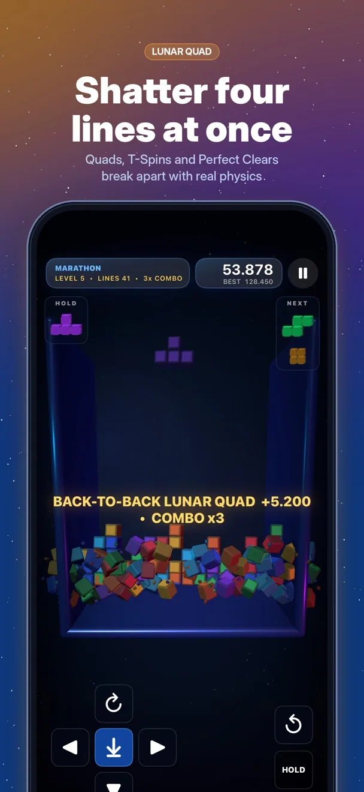

[Lunar Block](/zh/LunarBlock/) 是一款下落方块益智游戏。移动并旋转正在下落的方块，让它补齐横行，即可消行腾出空间。建议先练习快速下落前查看方块的预计落点。

## 选择模式

| 模式                   | 目标                                 | 练习重点                         |
| ---------------------- | ------------------------------------ | -------------------------------- |
| **马拉松（Marathon）** | 在 20 个逐渐加速的等级中控制堆叠高度 | 给下一个方块留出多个落点         |
| **冲刺（Sprint）**     | 尽快消除 40 行                       | 当前方块下落时就想好下一块的位置 |
| **极限（Ultra）**      | 在两分钟内争取最高分                 | 练习连续消行，减少补救操作       |

可以从马拉松开始，在速度较慢时熟悉操作。能稳定进行快速下落后，再用冲刺练习预判下一块。

## 移动、旋转、下落和暂存

| 操作           | 触控                     | 键盘           | 游戏手柄       |
| -------------- | ------------------------ | -------------- | -------------- |
| 左右移动       | 左右滑动或使用屏幕方向键 | 左或右方向键   | 方向键或左摇杆 |
| 顺时针旋转     | 轻点棋盘或旋转按钮       | 上方向键或 `X` | `A`            |
| 逆时针旋转     | 双指轻点或反向旋转按钮   | `Z`            | `X`            |
| 加速下落       | 向下拖动或用屏幕下方向键 | 下方向键       | 下方向键       |
| 立即下落并锁定 | 向下轻扫或按中央下落键   | 空格键         | `B`            |
| 暂存           | 轻点 **HOLD**            | `C` 或 Shift   | `Y` 或肩键     |
| 暂停           | 轻点暂停                 | `P` 或 Esc     | 菜单键         |

手柄的键位字母可能不同。触屏手势不易控制时，可试用屏幕方向键或左手布局。

## 使用落点影子和暂存槽

**落点影子**显示当前方块如果马上下落会到达的位置。移动或旋转方块，等影子对准目标后再快速下落。放置当前方块时也可查看**下一块**队列，为后续形状预留空间。

使用 **HOLD** 把当前方块留待稍后，或换回已暂存的方块。每个当前方块只能暂存一次，需要先锁定方块才能再次操作。给长条保留竖直的空隙时，确保还有空间放其他形状。

## 试试可重复的练习流程

1. 用马拉松的慢速下落消除几行，观察落点影子的变化。
2. 接下来几次用快速下落，但每次先核对影子。
3. 当当前方块在堆叠两边都无法放置时，试一次暂存来调整。
4. 在冲刺模式中用下一块队列做预判，记录自己能否更稳定地消除 40 行。

Lunar Block 会保存各模式的个人纪录。也可登录 Game Center 使用排行榜和成就。设备支持与设置详见 [Lunar Block 产品页面](/zh/LunarBlock/)。
