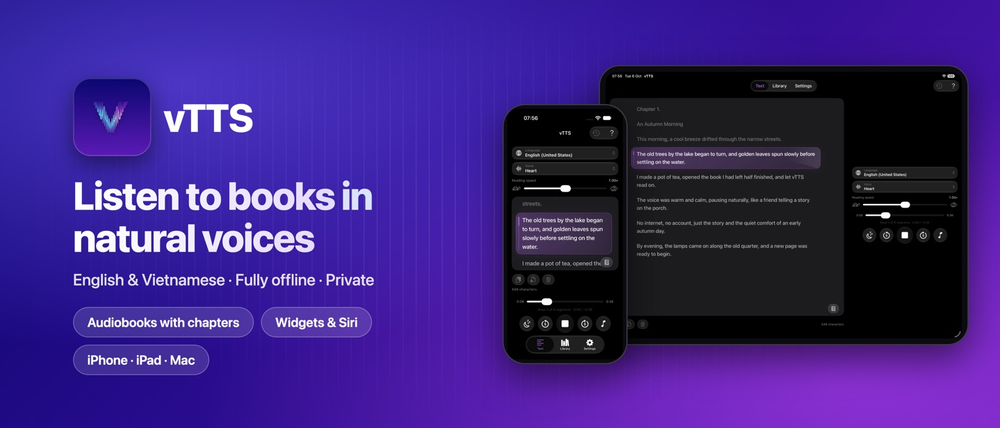
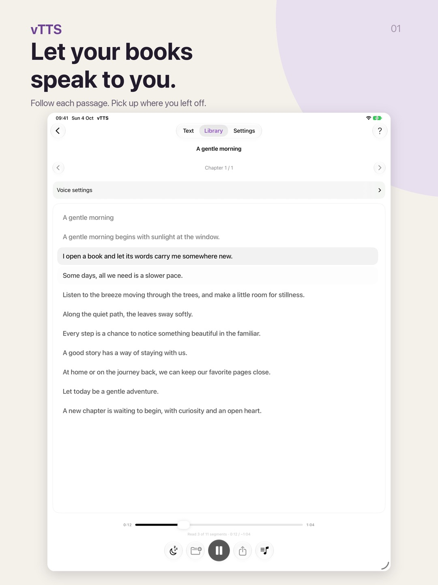

When your eyes need a break or your hands are busy, **vTTS** turns EPUB books and documents into Vietnamese or English speech **on your device**. It works without an internet connection and does not send your books to a server. This guide takes you from importing a book to exporting an audiobook you can listen to elsewhere.

## Supported devices

- **iPhone and iPad:** iOS and iPadOS 17 or later.
- **Mac:** macOS 14 or later.

Download vTTS from the [App Store](https://apps.apple.com/app/id6817003401). Voices are bundled with the app, so you can listen on first launch, even offline. The video above is narrated in Vietnamese; the written instructions below are in English.

## Step 1: Import books and documents

### EPUB books

- **On iPhone or iPad:** open an `.epub` file in Files and choose vTTS, or use the share sheet. The book is added to your **Library**.
- **On Mac:** right-click an EPUB in Finder and choose **Open With › vTTS**, or use **Open Document…** (<kbd>⌘</kbd> + <kbd>O</kbd>).

In the Library, search by title or author, mark favorites and arrange your books.

### Other documents and plain text

vTTS also opens **TXT, Markdown, HTML, RTF, PDF, DOCX, ODT and FB2** files in the **Text** view. You can paste text directly, such as a long article or an email.

- For **PDFs**, vTTS uses the existing text layer when available. Scanned pages use on-device OCR. Recognition can miss or misread words, so review any warnings.
- **DOCX, ODT and FB2** import the text without preserving the complete document layout.
- Encrypted or DRM-protected files, older Word files (`.doc`) and Kindle formats (MOBI, AZW3 and KFX) are not supported.

## Step 2: Choose a voice and speed

Select the **language**, **voice** and **speed** on the main screen. vTTS includes Vietnamese voices with northern and southern accents, male and female voices, and English voices.

You can move the speed slider while listening without stopping playback. Start at the default speed and adjust as you become familiar with a voice. A slower pace may suit fiction, while a faster pace may work for reference material.

## Step 3: Listen and follow along

Press Play. The sentence being spoken is highlighted so you can follow the text.

- **Tap any sentence** to start listening from that point.
- vTTS **remembers your place** in each book, letting you resume later.
- On iPhone, control playback from the **Lock Screen** and **Dynamic Island**. You can also use **widgets** and resume listening with **Siri**.

## Step 4: Set a sleep timer and background music

The **sleep timer** offers presets of 5, 15, 30, 45, 60 and 90 minutes, or a custom duration from 1 minute to 23 hours and 59 minutes. When it expires, vTTS pauses both speech and music and keeps your place. The timer continues across chapter changes.

**Piano background music** can accompany narration, with its own volume control. Music is off by default; enable it when you want a softer listening atmosphere.

## Step 5: Export audio or an audiobook

To listen on another device, in the car or share an audio file, use Export:

- **Audio formats:** WAV, M4A, AAC or MP3. MP3 supports 128, 160, 192 and 320 kbps.
- **Optional background music:** exports contain narration only by default. You can include piano music and adjust its volume separately.
- **M4B audiobooks:** export a complete book as one file with chapters, suitable for Apple Books and compatible audiobook players.

## Correct names and abbreviations

If a voice mispronounces a name, brand or abbreviation, open **Settings › Reading › Pronunciation Dictionary** and add the word with your preferred pronunciation. For example, “PHTV” can be read as “pê hát tê vê.” Changes apply to playback, exports and the LAN server. The dictionary stays on your device.

vTTS also handles numbers, dates, times, percentages, currencies, phone numbers and common Vietnamese abbreviations such as “TP.HCM” and “PGS. TS.” It supports Sino-Vietnamese readings of Chinese characters.

## Privacy

- **Speech generation works offline** on your device.
- Books, drafts and history stay locally. Files leave the device when you choose to export or share them.
- The **LAN server**, which provides a text-to-speech API on your local network, is **off by default** and requires a token when enabled. Enable it only on a network you trust.

See the [vTTS privacy policy](/vTTS/privacy.html) for details.

## Frequently asked questions

**Can vTTS read English books?**
Yes. Select English and an English voice. For Vietnamese text containing English words, vTTS detects the language to handle pronunciation.

**Why is the download relatively large?**
The speech models are bundled for offline use. You do not need to download them separately before listening.

**How do I report a pronunciation issue?**
Send a short description and your app version to contact@phamhungtien.com, or use Discussions on the [vTTS page](/vTTS/). You do not need to send your entire book or private document.
