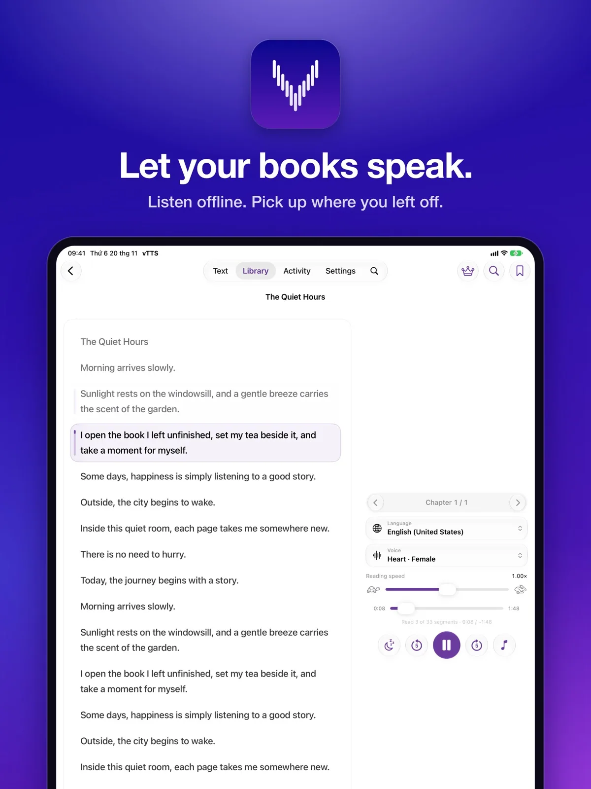

[vTTS](/vi/vTTS/) đọc sách và văn bản bằng giọng tiếng Việt hoặc tiếng Anh ngay trên thiết bị. Bạn có thể nghe khi đang nấu ăn, nghỉ mắt hoặc đi bộ, kể cả khi mất mạng. Các bước bên dưới mô tả vTTS trên iPhone, iPad và Mac.

## Chọn thiết bị và mở ứng dụng

Bản Apple hỗ trợ **iOS và iPadOS 17 trở lên**, hoặc **macOS 14 trở lên**. Các giọng đọc đi kèm ứng dụng, vì vậy bạn có thể nghe ngay khi cài xong. vTTS có trên [App Store](https://apps.apple.com/app/id6817003401) và [Google Play](https://play.google.com/store/apps/details?id=com.phamhungtien.vtts).

## Nhập sách và tài liệu

Để thêm **EPUB** trên iPhone hoặc iPad, chọn tệp trong ứng dụng Tệp rồi mở bằng vTTS qua bảng chia sẻ. Trên Mac, bấm chuột phải vào tệp trong Finder, chọn **Mở bằng › vTTS** hoặc dùng lệnh **Mở tài liệu** với <kbd>⌘</kbd> + <kbd>O</kbd>. Vào **Thư viện** để tìm lại sách theo tên hoặc tác giả, và đánh dấu sách yêu thích nếu cần.

Bạn cũng có thể dán văn bản trực tiếp hoặc mở tệp TXT, Markdown, HTML, RTF, PDF, DOCX, ODT và FB2 trong màn hình **Văn bản**.

- Với PDF, vTTS lấy phần chữ có sẵn trước. Trang scan được nhận dạng chữ trên thiết bị. Kiểm tra lại tên riêng và các đoạn máy báo khó nhận dạng.
- Từ DOCX, ODT và FB2, ứng dụng trích chữ để đọc. Các chi tiết dàn trang gốc có thể thay đổi.
- vTTS hỗ trợ các tài liệu tương thích mà bạn có quyền mở. Nếu sách có DRM, tệp Word là `.doc` hoặc sách ở định dạng Kindle, hãy dùng một bản EPUB hoặc tài liệu được hỗ trợ do nhà cung cấp cho phép.

## Chọn giọng, tốc độ và vị trí phát

Chọn ngôn ngữ, giọng và tốc độ ở màn hình đọc. Bạn có thể chọn giọng nam hoặc nữ, giọng Bắc hoặc Nam, và giọng tiếng Anh. Khi nhấn Phát, câu đang đọc được tô sáng. Chạm vào một câu để nghe từ đó. Ứng dụng lưu vị trí để bạn quay lại sau.

Bạn có thể đổi tốc độ trong khi đang nghe. Trên iPhone, dùng các điều khiển phát ở màn hình khóa hoặc Dynamic Island trên thiết bị tương thích. vTTS cũng có widget và tác vụ Siri để tiếp tục nghe.

## Hẹn giờ tắt và thêm nhạc nền

Chọn thời lượng định sẵn trong **Hẹn giờ ngủ**, hoặc nhập thời lượng tùy chỉnh. Khi hết giờ, ứng dụng dừng giọng đọc và nhạc, rồi giữ vị trí đang nghe. Bộ hẹn giờ tiếp tục chạy khi sang chương khác.

Nếu muốn nghe piano cùng lời đọc, bật nhạc nền và chỉnh âm lượng nhạc riêng. Hãy thử nghe một đoạn để kiểm tra giọng đọc vẫn rõ.

## Xuất tệp nghe ở nơi khác

Dùng chức năng **Xuất** để lưu âm thanh về Tệp hoặc chuyển sang thiết bị khác. Các định dạng âm thanh gồm WAV, M4A, AAC và MP3. Nếu muốn giữ cấu trúc chương của cả quyển sách, chọn **M4B** để mở trong Apple Books hoặc ứng dụng sách nói tương thích. Kiểm tra tùy chọn nhạc nếu bạn muốn lời đọc và piano cùng có trong tệp xuất.

## Sửa cách đọc tên riêng

Mở **Cài đặt › Đọc › Từ điển phát âm**. Nhập tên riêng, thương hiệu hoặc từ viết tắt cùng cách bạn muốn nghe. Bạn có thể hướng dẫn ứng dụng đọc “PHTV” thành “pê hát tê vê”. Mục từ được lưu trên thiết bị, dùng khi nghe, xuất tệp hoặc chạy máy chủ trong mạng nội bộ. Bạn cũng có thể đồng bộ từ điển qua iCloud bằng tùy chọn tương ứng.

## Quyền riêng tư và hỗ trợ

vTTS tạo giọng đọc ngay trên thiết bị. Sách, bản nháp và lịch sử được lưu cục bộ. Nếu bật đồng bộ iCloud, các nhóm dữ liệu bạn chọn cũng được đồng bộ qua iCloud cá nhân. Khi tự xuất hoặc chia sẻ, bạn chọn nơi nhận tệp. Máy chủ TTS trong mạng nội bộ là tùy chọn Premium, mặc định tắt và yêu cầu mã truy cập khi bật. Xem [chính sách quyền riêng tư của vTTS](/vi/vTTS/privacy.html).

Nếu gặp lỗi phát âm, hãy gửi phiên bản vTTS và một ví dụ ngắn không chứa nội dung riêng tư tới [contact@phamhungtien.com](mailto:contact@phamhungtien.com) hoặc dùng mục Thảo luận trên [trang vTTS](/vi/vTTS/).
