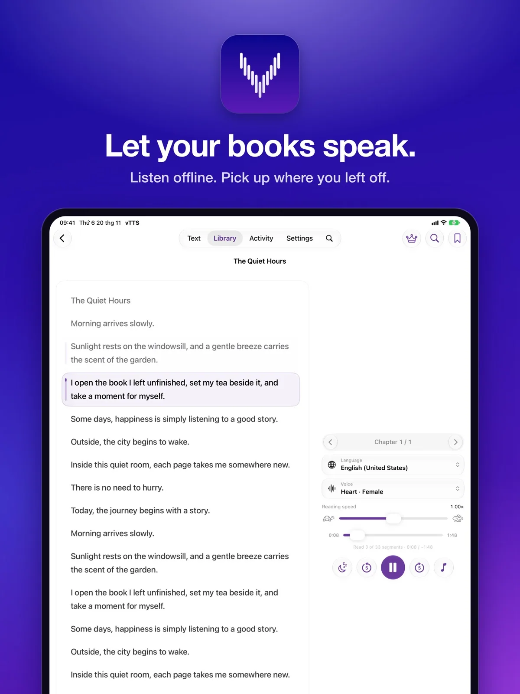

想让眼睛休息一下，或双手正忙时，可以用 [vTTS](/zh/vTTS/) 把 EPUB 和文档转换成越南语、英语等语言的朗读音频。语音在设备上生成，无需联网。本指南从导入电子书开始，演示如何导出可在其他播放器中收听的有声书。

## 支持的设备

本指南以 Apple 版为例。iPhone 和 iPad 需要 iOS 或 iPadOS 17 及以上版本，Mac 需要 macOS 14 及以上版本。vTTS 可从 [App Store](https://apps.apple.com/app/id6817003401) 或 [Google Play](https://play.google.com/store/apps/details?id=com.phamhungtien.vtts) 下载。语音随应用安装，首次启动即可离线收听。

## 第一步：导入书籍和文档

在 iPhone 或 iPad 上，从「文件」打开 `.epub` 文件，然后选择 vTTS，或通过分享菜单将文件交给应用。在 Mac 上，右键点按 Finder 中的 EPUB 并选择**打开方式 › vTTS**，也可在应用中使用**打开文档…**（<kbd>⌘</kbd> + <kbd>O</kbd>）。进入**书库**，按书名或作者搜索、收藏和整理电子书。

**文本**界面还可以打开 TXT、Markdown、HTML、RTF、PDF、DOCX、ODT 和 FB2，也可直接粘贴一篇文章或邮件。

- 如果 PDF 有文字层，vTTS 会优先使用其中的文字。扫描页面会在设备上进行 OCR。请查看应用给出的提示，因为识别时可能漏字或错字。
- 导入 DOCX、ODT 和 FB2 时会提取文本，原始版面可能无法完整保留。
- 加密或带 DRM 的文件、较旧的 Word 文件（`.doc`），以及 MOBI、AZW3、KFX 等 Kindle 格式不受支持。

## 第二步：选择语音与速度

在主界面选择**语言**、**音色**和**语速**。vTTS 提供英语、越南语和其他语言的内置语音。越南语有南部和北部口音，也可选择男声或女声。

播放时可以调整速度而不中断朗读。建议先用默认速度听一段。读小说时可放慢一点，听参考资料时则可适当加快。

## 第三步：跟随朗读内容

轻点播放后，应用会高亮显示正在朗读的句子。轻点任意句子即可从该处开始。vTTS 会记住每本书的播放位置，方便稍后继续。兼容的 iPhone 支持从锁定屏幕或灵动岛控制播放。也可用小组件和 Siri 继续收听。

## 第四步：设置睡眠定时器和背景音乐

**睡眠定时器**提供 5、15、30、45、60 和 90 分钟的预设，也可以自定 1 分钟到 23 小时 59 分钟的时长。时间到后，语音和音乐都会暂停，播放位置会保留。切换章节不会重置定时器。

如想在朗读中加入钢琴伴奏，可开启背景音乐并单独调整音量。音乐默认关闭。

## 第五步：导出音频或有声书

要在车里或另一台设备上收听，或分享音频，可使用导出功能。

- **音频格式**包括 WAV、M4A、AAC 和 MP3。MP3 支持 128、160、192 和 320 kbps。
- 默认只导出朗读。也可以加入钢琴伴奏，并分别设置音乐音量。
- 整本书可导出为带章节标记的 **M4B**，供 Apple Books 或其他兼容播放器使用。详细步骤请看 [M4B 导出指南](/zh/guides/export-m4b-audiobook-with-vtts/)。

免费版有使用限制。vTTS Premium 为可选的一次性购买，可解除收听、书籍数量和导出的限制。价格及适用功能请在应用内查看。

## 修正专有名词与缩写的发音

打开**设置 › 朗读 › 发音词典**，输入名称、品牌或缩写，再写入希望听到的发音。例如，可将「PHTV」设为「pê hát tê vê」。词典保存在本机，适用于播放、导出和局域网服务器。如开启对应的 iCloud 选项，也可同步词典。

vTTS 还可处理数字、日期、时间、百分比、货币、电话号码和常见越南语缩写，例如「TP.HCM」或「PGS. TS.」。也支持汉字的汉越音读法。

## 隐私与常见问题

设备上离线生成语音。书籍、草稿和历史记录保存在本机。启用 iCloud 同步后，所选类别也可以通过你的 iCloud 账户同步。Premium 提供的可选局域网文字转语音服务器默认关闭，开启后需要令牌。请仅在可信网络上使用。[vTTS 隐私政策](/zh/vTTS/privacy.html)

**可以听英语电子书吗？** 可以。选择英语和一种英语语音。越南语文本中混有英语单词时，vTTS 会检测语言来处理发音。

**为什么下载体积较大？** 语音模型随应用安装，以便离线使用。听书无需再单独下载模型。

**怎样反馈发音问题？** 请将应用版本和一段简短示例发送至 [contact@phamhungtien.com](mailto:contact@phamhungtien.com)，也可使用 [vTTS 页面](/zh/vTTS/)的讨论区。无需发送整本书或私人文档。
