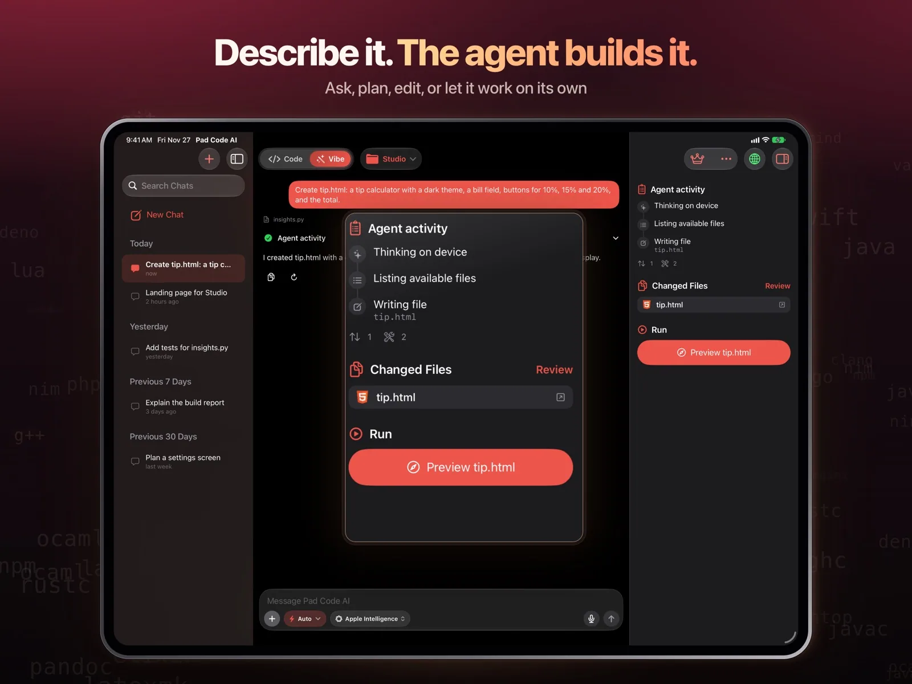

[Pad Code AI](/PadCodeAI/) includes a Python runtime that runs on your iPad or iPhone. Start with a short program using Python's standard library. The example runs locally and creates a file that you can review before saving to your project.



## Create a local project

1. On the home screen, choose **New Project** and give it a name, such as `Reading Log`.
2. Choose an empty project and save it to a folder you can access in Files. For a project that should be available offline, choose a location on your device.
3. Use **New File** in the project and name it `main.py`. If you selected a Python starter and already have `main.py`, open that file.

## Run a Python file

Enter this example in `main.py` and save it.

```python
from pathlib import Path

minutes = [18, 25, 12]
total = sum(minutes)
report = f"Reading time: {total} minutes\n"
print(report, end="")
Path("reading-log.txt").write_text(report, encoding="utf-8")
```

With the file open, tap **Run** and look for `Reading time: 55 minutes` in the output. If your project already has a different run entry, use the local terminal in Pad Code AI to run `python3 main.py` from the project folder.

## Review the generated file

The runtime works on a copy of the project. After the program finishes, **Review & Save** shows the generated `reading-log.txt`. Preview it and select it to keep it in the project. Run the script again with a changed list of numbers and review the result before replacing the saved file.

## Find and fix a syntax error

Remove the closing bracket in `minutes = [18, 25, 12]`, save and run again. Tap the diagnostic in the output to return to the reported location. Put the bracket back, then save and run to confirm the script works. For a runtime error that needs more investigation, tap a Python line number to set a breakpoint and inspect the variables when execution pauses.

Bundled runtimes support local projects. Some optional Python packages may need a network connection the first time you use them. The app's [privacy policy](/PadCodeAI/privacy.html) describes optional connections. See the [Pad Code AI page](/PadCodeAI/) for other runtimes and tools.
