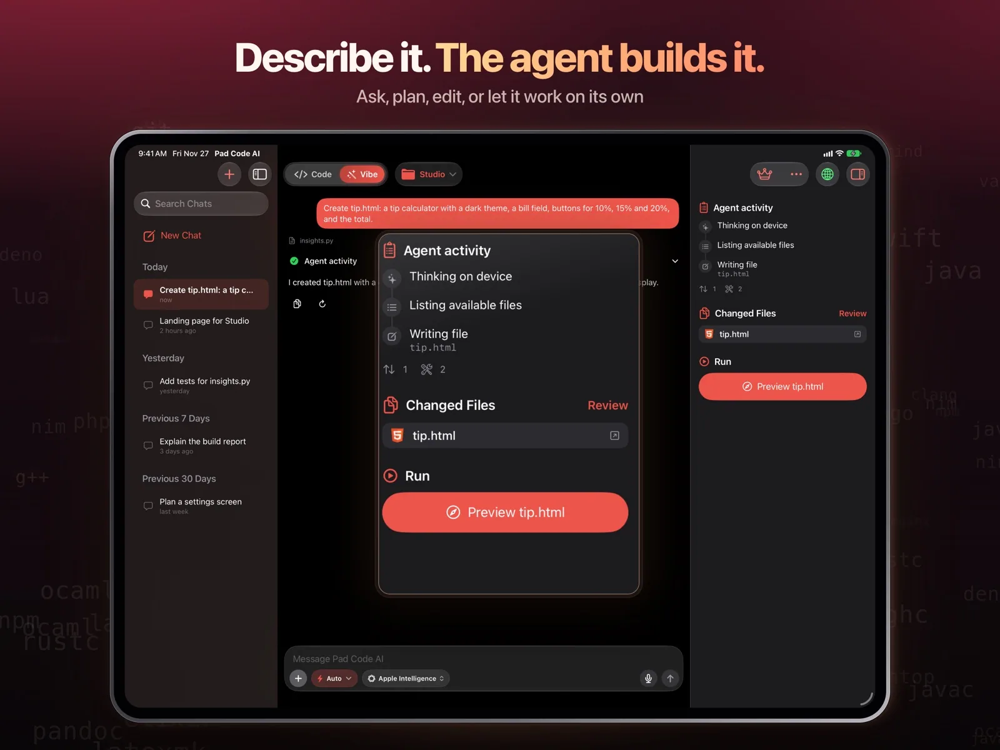

[Pad Code AI](/PadCodeAI/) permite ejecutar Python en el iPad o el iPhone. Para empezar, crearás un proyecto con un programa sencillo de la biblioteca estándar. El código suma el tiempo de varias sesiones de lectura y crea un archivo de texto que puedes revisar antes de guardarlo.



## Crea un proyecto local

1. En la pantalla de inicio, elige **Nuevo proyecto** y ponle un nombre, por ejemplo `Registro de lectura`.
2. Elige un proyecto vacío y guárdalo en una carpeta accesible desde Archivos. Para trabajar sin conexión, elige una carpeta que esté en tu dispositivo.
3. En el proyecto, toca **Nuevo archivo** y ponle el nombre `main.py`. Si has elegido una plantilla de Python que ya incluye `main.py`, abre ese archivo.

## Ejecuta el archivo de Python

Escribe este código en `main.py` y guarda el archivo.

```python
from pathlib import Path

minutes = [18, 25, 12]
total = sum(minutes)
report = f"Tiempo de lectura: {total} minutos\n"
print(report, end="")
Path("reading-log.txt").write_text(report, encoding="utf-8")
```

Con el archivo abierto, toca **Ejecutar**. En la salida debe aparecer `Tiempo de lectura: 55 minutos`. Si el proyecto ya tiene otro archivo de inicio, abre el terminal local de Pad Code AI y ejecuta `python3 main.py` desde la carpeta del proyecto.

## Revisa el archivo generado y guárdalo

El entorno de Python trabaja sobre una copia del proyecto. Al terminar, abre **Revisar y guardar** para ver `reading-log.txt`. Selecciona el archivo para conservarlo en el proyecto. Cambia los números de la lista y vuelve a ejecutar el programa. Así podrás comprobar el resultado antes de sustituir el archivo guardado.

## Localiza y corrige un error de sintaxis

Quita el corchete final de `minutes = [18, 25, 12]`, guarda el archivo y vuelve a ejecutar el programa. Toca el mensaje de error para volver al punto que indica. Coloca de nuevo el corchete, guarda y ejecuta el código para comprobar que funciona. Si quieres examinar qué ocurre durante la ejecución, toca un número de línea para poner un punto de interrupción y consulta los valores de las variables cuando el programa se detenga.

## Uso sin conexión y descarga

Este ejemplo funciona con la biblioteca estándar y no necesita funciones de IA. Algunos paquetes adicionales de Python requieren conexión la primera vez que se usan. La [política de privacidad de Pad Code AI (en inglés)](/PadCodeAI/privacy.html) detalla las funciones que se conectan a otros servicios.

[Descarga Pad Code AI en el App Store](https://apps.apple.com/app/id6774398897) y prueba el proyecto en tu dispositivo. Si después quieres funciones adicionales como el editor dividido, consulta en la app qué incluye cada opción y sus condiciones de compra.
