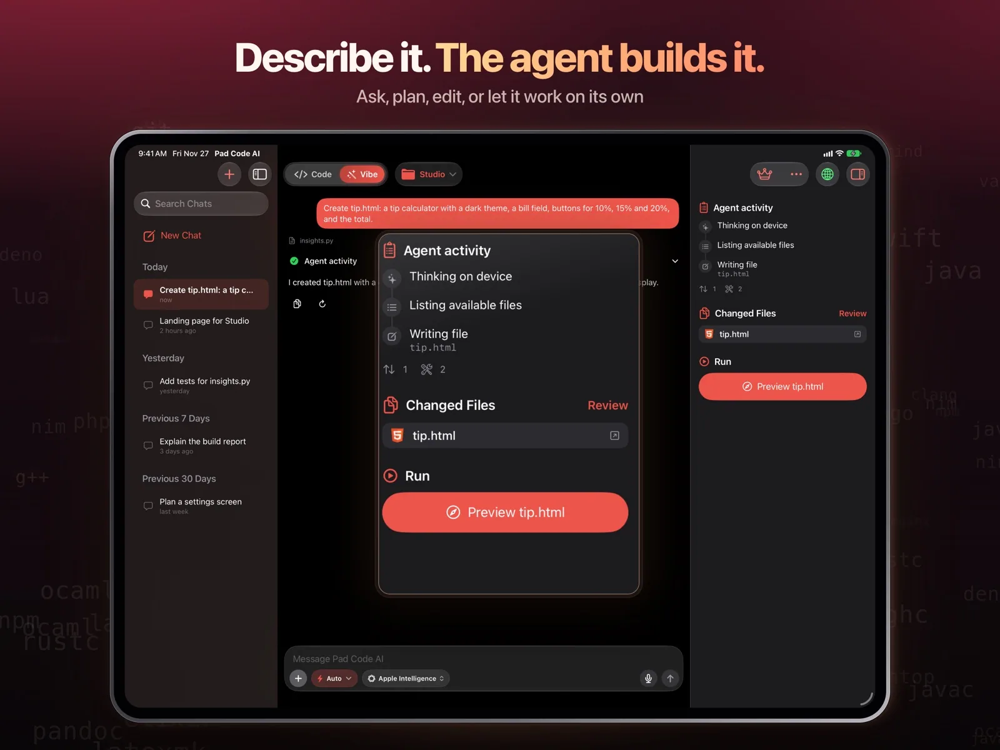

[Pad Code AI](/PadCodeAI/)を使うと、iPadやiPhoneでPythonのコードを実行できます。まずは標準ライブラリだけを使った小さなプロジェクトを作りましょう。読書時間を合計するコードを端末上で動かし、出力を確かめてから、生成されたテキストファイルを保存します。



## 端末にプロジェクトを作る

1. ホーム画面で**新規プロジェクト**を選び、`Reading Log`などの名前を付けます。
2. 空のプロジェクトを選び、「ファイル」アプリでアクセスできるフォルダに保存します。オフラインで作業するなら、iPadやiPhone本体のフォルダを選びます。
3. プロジェクト内で**新規ファイル**を選び、`main.py`を作ります。Pythonのテンプレートを選んで`main.py`がすでにある場合は、そのファイルを開きます。

## Pythonファイルを実行する

`main.py`に次のコードを入力して保存します。

```python
from pathlib import Path

minutes = [18, 25, 12]
total = sum(minutes)
report = f"読書時間は合計{total}分です。\n"
print(report, end="")
Path("reading-log.txt").write_text(report, encoding="utf-8")
```

ファイルを開いたまま**実行**をタップします。出力に`読書時間は合計55分です。`と表示されれば成功です。別のファイルを実行するようにプロジェクトが設定されている場合は、Pad Code AIのローカルターミナルを開き、プロジェクトのフォルダで`python3 main.py`を実行します。

## 生成されたファイルを確認して保存する

Pythonの実行環境はプロジェクトのコピーを使います。実行後に**確認して保存**を開き、生成された`reading-log.txt`の内容を確かめます。ファイルにチェックを入れて保存すると、プロジェクトに追加されます。リスト内の数字を変えてもう一度実行し、保存済みのファイルを置き換える前に新しい結果を確認してみましょう。

## 構文エラーを見つけて直す

`minutes = [18, 25, 12]`の末尾にある`]`を削除し、保存してもう一度実行します。出力のエラーメッセージをタップすると、報告された箇所に戻れます。`]`を元に戻して保存し、正常に実行できることを確認します。実行中の挙動を調べるには、Pythonファイルの行番号をタップしてブレークポイントを設定し、処理が一時停止したときに変数の値を確認します。

## オフラインで使える範囲と入手方法

この例の実行に追加パッケージやAI機能は不要です。Pythonの追加パッケージは、種類によって初回利用時にインターネット接続が必要です。ネットワークを使う機能は[Pad Code AIのプライバシーポリシー（英語）](/PadCodeAI/privacy.html)に記載されています。

[Pad Code AIをApp Storeで入手](https://apps.apple.com/app/id6774398897)して、このプロジェクトから試してみましょう。分割エディタなどの追加機能が必要になったら、アプリ内に表示される対象機能と購入条件を確認できます。
