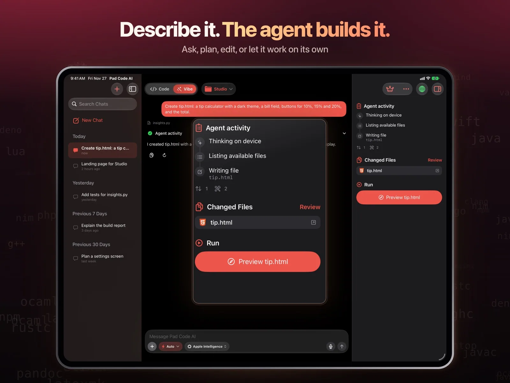

[Pad Code AI](/vi/PadCodeAI/) có trình chạy Python tích hợp trên iPad và iPhone. Bài này dùng một chương trình nhỏ từ thư viện chuẩn để bạn thử chạy mã trên thiết bị, sửa lỗi cú pháp và lưu một tệp kết quả vào dự án.



## Tạo dự án trên thiết bị

1. Ở màn hình chính, chọn **Dự án mới** (New Project) và đặt tên, chẳng hạn `Reading Log`.
2. Chọn dự án trống và nơi lưu trong ứng dụng Tệp. Nếu cần làm việc khi mất mạng, hãy chọn thư mục lưu trên thiết bị.
3. Tạo **Tệp mới** (New File) trong dự án và đặt tên `main.py`. Nếu đã chọn mẫu Python có sẵn `main.py`, hãy mở tệp đó.

## Chạy tệp Python

Nhập đoạn mã sau vào `main.py` rồi lưu lại.

```python
from pathlib import Path

minutes = [18, 25, 12]
total = sum(minutes)
report = f"Reading time: {total} minutes\n"
print(report, end="")
Path("reading-log.txt").write_text(report, encoding="utf-8")
```

Khi tệp đang mở, bấm **Chạy** (Run) và tìm dòng `Reading time: 55 minutes` trong phần kết quả. Nếu cấu hình dự án đang chạy một tệp khác, mở Terminal cục bộ trong Pad Code AI và chạy `python3 main.py` từ thư mục dự án.

## Xem trước tệp được tạo rồi lưu

Trình chạy làm việc trên một bản sao của dự án. Khi chương trình kết thúc, mở **Xem lại và lưu** (Review & Save) để xem tệp `reading-log.txt`. Chọn tệp nếu muốn giữ trong dự án. Bạn có thể sửa danh sách số phút, chạy lại và xem kết quả mới trước khi thay tệp đã lưu.

## Tìm và sửa lỗi cú pháp

Thử xóa dấu ngoặc vuông đóng trong dòng `minutes = [18, 25, 12]`, lưu rồi chạy lại. Chạm vào thông báo lỗi để quay về vị trí được báo. Đặt lại dấu ngoặc và chạy để xác nhận chương trình hoạt động. Khi lỗi xảy ra trong lúc chạy, bạn có thể chạm số dòng để đặt điểm dừng và kiểm tra giá trị biến.

Các trình chạy đi kèm xử lý dự án ngay trên máy. Một số gói Python bổ sung có thể cần mạng khi dùng lần đầu. Xem [chính sách quyền riêng tư](/vi/PadCodeAI/privacy.html) để biết các kết nối tùy chọn, hoặc [trang Pad Code AI](/vi/PadCodeAI/) để xem thêm ngôn ngữ và công cụ.
