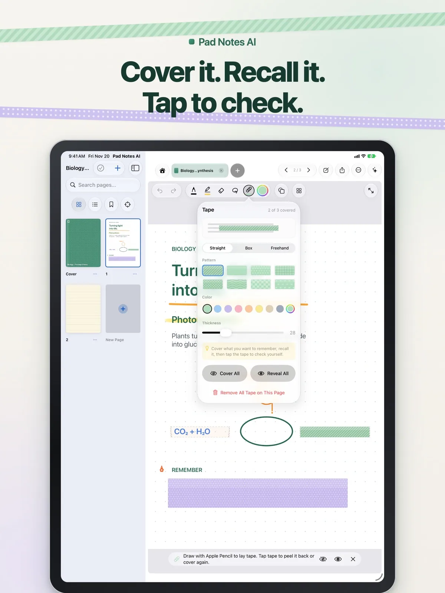

[Pad Notes AI](/PadNotesAI/) turns a PDF into notebook pages you can mark up. Memorization tape lets you cover an answer, recall it and tap to check. Try it with a handout or a practice worksheet on iPad.

## Import a PDF and annotate it

From the library, use **Import PDF or Image** and pick a handout from Files. Select a page range if you only need part of it. Open an imported page and add annotations with the pen or highlighter. You can also create a **New Notebook** and write questions and answers on a blank page.

## Place tape over the answers

1. Select **Tape** in the writing toolbar. Tap the tool again to pick a shape, pattern, color and thickness.
2. Choose a straight strip for one line, a box for a paragraph or freehand to follow an irregular shape.
3. Draw the tape with Apple Pencil. If finger drawing is enabled, drag with a finger. The tool remains selected until you change tools.
4. If a strip covers too much, press and hold it to edit it, or remove it with the eraser.

## Test yourself in place

Read the question without uncovering the answer. Try to say or write it from memory, then tap the strip to peel it back. Tap again to cover it. When you have several strips on a page, use **Cover All** or **Reveal All** in the tape options to change them together. Repeat first with the answers you missed.

## Export a PDF for review

Open the notebook's actions and choose **Export Notebook as PDF**. The export reflects the current tape state. Covered strips appear in the PDF, and peeled strips are omitted. If you want an answer copy, use **Reveal All** first and review the resulting PDF before sending it. Keep the notebook if you want to retain the interactive tape. For confidential text, use a dedicated redaction workflow before sharing a PDF.

See the [Pad Notes AI page](/PadNotesAI/) for notebook, handwriting and PDF tools or the [privacy policy](/PadNotesAI/privacy.html) for how imported material is handled.
