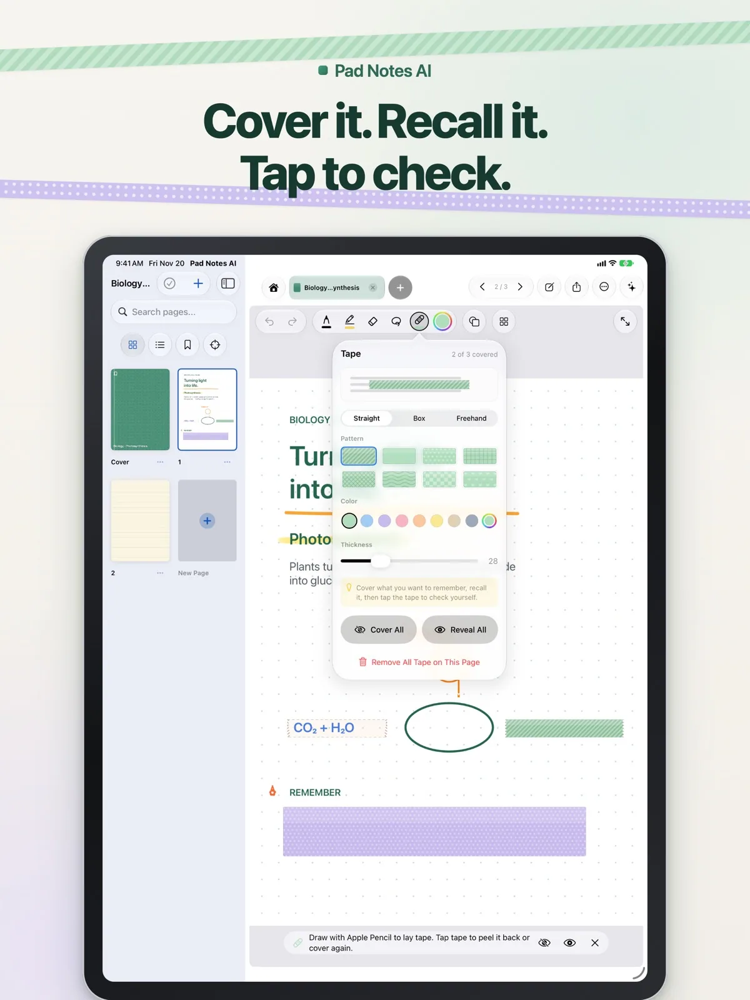

[Pad Notes AI](/es/PadNotesAI/) convierte un PDF en páginas de cuaderno en las que puedes escribir. Con la cinta para memorizar puedes tapar una respuesta, tratar de recordarla y tocar la cinta para comprobarla. Pruébalo con un apunte o una hoja de ejercicios en iPad.

## Importa y anota el PDF

Desde la biblioteca, elige **Importar PDF o imagen** y selecciona un documento en Archivos. Si solo necesitas algunas páginas, elige el intervalo. Abre una página importada y anota con el bolígrafo o el resaltador. También puedes crear un **Nuevo cuaderno** y escribir tus preguntas y respuestas en una página en blanco.

## Cubre las respuestas con cinta

1. Selecciona la **Cinta** en la barra de escritura. Toca la herramienta de nuevo para ajustar forma, patrón, color y grosor.
2. Usa una tira recta para una línea, un recuadro para un párrafo o el trazo libre para una zona irregular.
3. Dibuja con Apple Pencil. Si tienes activada la escritura con el dedo, también puedes arrastrarlo sobre la página. La herramienta sigue activa hasta que la cambies.
4. Si una tira tapa demasiado, mantenla pulsada para editarla o quítala con la goma.

## Repasa directamente en la página

Lee la pregunta e intenta responder de memoria. Toca la tira para ver la respuesta y vuelve a tocarla para taparla. Si tienes varias tiras, usa las opciones para **Cubrir todo** o **Revelar todo** a la vez. En la siguiente vuelta, empieza por las respuestas que no recordaste.

## Guarda una copia de repaso

En las opciones del cuaderno, selecciona **Exportar cuaderno como PDF**. Las tiras que tapan respuestas se ven en el archivo y las destapadas quedan fuera. Para exportar una copia con las respuestas visibles, usa **Revelar todo** y revisa el archivo antes de enviarlo. Conserva el cuaderno para seguir usando la cinta interactiva. Si necesitas retirar información confidencial, usa una herramienta de censura de PDF que elimine el contenido subyacente.

Consulta la [página de Pad Notes AI](/es/PadNotesAI/) y la [política de privacidad](/es/PadNotesAI/privacy.html) para conocer las herramientas de escritura y cómo se tratan los archivos importados.
