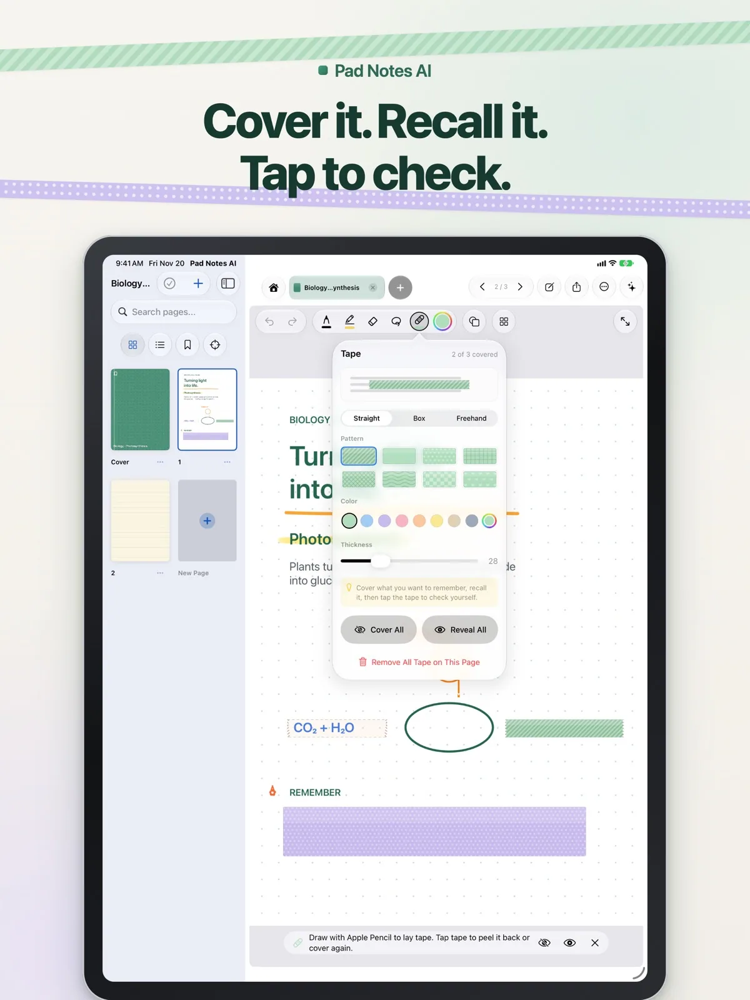

[Pad Notes AI](/ja/PadNotesAI/)では、PDFをノートのページに取り込んで書き込めます。暗記テープで答えを隠し、思い出してからタップで答え合わせをしましょう。iPadで授業のプリントや練習問題を使って試せます。

## PDFを取り込んで書き込む

ライブラリからPDFまたは画像の読み込みを選び、「ファイル」の資料を開きます。必要な一部のページを指定することもできます。読み込んだページでペンやマーカーを使って書き込みます。新規ノートを作って、白紙に質問と答えを書いても構いません。

## 答えの上に暗記テープを貼る

1. 書き込みツールバーのテープを選び、もう一度タップして形、柄、色、太さを選びます。
2. 1行なら直線、段落なら四角、形に沿って隠すならフリーハンドを使います。
3. Apple Pencilでテープを描きます。指で描画する設定が有効なら、指でもドラッグできます。別のツールを選ぶまでテープが選択されたままになります。
4. 範囲が広すぎたらテープを長押しして編集するか、消しゴムで削除します。

## 答えを隠したまま復習する

問題を読んで、答えを声に出すか書き出します。テープをタップして答えを確認し、もう一度押して隠します。複数のテープを使っているページでは、テープの設定から「すべて隠す」「すべて表示」でまとめて切り替えられます。間違えた答えから繰り返します。

## 復習用のPDFを書き出す

ノートの操作メニューでPDFへの書き出しを選びます。現在の表示状態が反映され、隠しているテープはPDFに入り、剥がしたテープは表示されません。解答付きのPDFが必要なら「すべて表示」にして、送る前に書き出したPDFを開いて確認します。タップで剥がせるテープを残すには元のノートを保持します。機密情報を含むPDFの共有には、専用の墨消し処理を使ってください。

ノート、手書き、PDFの機能は[Pad Notes AIのページ](/ja/PadNotesAI/)、取り込んだ資料の取り扱いは[プライバシーポリシー](/ja/PadNotesAI/privacy.html)で確認できます。
