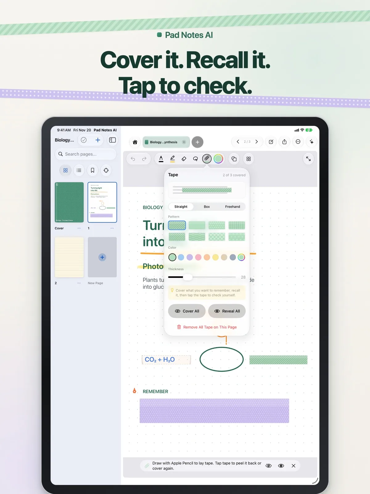

[Pad Notes AI](/vi/PadNotesAI/) biến các trang PDF thành trang sổ tay để bạn ghi chú và đánh dấu. Với băng dính ghi nhớ, bạn có thể che đáp án để tự trả lời, sau đó chạm vào băng để kiểm tra. Hãy thử với một phiếu bài tập hoặc tài liệu đã tải về iPad.

## Nhập PDF và ghi chú

Tại thư viện, chọn **Nhập PDF hoặc hình ảnh** rồi chọn tài liệu từ ứng dụng Tệp. Nếu chỉ cần một phần, chọn khoảng trang phù hợp. Mở trang vừa nhập, dùng bút hoặc bút tô sáng để ghi chú. Bạn cũng có thể tạo **Sổ tay mới**, rồi tự viết câu hỏi và đáp án trên trang trống.

## Dán băng lên từng đáp án

1. Chọn **Băng dính** trên thanh công cụ viết. Chạm lại công cụ để chọn kiểu, họa tiết, màu và độ dày.
2. Dùng dải thẳng cho một dòng, kiểu khung cho đoạn dài hoặc kiểu vẽ tự do cho vùng có hình dạng bất kỳ.
3. Vẽ bằng Apple Pencil. Nếu bật vẽ bằng ngón tay, bạn có thể kéo ngón tay để dán băng. Công cụ vẫn được chọn tới khi bạn chuyển sang công cụ khác.
4. Nếu che quá rộng, chạm giữ dải băng để chỉnh hoặc dùng tẩy để bỏ.

## Tự kiểm tra ngay trên trang

Đọc câu hỏi và thử nói hoặc viết đáp án ra trước. Chạm dải băng để bóc, xem đáp án, rồi chạm lần nữa để che lại. Nếu trang có nhiều dải, mở tùy chọn băng dính và dùng **Che tất cả** hoặc **Bóc tất cả**. Khi ôn lại, ưu tiên câu bạn vừa trả lời sai hoặc chưa nhớ.

## Xuất tệp PDF để xem lại

Mở các thao tác của sổ tay và chọn **Xuất sổ tay dưới dạng PDF**. Dải đang che sẽ xuất hiện trong tệp, còn dải đã bóc sẽ được bỏ qua. Nếu muốn một bản có đáp án, hãy dùng **Bóc tất cả**, rồi mở lại PDF đã xuất để kiểm tra trước khi gửi. Giữ sổ tay gốc nếu muốn tiếp tục dùng băng tương tác. Với thông tin mật, hãy dùng công cụ xóa nội dung vĩnh viễn khỏi PDF trước khi chia sẻ.

Xem [trang Pad Notes AI](/vi/PadNotesAI/) để tìm hiểu các công cụ viết tay và PDF, hoặc đọc [chính sách quyền riêng tư](/vi/PadNotesAI/privacy.html) để biết cách ứng dụng xử lý tài liệu đã nhập.
