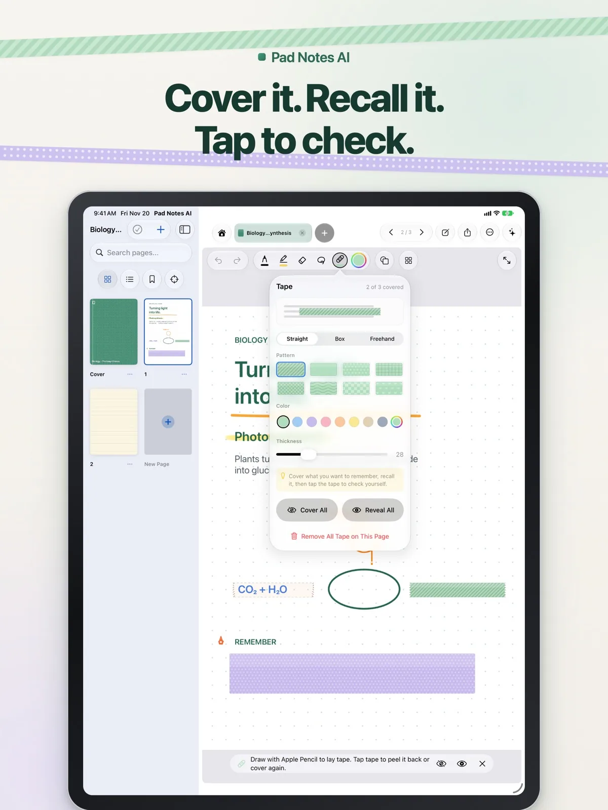

[Pad Notes AI](/zh/PadNotesAI/) 可以把 PDF 导入为可批注的笔记页。用记忆胶带遮住答案，从记忆中作答，再轻点揭开核对。可以用 iPad 上的一份讲义或练习题试试。

## 导入 PDF 并批注

在笔记库中选择**导入 PDF 或图像**，从「文件」中打开讲义。如果只需其中一部分，可选择页码范围。打开一页，用笔或荧光笔添加批注。也可**新建笔记本**，在空白页写下问题和答案。

## 用胶带盖住答案

1. 在书写工具栏中选择**胶带**。再次轻点工具，可选择形状、图案、颜色和粗细。
2. 单行答案可用直线，整段可用方框，不规则区域可用自由形状。
3. 用 Apple Pencil 画出胶带。若已启用手指绘制，也可用手指拖动。切换工具前，胶带工具会一直选中。
4. 如果盖住了过多内容，长按胶带编辑，或用橡皮擦移除。

## 在页面上自测

不要先揭开答案。试着从记忆中说出或写出答案，再轻点胶带揭开核对。再次轻点可重新盖住。若一页上有多个遮挡，可在胶带选项中用**全部遮住**或**全部揭开**统一操作。优先复习答错的题。

## 导出 PDF 用于复习

打开笔记本操作菜单，选择**将笔记本导出为 PDF**。导出会保留当前胶带状态。已遮住的胶带会出现在 PDF 中，已揭开的胶带不会显示。如果要导出带完整答案的版本，先选择**全部揭开**，再检查结果。要保留可交互的胶带，请保留原笔记本。分享机密文本时，请先用专门的 PDF 涂黑工具处理。

更多手写与 PDF 功能见 [Pad Notes AI 产品页面](/zh/PadNotesAI/)。有关应用如何处理导入内容，请查看[隐私政策](/zh/PadNotesAI/privacy.html)。
