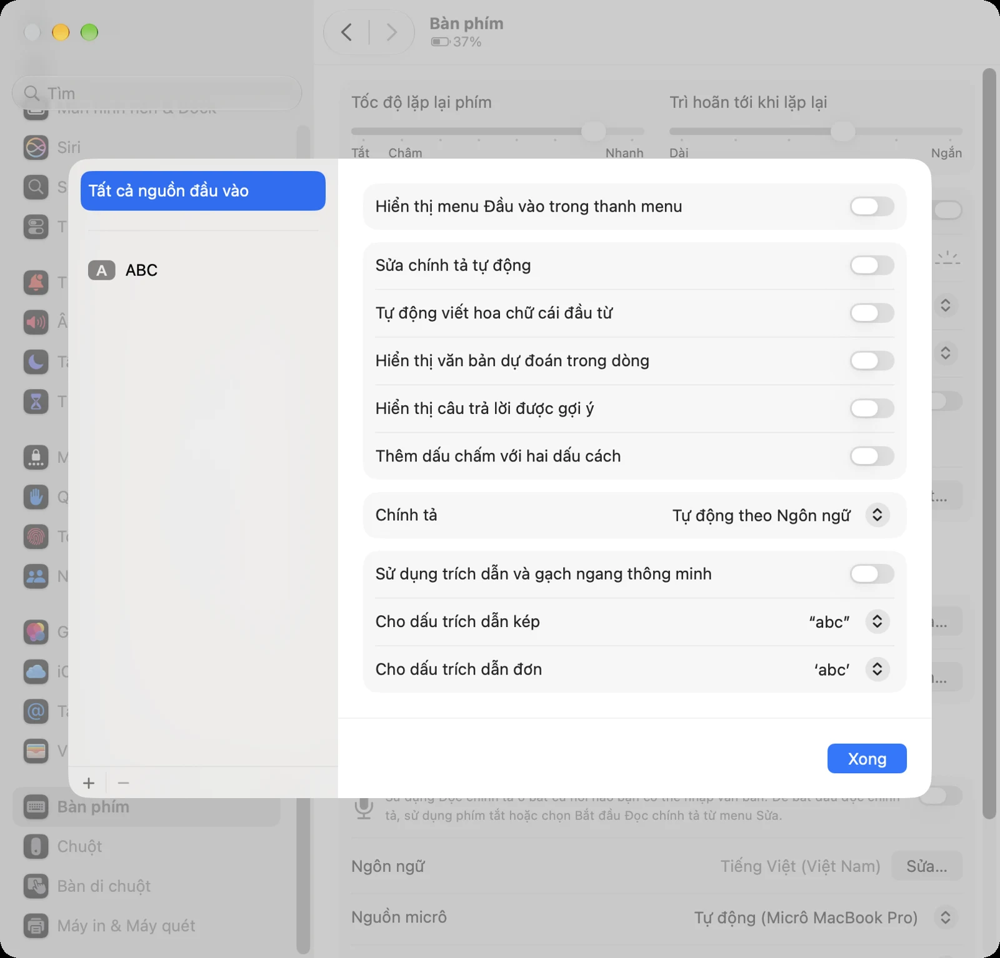
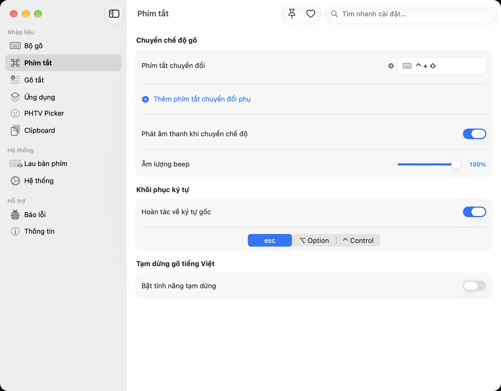

If **được** becomes **đđược**, accents disappear in a browser, or typing stops after a macOS update, try the same word in TextEdit first. That test can help you identify whether the issue affects PHTV everywhere or only one app.

## Check mode, permission and keyboard source

1. Choose **Vietnamese** in the PHTV menu and **ABC** or **U.S.** in the macOS input menu.
2. Check that PHTV reports its required permission as granted. The permission is **Accessibility** on macOS 26 and earlier, **Device Control and Data Access** on macOS 27.0–27.2, and **System & App Protection Override** on macOS 27.3 and later.
3. In TextEdit using Telex, type `vieejt`. If you see **việt**, skip to the section for the app where the issue occurs. If letters stay unaccented there too, revisit [setup and permissions](/en/guides/go-tieng-viet-tren-mac-voi-phtv/).

## Repeated letters or spelling autocorrections

When an input method replaces letters with an accented syllable, macOS autocorrection can try to rewrite the same letters at the same time. Open **System Settings › Keyboard**, then click **Edit** for Input Sources and disable automatic spelling correction and inline predictive text. If necessary, also try disabling automatic capitalization, smart punctuation or the double-space period option. Test one change at a time in the affected app.

If the issue occurs only when a shortcut expands, check whether both PHTV and macOS Text Replacements are handling it. See [PHTV macro setup](/en/guides/go-tat-tren-mac-voi-phtv/).

## Accents vanish in a browser, spreadsheet or chat app

Address-bar suggestions and autocomplete fields can alter text while PHTV is placing an accent. Update PHTV first. If the issue persists, open **Settings › Apps** and try the per-app option to send individual keystrokes for that app. Test the same word in a regular text field and in the address bar. In a spreadsheet, finish typing in the current cell and confirm it with <kbd>Enter</kbd> or <kbd>Tab</kbd> before moving elsewhere.

## Typing stopped after an update

Open PHTV and use the permission prompt to open the relevant pane of **System Settings › Privacy & Security**. Confirm the installed PHTV app is enabled, then quit and reopen it. If macOS refuses to open PHTV, download a fresh copy from the [official releases page](https://github.com/PhamHungTien/PHTV/releases/latest) and follow the [installation instructions](/en/guides/go-tieng-viet-tren-mac-voi-phtv/). Contact support with the exact macOS alert if it persists.

## Accents appear in terminal commands or code

In **Settings › Apps**, set your terminal or code editor to use English input or enable per-app language memory. This keeps Vietnamese available in other apps. When you type an occasional English word in a Vietnamese passage, PHTV's automatic restoration can restore recognized words when you press Space.

## Text displays characters such as Ã, Â or ½

Check **Settings › Input › Encoding** and choose **Unicode** for current apps. An old document may instead need conversion from its original encoding. Follow the [Vietnamese character encoding guide](/en/guides/bang-ma-tieng-viet-unicode-tcvn3-vni/) for TCVN3 and VNI Windows.

## The switching shortcut does nothing

Some apps or macOS shortcuts may already use <kbd>Control</kbd> + <kbd>Shift</kbd>. Try switching mode from PHTV's menu bar item. If that works, change or add a switching shortcut under **Settings › Shortcuts**.

## Report a reproducible issue

Include your PHTV and macOS versions, the app name, input method, encoding, and a short example anyone can type. If you use **Report an Issue** in PHTV, review its diagnostic details before sharing. You can report publicly in [GitHub Issues](https://github.com/PhamHungTien/PHTV/issues) or email [contact@phamhungtien.com](mailto:contact@phamhungtien.com).
