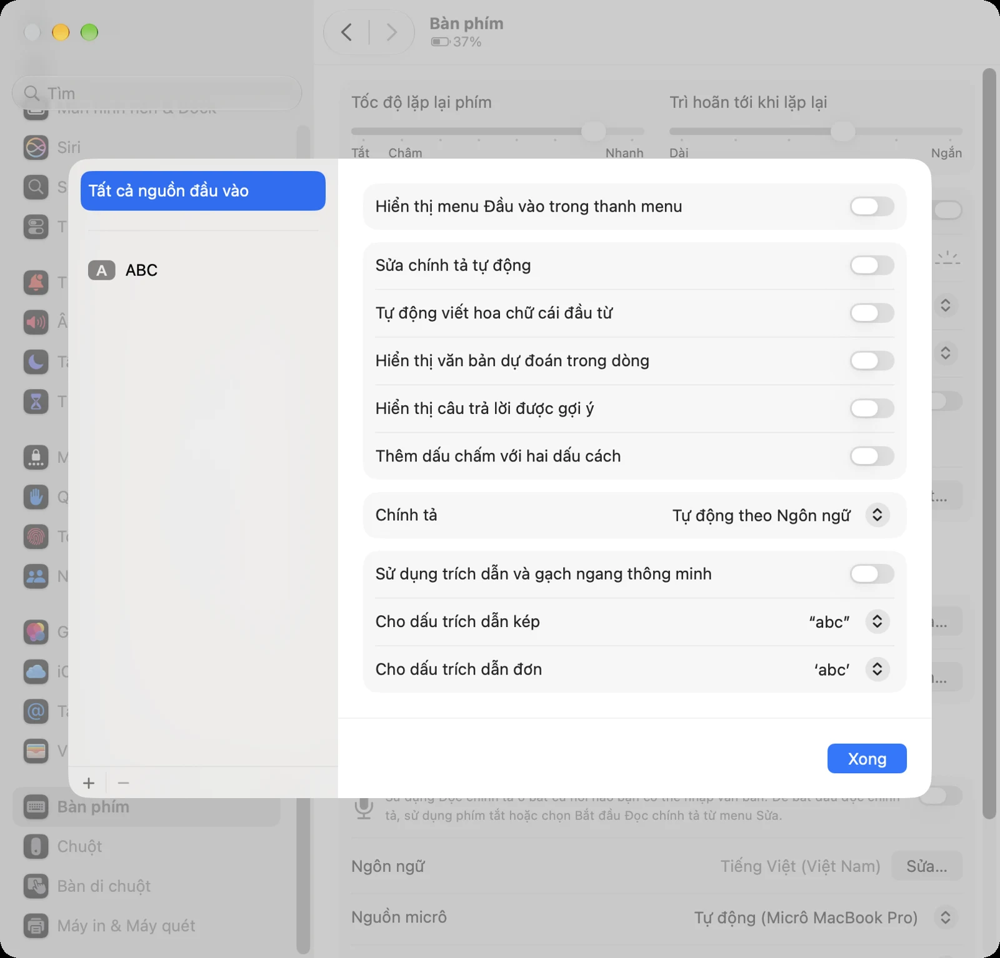
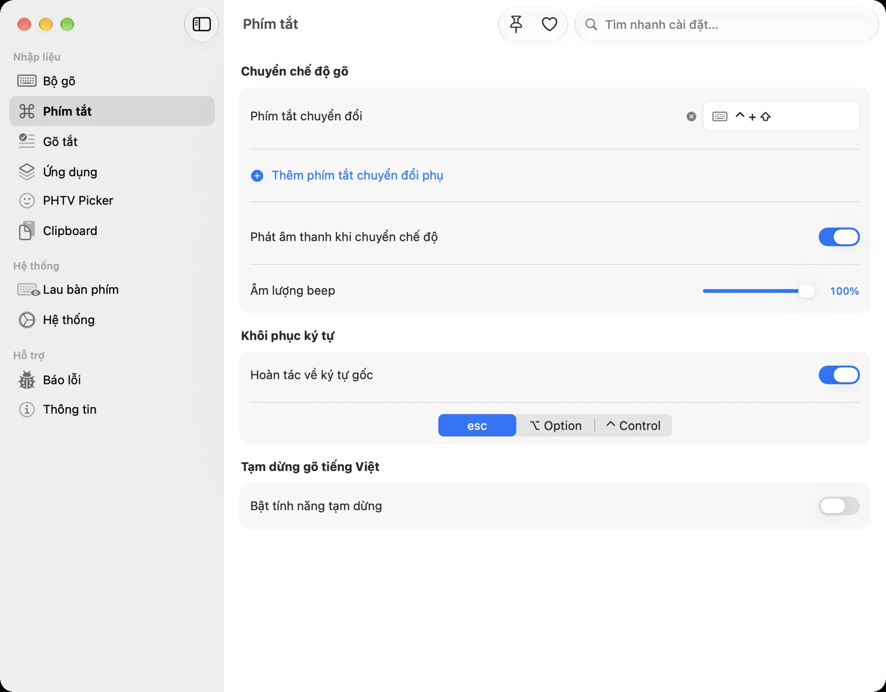

Si **được** se convierte en **đđược**, las tildes desaparecen en el navegador o dejas de poder escribir después de actualizar macOS, prueba primero la misma palabra en TextEdit. Así puedes saber si el problema afecta a todas las aplicaciones o solo a una.

## Comprueba el modo, el permiso y el teclado

1. Elige **Vietnamita** en el menú de PHTV y **ABC** o **U.S.** como fuente de entrada en macOS.
2. Comprueba que PHTV muestre su permiso como concedido. Es **Accesibilidad** en macOS 26 o anterior, **Device Control and Data Access** en macOS 27.0–27.2 y **System & App Protection Override** en macOS 27.3 o posterior.
3. Con Telex, escribe `vieejt` en TextEdit. Si ves **việt**, revisa el problema en la app afectada. Si tampoco salen las marcas en TextEdit, vuelve a [la configuración y los permisos](/es/guides/go-tieng-viet-tren-mac-voi-phtv/).

## Se repiten letras o se corrigen palabras

La corrección automática de macOS puede intentar reescribir la misma sílaba que PHTV está componiendo. Ve a **Ajustes del Sistema › Teclado**, pulsa **Editar** en Fuentes de entrada y desactiva la corrección ortográfica automática y las sugerencias de texto en línea. Si hace falta, prueba las opciones de mayúsculas automáticas, puntuación inteligente y punto con doble espacio de una en una.

Si solo ocurre al expandir una abreviatura, comprueba si la manejan a la vez PHTV y macOS. Consulta [cómo configurar las macros](/es/guides/go-tat-tren-mac-voi-phtv/).

## Se pierden las tildes en el navegador o en un campo concreto

Las sugerencias de la barra de direcciones y los campos de autocompletado pueden cambiar el texto a la vez que el método de entrada. Actualiza PHTV y prueba la misma palabra en un campo normal. Si el problema sigue, abre **Ajustes › Apps** y prueba la opción de enviar pulsaciones individuales para esa aplicación. En una hoja de cálculo, completa la celda con <kbd>Intro</kbd> o <kbd>Tab</kbd> antes de pasar a otra.

## PHTV deja de escribir tras una actualización

En el aviso de PHTV, abre el panel correspondiente de **Ajustes del Sistema › Privacidad y seguridad**. Confirma que la versión instalada tenga el permiso activo, sal de PHTV y vuelve a abrirlo. Si el sistema impide abrir la app, descarga otra copia desde [la página oficial de versiones](https://github.com/PhamHungTien/PHTV/releases/latest) y sigue la [guía de instalación](/es/guides/go-tieng-viet-tren-mac-voi-phtv/). Si el aviso persiste, incluye su texto exacto al pedir ayuda.

## Aparecen signos al escribir código o comandos

En **Ajustes › Apps**, asigna inglés a la terminal o al editor, o activa la memoria de idioma por app. Para una palabra inglesa ocasional dentro de texto vietnamita, la recuperación automática puede restaurar palabras reconocidas al pulsar espacio.

## Aparecen caracteres como Ã, Â o ½

En **Ajustes › Entrada › Codificación**, elige **Unicode** para las apps actuales. Si el problema está en un documento antiguo, consulta la [guía de codificaciones vietnamitas](/es/guides/bang-ma-tieng-viet-unicode-tcvn3-vni/) para convertir TCVN3 o VNI Windows.

## El atajo de cambio de idioma no responde

La app activa u otro atajo de macOS pueden usar <kbd>Control</kbd> + <kbd>Mayús</kbd>. Intenta cambiar desde el menú de PHTV. Si funciona, cambia o añade un atajo en **Ajustes › Atajos**.

## Informa de un problema reproducible

Incluye las versiones de PHTV y macOS, el nombre de la app, el método de entrada, la codificación y un ejemplo breve que pueda escribir otra persona. Si usas **Informar de un problema** en PHTV, revisa los datos de diagnóstico antes de compartirlos. Puedes escribir en [GitHub Issues](https://github.com/PhamHungTien/PHTV/issues) o a [contact@phamhungtien.com](mailto:contact@phamhungtien.com).
