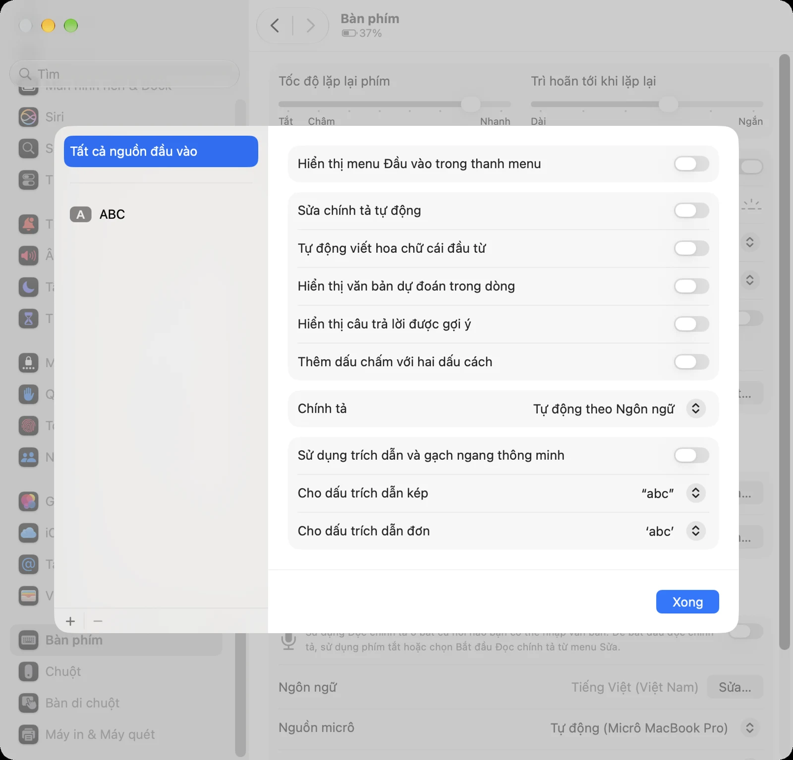
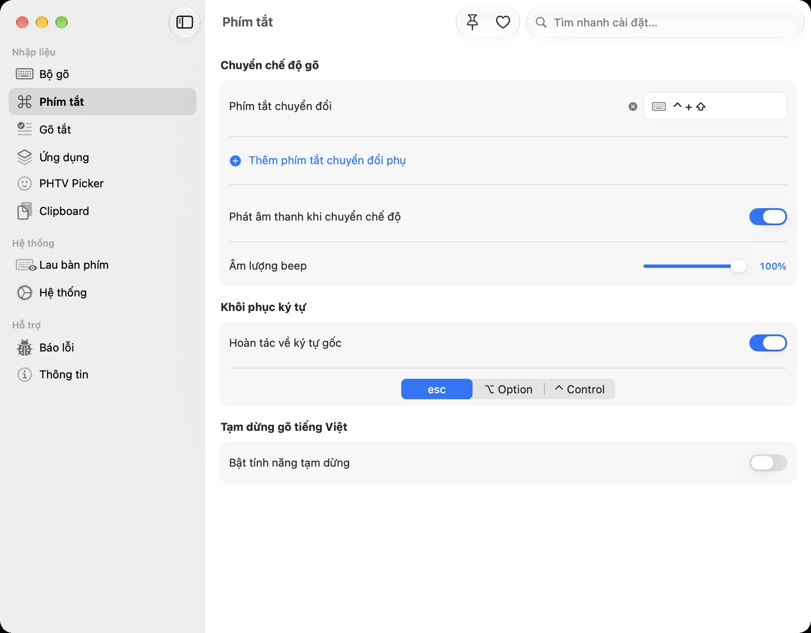

**được**が**đđược**になる、ブラウザーで記号が消える、macOSの更新後に入力できなくなるときは、同じ単語をテキストエディットで試します。PHTV全体の問題か、特定のアプリでだけ起きる問題かを切り分けられます。

## 入力モード、権限、入力ソースを確認する

1. PHTVのメニューでベトナム語、macOSの入力メニューで**ABC**または**U.S.**を選びます。
2. PHTVが必要な権限を取得済みか確認します。macOS 26以前は**アクセシビリティ**、27.0〜27.2は**Device Control and Data Access**、27.3以降は**System & App Protection Override**です。
3. テキストエディットでTelexの`vieejt`を入力します。**việt**になれば、症状のあるアプリの項目へ進みます。記号が付かない場合は、[セットアップと権限](/ja/guides/go-tieng-viet-tren-mac-voi-phtv/)を再確認します。

## 文字の重複やスペルの自動修正

入力アプリが文字を声調付きの音節に置き換えるのと同時に、macOSが同じ文字を修正する場合があります。「システム設定 → キーボード」で入力ソースの「編集」を開き、スペルの自動修正とインラインの予測入力をオフにします。必要なら、文頭の自動大文字化、スマート引用符などの句読点、スペース2回でピリオドを入力する設定も確認します。症状の出るアプリで一つずつ試してください。

定型文の展開時だけ起きる場合は、PHTVとmacOSのユーザ辞書が同じ短縮入力を処理していないか確認します。[PHTVのマクロ設定](/ja/guides/go-tat-tren-mac-voi-phtv/)

## ブラウザー、表計算、チャットで記号が消える

アドレスバーの候補や自動補完が、PHTVの記号を付ける処理に重なることがあります。まずPHTVを更新します。改善しない場合は「設定」のアプリ別設定で、対象のアプリにキーを一つずつ送るオプションを試します。通常の入力欄とアドレスバーで同じ単語を試してください。表計算アプリでは、セルの入力を<kbd>Enter</kbd>または<kbd>Tab</kbd>で確定してから他のセルに移ります。

## 更新後に入力できなくなった

PHTVの権限の案内から「システム設定 → プライバシーとセキュリティ」の該当項目を開きます。インストールしたPHTVが有効になっていることを確認し、終了して開き直します。macOSがPHTVを開けない場合は[公式リリース](/ja/PHTV/#install)または[GitHub Releases](https://github.com/PhamHungTien/PHTV/releases/latest)から取得し、[インストール手順](/ja/guides/go-tieng-viet-tren-mac-voi-phtv/)に沿って入れ直します。問題が続く場合は、macOSの警告文を添えて問い合わせてください。

## コマンドやコードに記号が付く

アプリ別設定で、ターミナルやコードエディターの入力を英語にするか、アプリごとに入力言語を記憶させます。ほかのアプリではベトナム語を使えます。ベトナム語の文に英単語を混ぜる場合は、Spaceを押したときに認識した英単語を元に戻す自動復元を利用できます。

## Ã、Â、½などの文字が出る

PHTVの入力設定で文字コードを確認し、現在のアプリでは**Unicode**を選びます。旧来の文書は元の文字コードから変換する場合があります。[TCVN3・VNI Windowsの変換手順](/ja/guides/bang-ma-tieng-viet-unicode-tcvn3-vni/)を参照してください。

## 切り替えショートカットが反応しない

一部のアプリやmacOSで<kbd>Control</kbd> + <kbd>Shift</kbd>が割り当てられている場合があります。PHTVのメニューバーから切り替えできるなら、設定のショートカット欄で別の組み合わせを選びます。

## 再現手順を報告する

PHTVとmacOSのバージョン、アプリ名、入力方式、文字コード、短い再現例を記載します。PHTVの問題報告機能を使う場合は、診断情報を送信前に確認してください。[GitHub Issues](https://github.com/PhamHungTien/PHTV/issues)または[サポートメール](mailto:contact@phamhungtien.com)で受け付けています。
