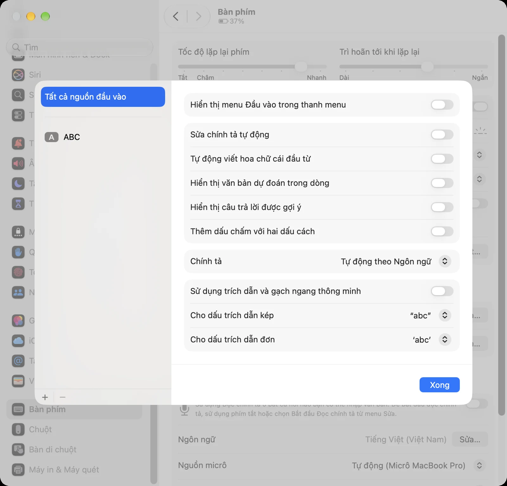
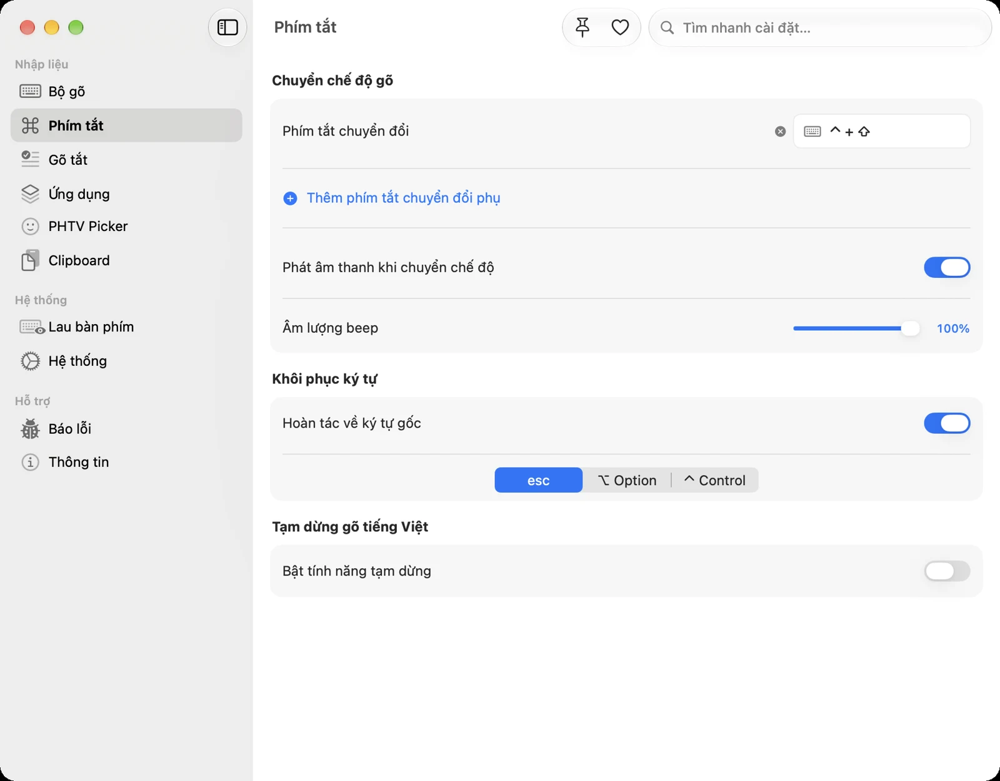

Gõ tiếng Việt trên Mac đôi khi gặp những lỗi rất khó chịu: chữ bị lặp ("đđược"), dấu biến mất khi gõ vào thanh địa chỉ trình duyệt, hoặc bỗng dưng không gõ được tiếng Việt sau khi cập nhật macOS. Phần lớn các lỗi này có cùng vài nguyên nhân. Bài viết đi qua từng triệu chứng, giải thích vì sao lỗi xảy ra và cách sửa. Hướng dẫn dùng [PHTV](/PHTV/) làm ví dụ, nhưng nhiều mẹo cũng áp dụng cho các bộ gõ khác.

## Hiểu nhanh: bộ gõ tiếng Việt hoạt động thế nào?

Khi bạn gõ `vieejt`, bộ gõ nhận từng phím, rồi **xóa** các ký tự vừa hiện và **gửi lại** chữ đã ghép là "việt". Quá trình xóa và gửi lại diễn ra rất nhanh. Nếu một chương trình khác cũng chen vào sửa chữ đúng lúc đó, chẳng hạn tính năng tự sửa chính tả của macOS, gợi ý của trình duyệt hay ô tự hoàn thành, các bước bị lệch nhau và bạn nhận được chữ lặp hoặc mất dấu.

Vì vậy, nguyên tắc chung là: **chỉ để một thứ sửa chữ của bạn.**

## Bước kiểm tra đầu tiên cho mọi lỗi

Trước khi đi vào từng trường hợp, hãy kiểm tra ba điều:

1. **Đang ở chế độ tiếng Việt:** biểu tượng ngôi sao của PHTV trên thanh menu đang chọn Tiếng Việt. Nhấn <kbd>Control</kbd> + <kbd>Shift</kbd> để đổi.
2. **Quyền nhập liệu đã bật:** vào Cài đặt hệ thống › Quyền riêng tư & Bảo mật, mục **Trợ năng** (macOS 26 trở về trước) hoặc **Điều khiển thiết bị và truy cập dữ liệu** (macOS 27 trở lên), đảm bảo công tắc của PHTV đang bật.
3. **Thử trong Ghi chú hoặc TextEdit:** nếu gõ được ở đó, lỗi nằm ở ứng dụng bạn đang dùng chứ không phải ở bộ gõ.

## Lỗi 1: Chữ bị lặp, nhảy chữ hoặc tự đổi thành chữ khác

**Triệu chứng:** gõ "được" ra "đđược", gõ "hôm" bị đổi thành "home", chữ bị gạch chân rồi đổi.

**Nguyên nhân:** các tính năng tự sửa văn bản của macOS chạy song song với bộ gõ.

**Cách sửa:** mở **Cài đặt hệ thống › Bàn phím**, bấm **Sửa…** ở mục Nguồn đầu vào, rồi tắt:

- Sửa chính tả tự động
- Tự động viết hoa chữ cái đầu từ
- Hiển thị văn bản dự đoán trong dòng
- Thêm dấu chấm với hai dấu cách
- Sử dụng trích dẫn và gạch ngang thông minh



Trình thiết lập của PHTV có sẵn bước này (Bước 2), với nút mở thẳng đến đúng chỗ. Nếu bạn dùng tính năng Thay thế văn bản (Text Replacements) của macOS, hãy cân nhắc chuyển các mục đó sang [gõ tắt của PHTV](/huong-dan/go-tat-tren-mac-voi-phtv/) để tránh hai bên cùng thay chữ.

## Lỗi 2: Mất dấu hoặc lặp chữ trong thanh địa chỉ trình duyệt

**Triệu chứng:** gõ trong thanh địa chỉ của Chrome, Safari, Edge hay Firefox thì chữ bị mất dấu hoặc bị gợi ý tự hoàn thành "ăn" mất.

**Nguyên nhân:** thanh địa chỉ tự đề xuất và tự điền phần còn lại của địa chỉ trong lúc bạn gõ. Khi bộ gõ xóa ký tự để thay bằng chữ có dấu, phần gợi ý bị xóa theo hoặc bị chèn vào giữa.

**Cách sửa:**

- PHTV có cơ chế xử lý riêng cho thanh địa chỉ và ô tự hoàn thành của các trình duyệt phổ biến. Hãy cập nhật PHTV lên bản mới nhất.
- Nếu một trang web cụ thể vẫn lỗi, bật **Gửi từng phím** cho trình duyệt đó trong **Cài đặt › Ứng dụng**. PHTV sẽ gửi từng phím riêng lẻ thay vì cả cụm, chậm hơn một chút nhưng ổn định hơn với các ô nhập khó tính.

## Lỗi 3: Không gõ được tiếng Việt sau khi cập nhật macOS hoặc PHTV

**Triệu chứng:** biểu tượng vẫn hiện Tiếng Việt, quyền vẫn bật, nhưng gõ chỉ ra chữ không dấu.

**Nguyên nhân:** macOS lưu quyền của mỗi ứng dụng trong một cơ sở dữ liệu riêng (TCC). Sau khi ứng dụng được cập nhật hoặc ký lại, mục quyền cũ đôi khi bị "kẹt": công tắc vẫn bật nhưng macOS không còn công nhận ứng dụng.

**Cách sửa:**

1. Mở **Cài đặt** của PHTV hoặc trình thiết lập, bấm nút mở quyền đang thiếu. PHTV tự làm mới mục quyền bị kẹt rồi mở đúng chỗ trong Cài đặt hệ thống.
2. Bật lại công tắc của PHTV.
3. Thoát hẳn PHTV (menu › **Thoát PHTV**) rồi mở lại để macOS áp dụng trạng thái mới.

Trong trường hợp thông thường, bạn không cần chạy lệnh Terminal nào.

## Lỗi 4: macOS báo "PHTV bị hỏng" hoặc "không thể mở"

**Nguyên nhân:** khi tải ứng dụng ngoài App Store, macOS gắn cờ "cách ly" (quarantine) cho tệp. Đôi khi cờ này khiến macOS từ chối mở.

**Cách sửa:** mở Terminal và chạy:

```bash
xattr -cr /Applications/PHTV.app
```

Sau đó nhấn chuột phải vào PHTV trong Applications và chọn **Mở**. Cài bằng Homebrew (`brew install --cask phtv`) thường tránh được lỗi này.

## Lỗi 5: Gõ lệnh trong Terminal hoặc viết code bị biến thành chữ có dấu

**Triệu chứng:** gõ `git status` trong Terminal ra "gít status", hoặc tên biến trong VS Code bị thêm dấu.

**Cách sửa (chọn một):**

- Thêm Terminal, iTerm2, VS Code hay Xcode vào **Tiếng Anh theo ứng dụng** trong **Cài đặt › Ứng dụng**. Chọn _Khóa tiếng Anh_ để luôn gõ tiếng Anh trong ứng dụng đó, hoặc _Tự chuyển_ nếu thỉnh thoảng vẫn muốn bật tiếng Việt.
- Bật **Ghi nhớ chế độ theo ứng dụng**: chỉ cần chuyển sang tiếng Anh một lần trong Terminal, lần sau PHTV tự nhớ.
- Giữ **Tự động khôi phục từ** (mặc định bật) để các từ tiếng Anh có trong từ điển tự trở về dạng gốc khi bạn nhấn phím cách.

PHTV có sẵn cấu hình tương thích cho Terminal, iTerm2, Warp, terminal của JetBrains và các công cụ dòng lệnh như Claude Code.

## Lỗi 6: Lỗi trong Excel, Google Sheets hoặc ứng dụng chat

**Triệu chứng:** trong Google Sheets, gõ vào ô bị mất chữ đầu. Trong Zalo, Messenger hay Microsoft Teams, chữ cuối câu đôi khi bị nhân đôi.

**Cách sửa:**

- Cập nhật PHTV lên bản mới nhất. Các ứng dụng này được kiểm thử riêng trước mỗi lần phát hành.
- Nếu một ứng dụng cụ thể vẫn lỗi, bật **Gửi từng phím** cho riêng ứng dụng đó trong **Cài đặt › Ứng dụng**.
- Với bảng tính, gõ xong một ô rồi nhấn <kbd>Enter</kbd> hoặc <kbd>Tab</kbd> bình thường. Đừng chuyển ô bằng chuột khi chữ vừa gõ chưa hoàn tất.

## Lỗi 7: Chữ hiển thị thành ký tự lạ (Ã, Â, ½…)

**Nguyên nhân:** văn bản được gõ hoặc lưu bằng một bảng mã khác bảng mã mà ứng dụng đang đọc, ví dụ gõ TCVN3 trong một ứng dụng hiện đại chỉ hiểu Unicode.

**Cách sửa:** trong PHTV, chọn **Bảng mã: Unicode** ở **Cài đặt › Bộ gõ**. Đây là lựa chọn đúng cho gần như mọi ứng dụng ngày nay. Để chuyển văn bản cũ đã bị lỗi, dùng công cụ **Chuyển đổi bảng mã** của PHTV. Bài [Bảng mã tiếng Việt: Unicode, TCVN3, VNI](/huong-dan/bang-ma-tieng-viet-unicode-tcvn3-vni/) giải thích chi tiết.

## Lỗi 8: Phím tắt Control + Shift không hoạt động

1. Kiểm tra ứng dụng đang mở có dùng tổ hợp phím đó cho việc khác không.
2. Mở **Cài đặt hệ thống › Bàn phím › Phím tắt bàn phím** để tìm phím tắt bị trùng.
3. Đổi sang tổ hợp khác trong **Cài đặt › Phím tắt** của PHTV, hoặc thêm một phím tắt chuyển đổi phụ.



## Vẫn chưa được?

Mở **Báo lỗi** trong Cài đặt của PHTV. Ứng dụng tự thu thập thông tin hệ thống và nhật ký (bạn được xem trước khi gửi), giúp xác định lỗi nhanh hơn. Khi mô tả, hãy ghi rõ:

- phiên bản PHTV, phiên bản macOS và loại chip (Apple Silicon hay Intel);
- ứng dụng đang gõ khi lỗi xảy ra;
- kiểu gõ (Telex, VNI…) và bảng mã;
- các bước để tái hiện lỗi.

Bạn cũng có thể [tạo issue trên GitHub](https://github.com/PhamHungTien/PHTV/issues) hoặc email contact@phamhungtien.com.
