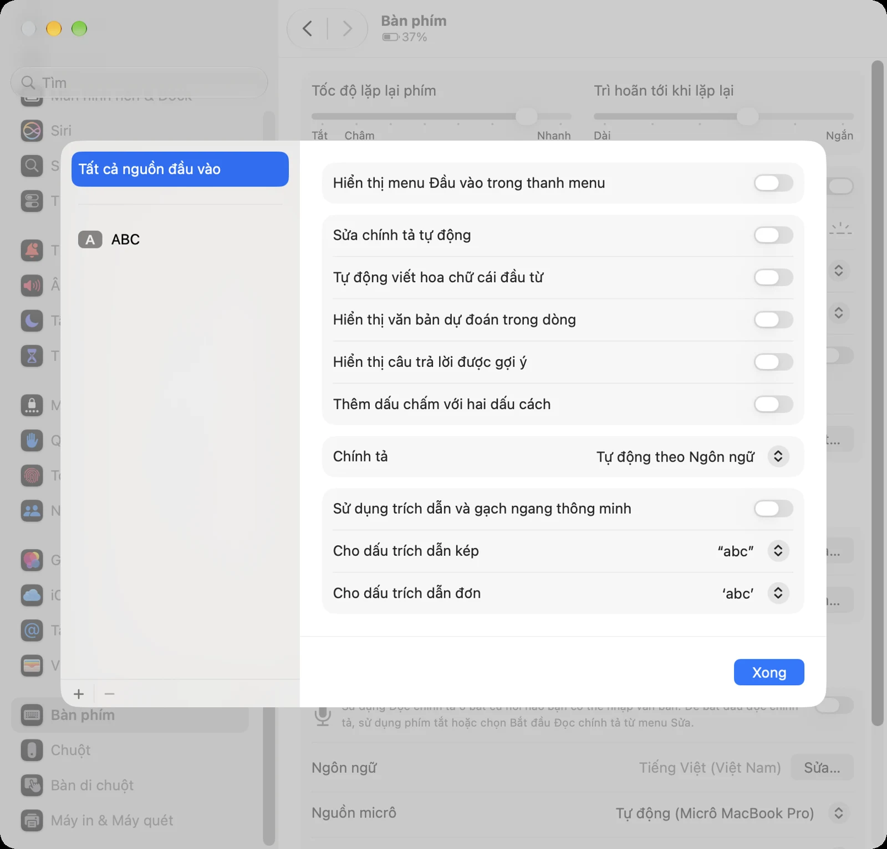
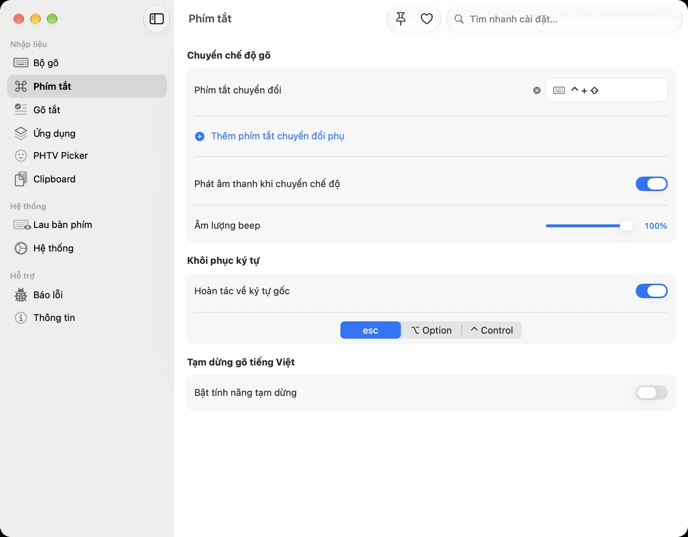

如果 **được** 变成 **đđược**、浏览器里丢失声调，或更新 macOS 后无法输入越南语，可先在「文本编辑」试同一个词。这个测试能帮助区分是 PHTV 在各应用中都出错，还是只影响一个应用。

## 检查输入模式、权限和系统输入源

1. 从 PHTV 菜单中选择**越南语**，并在 macOS 输入菜单中选择 **ABC** 或 **U.S.**
2. 检查 PHTV 是否显示权限已授予。macOS 26 及以下需要**辅助功能**，27.0–27.2 需要 **Device Control and Data Access**，27.3 及以上需要 **System & App Protection Override**。
3. 在「文本编辑」中使用 Telex 输入 `vieejt`。如果看到 **việt**，请跳到发生问题的具体应用对应的章节。如果仍没有音标，请重新检查 [PHTV 设置和权限](/zh/guides/go-tieng-viet-tren-mac-voi-phtv/)。

## 处理重复字母或自动纠正拼写

输入法将字母替换成带音标的音节时，macOS 自动纠正功能可能同时尝试重写同一串字符。打开**系统设置 › 键盘**，点按输入源旁的**编辑**，关闭自动纠正拼写和行内预测文本。必要时，也可以尝试关闭自动大写、智能标点或连按两次空格添加句号。每次只改一项，再到原应用中测试。

如果仅在展开快捷短语时出现问题，请检查 PHTV 和 macOS 文本替换是否在同时展开同一个触发词。[PHTV 快捷短语设置](/zh/guides/go-tat-tren-mac-voi-phtv/)

## 浏览器、表格或聊天应用中丢失音标

PHTV 放置音标时，地址栏建议和自动完成字段可能改写文字。请先更新 PHTV。如果问题仍在，打开**设置 › 应用**，尝试为该应用启用逐个发送按键的选项。分别在普通文本框和地址栏测试同一个词。使用表格时，在当前单元格输入完成后，先按 <kbd>Enter</kbd> 或 <kbd>Tab</kbd> 确认，再移到其他位置。

## 更新后无法输入

打开 PHTV，通过权限提示进入**系统设置 › 隐私与安全性**中对应的面板。确认安装的 PHTV 已启用，然后退出并重新打开应用。如果 macOS 拒绝启动 PHTV，请从[官方发布页](https://github.com/PhamHungTien/PHTV/releases/latest)下载最新版本，并按[安装指南](/zh/guides/go-tieng-viet-tren-mac-voi-phtv/)操作。如果仍有问题，请在联系支持时提供系统提示原文。

## 终端命令或代码中出现音标

在**设置 › 应用**为终端或代码编辑器设置英语输入，或开启按应用记忆语言。这样在其他应用仍可使用越南语。偶尔在越南语中夹杂英文单词时，PHTV 的自动恢复功能可在按空格后还原识别出的英语单词。

## 文本显示 Ã、Â、½ 等字符

在**设置 › 输入 › 编码**中为现代应用选择 **Unicode**。旧文档可能需要从原编码转换。TCVN3 和 VNI Windows 的转换步骤见[越南语字符编码指南](/zh/guides/bang-ma-tieng-viet-unicode-tcvn3-vni/)。

## 切换快捷键无效

部分应用或 macOS 快捷键可能已占用 <kbd>Control</kbd> + <kbd>Shift</kbd>。先从 PHTV 的菜单栏图标切换输入模式。若这样能切换，可在**设置 › 快捷键**重新设置切换键。

## 报告可重现的问题

请提供 PHTV 与 macOS 版本、应用名称、输入方式、编码，以及一小段他人可以复现的输入示例。使用 PHTV 内的**报告问题**功能时，请在分享前查看诊断详情。可以在 [GitHub Issues](https://github.com/PhamHungTien/PHTV/issues) 公开报告，也可以发邮件至 [contact@phamhungtien.com](mailto:contact@phamhungtien.com)。
